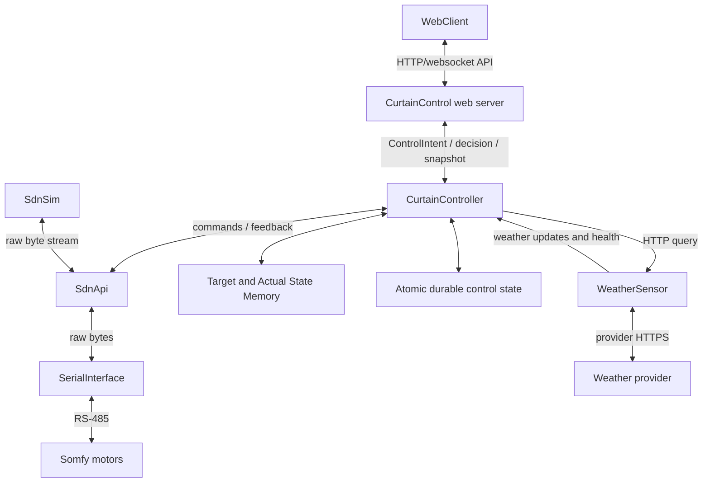
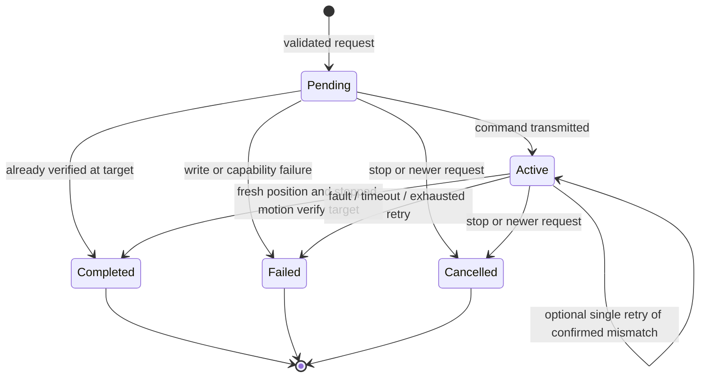
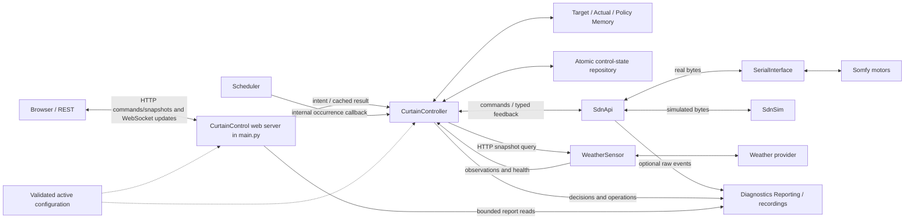
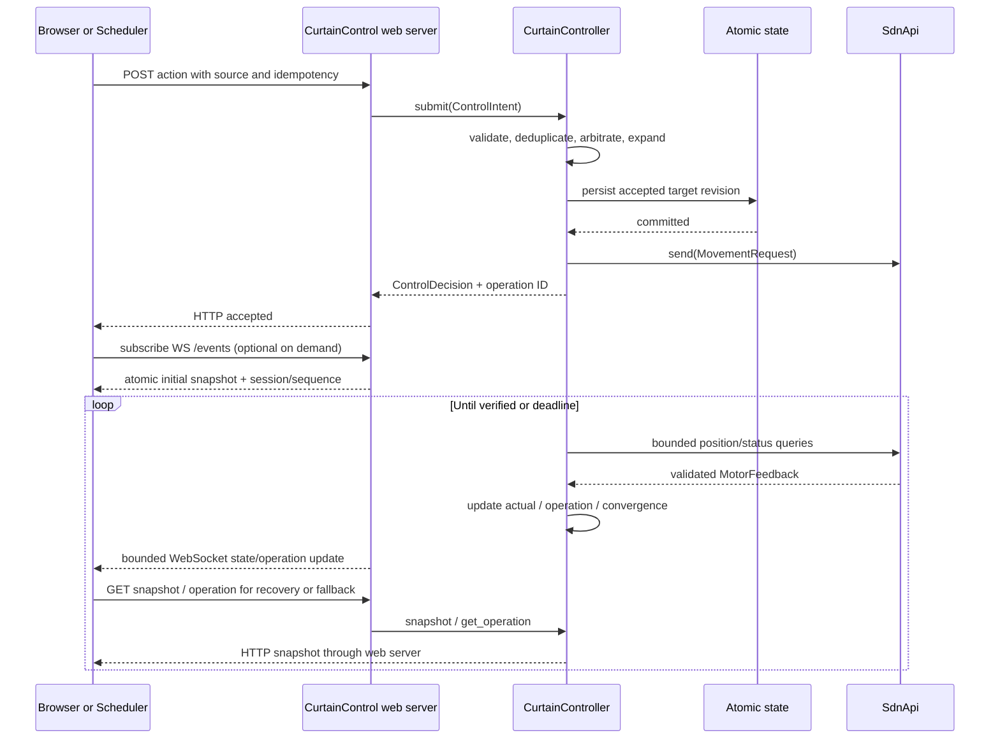
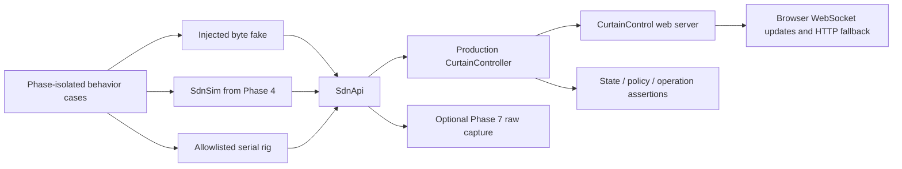

# main.py Curtain Control Program Specification
### Brad Larson
### 2026-10-02

## Table of Contents

- [Introduction](#introduction)
- [Creator Interview](#creator-interview)
  - [Creator Interview Transcripts](#creator-interview-transcripts)
    - [Existing-program review and migration requirements](#existing-program-review-and-migration-requirements)
- [Specification Description](#specification-description)
- [Program Generation Process](#program-generation-process)
- [Program Generation Report](#program-generation-report)
- [Program](#program)
  - [Program Description](#program-description)
  - [Development Phases](#development-phases)
  - [Overall System Definition](#overall-system-definition)
    - [Description](#description)
    - [Behavior](#behavior)
    - [Interface](#interface)
    - [Validation](#validation)
    - [Design](#design)
  - [Phase 1: Serial/RS485 Interface / web server / web client](#phase-1-serialrs485-interface--web-server--web-client)
    - [Description](#description-1)
    - [Behavior](#behavior-1)
    - [Interface](#interface-1)
    - [Validation](#validation-1)
    - [Design](#design-1)
  - [Phase 2: SdnApi](#phase-2-sdnapi)
    - [Description](#description-2)
    - [Behavior](#behavior-2)
    - [Interface](#interface-2)
    - [Validation](#validation-2)
    - [Design](#design-2)
  - [Phase 3: Controller](#phase-3-controller)
    - [Description](#description-3)
    - [Behavior](#behavior-3)
    - [Interface](#interface-3)
    - [Validation](#validation-3)
    - [Design](#design-3)
  - [Phase 4: SdnSim / web client](#phase-4-sdnsim--web-client)
    - [Description](#description-4)
    - [Behavior](#behavior-4)
    - [Interface](#interface-4)
    - [Validation](#validation-4)
    - [Design](#design-4)
  - [Phase 5: Scheduler & Automation / web client](#phase-5-scheduler--automation--web-client)
    - [Description](#description-5)
    - [Behavior](#behavior-5)
    - [Interface](#interface-5)
    - [Validation](#validation-5)
    - [Design](#design-5)
  - [Phase 6: WeatherSensor](#phase-6-weathersensor)
    - [Description](#description-6)
    - [Behavior](#behavior-6)
    - [Interface](#interface-6)
    - [Validation](#validation-6)
    - [Design](#design-6)
  - [Phase 7: Diagnostics Reporting](#phase-7-diagnostics-reporting)
    - [Description](#description-7)
    - [Behavior](#behavior-7)
    - [Interface](#interface-7)
    - [Validation](#validation-7)
    - [Design](#design-7)
  - [Application Integration](#application-integration)
    - [Structure Analysis and Simplification](#structure-analysis-and-simplification)
    - [Program Structure](#program-structure)
    - [Module Design](#module-design)
    - [Inter-module Communication Contract](#inter-module-communication-contract)
    - [Startup and Shutdown Communication](#startup-and-shutdown-communication)
    - [Dependency-injected application services](#dependency-injected-application-services)
    - [Local configuration boundary](#local-configuration-boundary)
    - [Command, Feedback, and Live-State Communication](#command-feedback-and-live-state-communication)
    - [API Contract](#api-contract)
    - [REST and Live State](#rest-and-live-state)
    - [JSON Configuration](#json-configuration)
    - [Pydantic Data Models](#pydantic-data-models)
    - [System-Control Data Sources](#system-control-data-sources)
    - [Manual web control](#manual-web-control)
    - [Web Interface](#web-interface)
    - [Legacy capability and requested-feature review](#legacy-capability-and-requested-feature-review)
    - [Requirements and Current Assessment](#requirements-and-current-assessment)
    - [Testing and Code Generation](#testing-and-code-generation)
    - [Mocked, Simulated, and Real Communication Backends](#mocked-simulated-and-real-communication-backends)
    - [Use Cases](#use-cases)
    - [Alexa Control](#alexa-control)
    - [Program Environment](#program-environment)
- [Prompts](#prompts)
- [Functional Requirements](#functional-requirements)
- [Tests](#tests)
  - [Unit Tests](#unit-tests)
  - [Integration Tests](#integration-tests)
  - [System-Wide Tests](#system-wide-tests)
  - [End-to-End Tests](#end-to-end-tests)
- [Deferred Extensions](#deferred-extensions)
  - [Simulation Fidelity and Learning (Deferred)](#simulation-fidelity-and-learning-deferred)
    - [Description](#description-8)
    - [Behavior](#behavior-8)
    - [Interface](#interface-8)
    - [Validation](#validation-8)
    - [Design](#design-8)
- [Program Capabilities](#program-capabilities)
- [Issues](#issues)
  - [Open Issues](#open-issues)
  - [Resolved Issues](#resolved-issues)

## Introduction

`main.py` shall progressively replace the existing Node.js CurtainControl server with the seven-phase Python FastAPI service. The completed service operates Somfy SDN curtains through real RS-485 or SdnSim, preserves compatible device commands and serial settings, and supports scheduling. Earlier phases construct only their required components. A dependency-free static client begins with Phase 1 diagnostics and grows into the normal control/reporting interface.

The service is started with the path to one JSON configuration file as a required command-line argument. That file is the sole persistent source of configuration; the program shall not require, connect to, or depend on an external SQL database. CurtainControl is the overall application and web server. Its FastAPI HTTP interface serves browsers, automation clients, and administration. CurtainController provides system integration and control, including authoritative target and actual state.

Inputs are command-line options, JSON configuration, HTTP requests, time/celestial occurrences, timestamped weather updates, and raw backend bytes. Outputs are validated HTTP responses, SDN frames, truthful cached control snapshots, operational/decision/operation reports, optional raw recordings, and scheduling activity. Fidelity/learning reports belong to deferred extensions.

## Creator Interview

### Creator Interview Transcripts

#### Existing-program review and migration requirements

**Date**: 2026-10-02  
**Creator**: Brad Larson  
**Interviewer**: Codex  

**Transcript**:

**Q:** What behavior does the existing program provide?  
**A:** It controls Somfy SDN curtains and groups over RS-485, presents web and Socket.IO controls, stores motors and groups in MySQL, and has scheduling support.

**Q:** What implementation change is required?  
**A:** Convert the Node server to a Python FastAPI server with similar functionality.

**Q:** What is the storage change?  
**A:** Remove the dependency on an external SQL database. System configuration is in a JSON file specified as a command-line parameter.

**Q:** Should the existing UI be retained?  
**A:** At that stage no interface was required. The later web-interface request supersedes this answer: the server now serves the new static client, but does not retain the legacy UI or Socket.IO.

**Q:** How should the small Python project be organized?  
**A:** Use `main.py` and a small set of support classes for serial communication, SDN commands, system control, data sources, and scheduling. Alexa is now deferred.

**Q:** How should runtime dependencies and credentials be handled?  
**A:** Declare runtime packages in `requirements.txt`. Store secrets in a separate `creds.yaml` file with restricted read access on Raspberry Pi; do not put secrets in `config.json` or source control.

**AI text generation instructions expansion table:**

| Instruction topic | Evidence / answer | Resulting specification |
|---|---|---|
| Purpose, inputs, outputs, and processing | The existing server handles SDN commands, serial I/O, configuration, and scheduling. | Implement a FastAPI service using local JSON configuration, an RS-485 transport, and a small static client. |
| Storage | The creator requires a JSON file named at the command line and no external SQL database. | Load, validate, and atomically persist one local JSON configuration document; do not include a database driver. |
| User interface | The initial creator interview specified no interface; a later explicit request requires one. | Serve the new dependency-free responsive client from `static/`; do not carry forward jQuery, Socket.IO, or the legacy pages. |

## Specification Description

This document directs future implementation and verification of `main.py`, its support modules, and the specified static client. It is the source of truth for the new Python service. The completed server shall provide stateless HTTP commands/snapshots, authenticated WebSocket updates with polling fallback, and responsive assets under static/. CurtainController owns all control state and weather decisions; WeatherSensor supplies observations only. Serving the legacy browser UI or using Socket.IO is prohibited. The current web-interface work is specification-only.

When a requirement conflicts with undocumented legacy behavior, this specification takes precedence. The existing JavaScript source is reference material for compatible SDN commands and data fields, not for carrying forward defects.

This specification defines a common Overall System Definition followed by seven ordered development phases. The overall system and each sub-module are defined using Description, Behavior, Interface, Validation, and Design, in that order. Public-interface examples EX01–EX08 shall be executable and validated by automated tests. Application Integration defines configuration, data-source wiring, the incremental web client, cross-module contracts, and main.py orchestration. This revision organizes requirements; it does not authorize implementation or hardware execution.

## Program Generation Process

Each authorized implementation iteration shall select one active phase and its applicable requirements from this specification. Use curtain_control_spec.md, existing source files, independent fixtures, and prior curtain_control_implementation.md results as context.

Use the Plan → Act → Critique → Revise (PACR) loop:

1. Plan the smallest change that satisfies the selected phase contract, its working examples, and acceptance cases. Inspect existing code/tests first and identify what can be retained, adapted, disconnected, or replaced.
2. Act within the authorized scope. Preserve reasonable implementations, fixtures, schemas, and tests; rebuild integration wiring progressively rather than regenerating the whole program. A documentation-only request does not authorize code generation or device/network actions.
3. Critique observable behavior against the phase's Description, Behavior, Interface, Validation, and Design. Check errors, resource cleanup, ownership, and dependencies on later phases.
4. Revise failures and rerun the affected checks. Report passed, failed, deferred, unsupported, and not-run separately; a future-phase placeholder is never a pass.

For implementation, validate the independently usable sub-module and its executable public-interface examples, then its current browser/API integration. Run applicable regression cases for changed earlier contracts. Hardware acceptance remains subject to the explicit rig/profile requirements. Update the architecture diagrams and report when an implementation changes a contract. Do not delete unrelated or unreviewed code as part of phase isolation.

re behavior.

## Program

### Program Description

The program is a long-running FastAPI process communicating with Somfy curtain motors through one Serial/RS485 backend or, from Phase 4, SdnSim. main.py validates the configuration required by the selected development stage and constructs only active components. Real mode opens the configured adapter; simulated mode opens no operating-system serial port. Early phases run without later policy, scheduler, weather, or reporting components.

Quality attributes are reliability, maintainability, consistent performance, simple configuration, low maintenance, observable failures, and testability with and without hardware.

CurtainControl web server is the overall application: it owns application startup/shutdown, configuration loading, HTTP hosting and authentication, web assets and views, request/response handling, application readiness, and reporting access. main.py is its process entry point. CurtainController provides the system integration and control functionality: it coordinates SDN, scheduling, weather updates, target/actual state, operations, policy/protection, persistence, and bounded reconciliation. The web server invokes Controller through its public interface and presents results. Stateless HTTP requests do not make the application or controller stateless.

WeatherSensor queries weather providers and publishes timestamped updates and health. CurtainController queries its HTTP observation interface through an injected client, validates freshness, and determines whether configured rules should change a target. WeatherSensor never decides a curtain action. Scheduler computes timed/celestial occurrences; Controller evaluates conditions and policy. The browser uses HTTP commands/snapshots and on-demand WebSocket updates with polling fallback; no browser session owns curtain state.



### Development Phases

Apply the shared Overall System Definition before implementing these seven phases in order. The shared foundation is not a separate numbered phase. Every phase uses **Description**, **Behavior**, **Interface**, **Validation**, and **Design**. Public-interface examples are executable and linked to automated tests against production components. CurtainControl web server and its browser interface begin in Phase 1 and grow throughout the phases; each underlying module remains usable without a browser.

| Phase | Sub-module | Integration and verification outcome |
|---|---|---|
| 1 | Serial/RS485 Interface / web server / web client | Overall application/server integration and serial diagnostics; byte transport, port/settings, controlled TX/RX, logging, errors, and cleanup. |
| 2 | SdnApi | Protocol encoding/parsing, inventory/profile/device settings, verified read-only device information, communication/health, command validation, decoded responses, queries, and logging. Extend existing diagnostics. |
| 3 | Controller | Manual motor/group control; target/actual tracking; verified operations; failure detection/recovery; protection, reconciliation, and stop. Extend the existing web server and controls. |
| 4 | SdnSim / web client | Complete simulated control and verification using the same protocol/controller path; visible backend/scenario identity. |
| 5 | Scheduler & Automation / web client | Rule configuration, upcoming occurrences, and Controller-owned condition/policy decisions. |
| 6 | WeatherSensor | Provider queries and updates; Controller decisions; browser provenance, freshness, and health. |
| 7 | Diagnostics Reporting | Serial/protocol/device/controller/automation/weather diagnostics, correlated operational/decision/operation history, optional raw recordings, filtering, and read-only inspection/export. |

Phases 1–3 require automated verification through the production real serial/SDN driver on an explicitly configured rig. Unit and deterministic fault/race cases retain isolated fakes/clocks and never count as real-device acceptance. Missing hardware leaves hardware acceptance not run or failed preflight, never passed by fallback. Phase 4 adds production SdnSim for simulated control/verification and regression tests without replacing earlier hardware evidence.

Retain all earlier serial, protocol, and controller visualization/verification in the application diagnostic views. Share the active transport's single receive/write owner; no diagnostic page opens a competing port or bypasses Controller policy. Start optional expensive diagnostics only when enabled or requested and stop their work when no longer needed. Required monitoring, command verification, bounded recovery, and error reporting remain active whenever their control component is enabled.

**Progressive composition and reuse.** Validate and construct only active components. Phase 1 requires serial/server/web settings, not Controller, locations, schedules, weather credentials, or trace destinations. Phase 2 adds protocol/inventory profiles; Phase 3 adds Controller/state; Phase 4 adds simulation; Phase 5 adds schedule/calendar; Phase 6 adds weather; Phase 7 adds persisted diagnostic reporting. Do not probe inactive component files/network/destinations. Retain reasonable implementations, fixtures, and diagnostic views and adapt their integration as the owning phase arrives.

EX01–EX08 remain stable example IDs: EX01 covers transport and EX04 the application/web server now introduced in Phase 1. EX04's Controller-dependent portions are completed in Phase 3. The other examples follow their named subsystem; example IDs need not equal phase numbers. Every example covers initialization, ordinary use, expected output, errors, and cleanup. Do not claim validation before its linked tests pass. Fidelity/learning and EX09 remain deferred. This documentation revision does not implement or test application/device behavior.

### Overall System Definition

#### Description

This section defines the shared application foundation needed to implement all seven phases. It precedes Phase 1 and is not an additional development phase. Establish its application/configuration boundaries and complete the applicable baseline validation before accepting Phase 1; extend and revalidate the same foundation as each later component is attached. The file layout below is the target organization, not a claim that unimplemented files/features already exist.

CurtainControl web server is a Python FastAPI web interface, launched by main.py. It publishes static HTML/js/CSS content from a /staic directory.  It owns configuration/credential loading, application hosting/authentication, static assets, request handling, readiness, and application reporting access. 

Use a small flat Python project, local JSON configuration, and dependency-free browser assets.

#### Behavior

Empty web server with only the basic static content serving.

#### Interface

| Shared interface | Contract |
|---|---|
| main(argv) / CLI | Require --config PATH. Accept --credentials PATH when selected features require secrets. Configuration/bootstrap failure returns a safe diagnostic and nonzero exit before motion. Implementation-specific host/port options, if provided, are documented transient overrides rather than another persistent settings source. |
| load_config(path, profile) -> validated application/component settings | Read the one JSON source and validate the selected phase/feature requirements. No device/network access; probe writable destinations only when their owning component is active and needs them. Preserve existing loader code where its behavior satisfies this contract. |
| load_credentials(path, required_features) -> secret models | Safe YAML loading, required-field/permission checks, redacted errors, and per-feature secret subsets. Optional absence is valid only when no active feature needs secrets. |
| create_app(settings, credentials, profile, dependencies) -> application | Construct CurtainControl/FastAPI from validated inputs and explicit factories/borrowed resources. No implicit global singleton or import-time hardware/provider work. Keep public spelling compatible with reusable code where possible. |
| log, and error handlings | Log messages and handle errors consistently across the application. Ensure that all errors are captured, logged, and reported in log files. |
| initial application surface | GET /, /static/{path}, /health, and authorized current-phase diagnostics/configuration. WS /events provides only active channels with bounded subscription/snapshot behavior; future-phase endpoints are unavailable and cannot instantiate missing modules. |
|Default configuration file| default configuration overridable with command line parameters /etc/curtain-control/config.json |
|Default credentials file| default credentials file overridable with command line parameters /etc/curtain-control/creds.yaml |
|Default log file| default log file overridable with command line parameters /etc/curtain-control/log.yaml |

Launch contract (paths are deployment examples):

```cmd
python main.py  /etc/curtain-control/config.json --credentials /etc/curtain-control/creds.yaml
```


For complete resource schemas, endpoint/status behavior, and deployment details, extend these shared contracts through [JSON Configuration](#json-configuration), [API Contract](#api-contract), [REST and Live State](#rest-and-live-state), [Pydantic Data Models](#pydantic-data-models), and [Program Environment](#program-environment). Later sections refine component behavior; they must preserve these common ownership, secret, and phase-isolation rules.

#### Validation

These are future implementation acceptance cases for the common foundation. Run applicable cases with Phase 1 and again when later integration changes their contract. Use temporary files, an injected driver/client/clock, and the production loader/application; no SQL, live provider, or serial device is required for these baseline checks. The separate phase-specific real-driver requirements remain mandatory.

| Case | Required result |
|---|---|
| CASE01 — File/dependency boundary | Required current-phase modules/assets/examples exist; imports require no future module, SQL, Node, or external browser asset. A clean supported environment installs declared dependencies and imports the application without side effects. |
| CASE02 — Phase-aware configuration | Minimal Phase 1 JSON validates without later sections; reject malformed/unsupported-version/invalid active settings and enabling unimplemented features. Inactive sections cannot create/probe destinations or open network/serial resources. |
| CASE03 — Paths and atomic replacement | CLI/config-relative paths resolve deterministically; invalid replacements and injected write/reload failures preserve the last complete file and active configuration; configuration and operational state stay separate. |
| CASE04 — Executable baseline example | Execute CASE-EX01 against production loader/application and injected dependencies, including failure paths; prove no hardware/provider activity and clean teardown. Record results explicitly rather than accepting the prose as proof. |

Acceptance records link these cases to FR-001–004, FR-007/010/011/013/016/035/039 and FR-041. An absent dependency/device or unimplemented phase is reported accurately; a baseline success does not imply protocol, movement, provider, or hardware acceptance. This specification-only update creates no executable tests and runs no application/device checks.

#### Design

**Program file structure.** Keep the project flat and reuse existing files. Introduce the later modules only with their phase; preserved source may remain unused meanwhile. Named helper files below are logical homes and may be combined when that avoids duplication/cycles. Do not create a package hierarchy solely to match this outline.

```text
CurtainControl/
  main.py                         # process entry and CurtainControl application/server
  config.py                       # validated settings, credentials, file boundary
  serial_interface.py             # Phase 1 byte transport
  sdn_api.py                      # Phase 2 protocol/parser/query coordination
  controller.py                   # Phase 3 system integration, control, operational state
  sdn_sim.py                      # Phase 4 raw-byte simulator; optional capture helpers
  scheduler.py                    # Phase 5 occurrence calculation and Controller callback
  data_sources.py                 # reusable calendar/provider helpers as phases need them
  weather_schema.py               # Phase 6 provider/observation models
  curtain_control.py              # optional application/server helpers, not another controller
  models.py / clock.py            # optional small genuinely shared contracts/helpers
  reporting.py                    # optional Phase 7 diagnostics/reporting helper
  static/html/index.html
  static/css/app.css
  static/js/app.js
  requirements.txt                # direct runtime dependencies
  requirements-dev.txt            # test/documentation dependencies
  config.example.json             # valid current-stage non-secret example
  creds.example.yaml              # credential placeholders only
  tests/                         # phase-isolated cases, helpers, independent fixtures
  docs/                          # deployment notes, diagrams, evidence references
  curtain_control_spec.md
  curtain_control_implementation.md
  .gitignore
```

Populated config.json/creds.yaml, operational control-state files, recordings, and generated reports are deployment/runtime data rather than source templates; exclude secret-bearing/local runtime data from version control. Production state may live under /var/lib/curtain-control and logs under a configured service-writable destination. Paths are explicit; never overwrite credentials or configuration with runtime state. Legacy JavaScript is compatibility/reference material and is not a runtime dependency.

**Dependencies and environment.** Use Python 3.11+ and Pydantic v2 as already specified. Keep direct runtime dependencies in requirements.txt and verification tools in requirements-dev.txt; add a package when its phase first needs it and record tested compatibility/constraints. The completed-project manifest may include future-phase packages, but an early module must not eagerly import their implementations. Use an isolated virtual environment. Browser assets require no build process.

| Availability | Dependencies / purpose |
|---|---|
| Foundation and Phase 1 | fastapi, uvicorn[standard], pydantic, pyserial, PyYAML for the application/HTTP/WS host, validation, real driver, and restricted credentials. |
| Shared platform support | tzdata on Windows when IANA timezone data is needed; asyncio, JSON/path/logging/atomic-file facilities use Python's standard library. |
| Phase 2–4 | Reuse the above libraries and standard library for codec/controller/simulation; recording hooks do not require another subsystem to be constructed. |
| Phase 5 | croniter, astral, ephem for configured time/celestial calculation. |
| Phase 6 | httpx for asynchronous WeatherSensor/provider integration; tests inject HTTP responses. |
| Phase 7 | Standard logging/JSON and existing validation for diagnostics/recording; extra libraries require an explicit justified dependency update. |
| Development | pytest, pytest-asyncio, jsonschema and any explicitly selected documentation/graph tools; none are required in the production control loop. |

The startup/composition layer selects validated settings and factories before importing/constructing phase implementations. Application HTTP/web concerns depend on public Controller contracts once available; Controller coordinates control components, Scheduler supplies internal occurrences, WeatherSensor supplies observations, and SdnApi alone owns backend byte I/O. Small injected clocks/repositories/sinks make these boundaries independently verifiable. Keep dependencies one-way and prohibit shared mutable state ownership between application, controller, simulator, and browser.

All seven phase definitions below build on this foundation and retain their own Description, Behavior, Interface, Validation, and Design. The detailed [Application Integration](#application-integration) section supplies cross-component flows and complete-system refinements rather than requiring later features to exist before Phase 1.

### Phase 1: Serial/RS485 Interface / web server / web client

#### Description

`SerialInterface` in `serial_interface.py` provides asynchronous RS-485 byte transport independently of SDN commands, motor inventory, application policy, and web components. Receive validated serial settings and an optional driver factory by injection; read no application configuration files.

CurtainControl web server is the overall application and web interface, started by main.py. It owns HTTP hosting, authentication/authorization, web asset delivery and navigation, configuration loading/persistence, application lifecycle/readiness, diagnostics, reporting access, and handling browser/REST requests and presenting Scheduler configuration/results. CurtainController supplies its system integration and control functionality. The web server constructs or receives the controller, starts/stops it through its lifecycle interface, and presents its results. Application/server code may live in main.py and purpose-specific helpers, including curtain_control.py when useful. Controller remains the single owner of operational targets, observations, policy, and control-state persistence.

The web server and diagnostic client are introduced here and extended in every later phase. Controller-dependent APIs are installed when Controller arrives in Phase 3; Phase 1 must start without importing it or other future components.

#### Behavior

**USB-to-RS485 serial connection.** Connect the Raspberry Pi to the SDN data bus through an isolated USB-to-RS485 adapter that supports two-wire half-duplex communication and automatic transmit/receive direction, or configure direction control if the adapter requires it. The motor documentation identifies the data conductors as RS485 `+`, signal ground, and RS485 `-`; connect them according to the adapter and installation wiring documentation. The program opens the adapter device (normally `/dev/ttyUSB0`) at 4800 baud, 8 data bits, odd parity, one stop bit (`4800 8O1`), NRZ, with no software transformation of UART bit order. The UART sends each byte least-significant bit first automatically.

The program shall wait until the bus is idle before writing. Use the more conservative device-specific interval of at least 100 ms between master messages unless verified hardware testing establishes a shorter safe value; this also exceeds the general SDN master-request delay. A complete frame must be supplied to the serial driver in one ordered write so the inter-character gap remains below 1 ms. The adapter must release the half-duplex bus after transmission so a motor can reply. Reads may return partial or multiple messages and therefore feed the incremental parser rather than assuming one read equals one frame.

Writes shall preserve byte order and report short/failed writes. Reads may return arbitrary chunks; the transport shall not interpret them as SDN frames. Blocking driver calls shall not block the event loop. Close releases the port and unblocks or terminates pending I/O with a documented outcome.

##### Application and web behavior

Authenticate/authorize each request, validate its schema, normalize open/close to 0/100 and external units at the boundary, attach source/actor/idempotency metadata, and delegate once. The controller resolves group membership, decides priority/protection, persists targets, and verifies movement. Preserve caller idempotency/precondition keys across repeated HTTP requests. Return an accepted decision and operation ID promptly; do not wait for full travel in the request handler. All state reads return controller-owned cached snapshots with authorization/redaction applied.

For each active component the browser obtains its cached HTTP snapshot, subscribes to WS /events for live updates, and uses bounded HTTP polling as fallback. Control snapshots/operation routes become available with Controller in Phase 3. Display actual/desired/freshness distinctly and retain a last-known snapshot labeled unavailable during errors. A reconnect or session change fetches a complete snapshot; older session/revision responses cannot replace newer state. No state-dependent toggle is sent from unknown/offline data. Use the shared HTTP/WebSocket live-state contract: commands via HTTP, cached initial/recovery snapshots via HTTP, live updates via WS /events, and polling fallback.

#### Interface

| Interface | Contract |
|---|---|
| `SerialInterface(settings, serial_factory=None)` | Construct from validated port/baud/data/parity/stop settings without opening hardware. |
| `await open()` | Open the configured adapter or raise a typed transport error. |
| `await read() -> bytes` | Return a nonempty raw chunk or a typed closed/disconnected error. |
| `await write(data: bytes)` | Serialize one complete supplied byte sequence; return only on successful transmission to the driver. |
| `await close()` | Release I/O resources; repeated close is harmless. |

The same open/read/write/close contract shall be implementable by a byte fake and SdnSim. A driver write is transmission evidence only, never movement confirmation. SDN bus-idle and query coordination belong to SdnApi.

**Required executable example (EX01):** open the production SerialInterface using explicit 4800/8/odd/1 settings on the configured read-only test rig; transmit one approved non-moving request fixture through the driver, record exact returned chunks/effective settings, and close in a finally block. A driver/line-capture fixture supplies the independent expected bytes; no decoder is required in Phase 1. Run a separate fake-driver variant for short-write/open-error/fragmentation cleanup. Link real evidence to SI06 and deterministic cases to SI01–SI05; the fake variant cannot satisfy SI06.

**Web-client integration:** expose a diagnostic page showing configured/effective serial settings, open/closed/error status, exact hex TX/RX chunks, timestamps, and safe I/O failures. Open/close and explicitly supplied byte writes use the diagnostic HTTP routes; one transport owner buffers reads for inspection. The browser shall not infer motor movement from a write or parse SDN messages in this phase. Invalid hex sends zero bytes. Closing/cancellation releases pending work. Retain the page after Phase 1. From Phase 2 display byte data from SdnApi-owned receive/write hooks; protocol queries/commands use SdnApi, and from Phase 3 movement uses Controller policy. Reject independent raw writes/open/close while another owner is active; retain read-only views and supported verification rather than hiding the whole diagnostic interface. Hardware tests retain the rig/allowlist policy.

##### CurtainControl web server interface

| Web server/application operation | Responsibility |
|---|---|
| Action and desired-state HTTP routes | Validate/normalize to ControlIntent and call CurtainController.submit. |
| Override/lock/reconcile routes | Authenticate administration and call the corresponding controller policy method. |
| State and operation GET routes | Return redacted Controller snapshot/operation data without serial or weather queries. |
| Configuration, groups, and schedules | The application validates/persists configuration and calls Controller.reload to coordinate control-system changes; handlers never mutate controller internals. |
| Weather/log/report reads | Return the authorized cached observations or bounded reporting results of their owning components. |

See API Contract for concrete routes and statuses. From Phase 3, normal movement/policy handlers call Controller only and never alter its models/private dictionaries. Phase 1/2 diagnostics use their active module interface; retained diagnostics share the current owner and never create a competing serial reader/writer. HTTP statelessness applies to transport requests; authoritative control state stays in Controller once integrated in Phase 3. Earlier diagnostics own only bounded transport/server observations.

**Required executable example (EX04):** in Phase 1 start the production CurtainControl web server with only SerialInterface, verify authentication/static assets/readiness/serial diagnostics/live updates, disable optional collection when unused, and shut down cleanly. In Phase 3 extend this same example with Controller: submit an authenticated idempotent target, inspect decision/operation identity, receive feedback-derived WebSocket progression, recover from reconnect using an HTTP snapshot, and repeat the key without another movement. Verify invalid/unauthorized input, redaction, and safe errors. Keep separate deterministic and explicitly configured real-driver runs; record which portions are applicable by phase.

**Web-client integration:** Phase 1 delivers server/serial diagnostics. From Phase 3 extend the same application with room/group/curtain tiles, position controls, targets/actual/convergence, protection, stop/resume, and WebSocket/polling/error displays. Retain the shared Manual web control and Web Interface requirements; all policy originates in Controller.

#### Validation

| Name | Test description | Interface tested |
|---|---|---|
| SI01 — Driver settings | Verify port, 4800/8/odd/1 defaults, disabled flow control, and finite I/O timeouts through an injected driver. | SerialInterface.open() |
| SI02 — Ordered writes | Concurrent complete writes remain ordered and uninterleaved; short writes and driver failures raise typed errors. | SerialInterface.write() |
| SI03 — Chunked reads | Preserve exact bytes across fragmented/coalesced reads without adding frame interpretation. | SerialInterface.read() |
| SI04 — Lifecycle and responsiveness | Exercise open/read/write failures, repeated close, pending I/O cleanup, and event-loop responsiveness. | SerialInterface lifecycle |
| EX01 — Serial interface example | Execute production real-driver read-only acceptance with captured evidence under SI06, plus a separate deterministic fake-driver error/cleanup variant. Record backend and results separately. | Production SerialInterface / rig and isolated fake-driver examples |

S10 and read-only hardware case H02 subsequently verify this contract within SdnApi and on a configured rig. Physical serial acceptance remains separate from fake-driver acceptance.

| Name | Test description | Interface tested |
|---|---|---|
| SI05 — Browser diagnostics | Open/close the Phase 1 driver through authorized routes; inspect exact buffered chunks/timestamps and WebSocket updates with polling fallback; invalid input writes nothing. Retain the page later using active SDN/Controller ownership. | Production assets, transport/SDN hooks, WS /events and HTTP |
| SI06 — Real serial acceptance | Open the production adapter with a validated read-only rig; send an approved safe fixture, record genuine received chunks/effective settings, test finite cleanup, and retain captured evidence. No mock fallback may pass this case. | SerialInterface / production driver and rig |

##### Application and web validation

CC01/CC02 verify request normalization, authorization, and safe errors; CC17 verifies source adapter equivalence; CC18 verifies cached reads and stop/resume. A01–A06 verify HTTP requests, WebSocket delivery/recovery, and polling fallback. UI01–UI07 exercise production assets/routes. Use production Controller for integrated policy assertions: real SDN/rig for Phase 3 acceptance, and an injected SDN fake for isolated repeatable faults. Adapter-only tests may use a controller spy. Phase 1 has no Controller dependency.

Phase 1 acceptance covers actual serial transport, web startup/readiness/authentication/assets, live serial diagnostics, error handling, and cleanup. Controller/action/policy parts of EX04, CC01–CC18, A01–A06, and UI03–UI08 become applicable in Phase 3 or their owning later phase; they do not require a placeholder controller in Phase 1. SI06 is required hardware evidence; fake-driver SI01–SI05 cases remain deterministic unit/integration checks.

#### Design

Keep one driver handle and one write-serialization lock in the transport. Isolate blocking pyserial operations from asynchronous callers. The transport has no dependency on SdnApi, controller classes, the scheduler, or FastAPI.

Organize CurtainControl as the application/web-server layer, with main.py as its executable entry point and helpers for configuration, hosting/authentication, routes, static views, diagnostics, and reporting. The application calls Controller.start/close/reload for control-system integration and supplies validated settings/dependencies; Controller coordinates its attached SDN, scheduler, weather, repository, and control tasks. Retain useful existing application and component code. Keep request normalization and safe response serialization in the web server, and operational policy/state in Controller. Use clear interfaces within one process unless an external service is explicitly configured.

##### Design references and adopted patterns

These are design references, not runtime dependencies:

| Reference | Useful pattern | Applied improvement |
|---|---|---|
| [Home Assistant Cover entity](https://developers.home-assistant.io/docs/core/entity/cover/) | Small standard action set (`open`, `close`, `set_position`, `stop`), current position/motion, and advertised supported features; state properties return cached information rather than performing I/O. | Use a capability set and a read-only in-memory snapshot. Normalize open/close to position while retaining stop. Home Assistant's position convention is the reverse of this program, so any adapter must invert explicitly at its boundary. |
| [Matter Window Covering](https://docs.espressif.com/projects/arduino-esp32/en/latest/matter/ep_window_covering.html) | Separate target and current lift position, operational status, feature-dependent commands, calibration, and `0=open`/`100=closed`. | Use the same internal percentage convention, keep calibration/counts below the public interface, and never report a target as current position. |
| [AWS IoT Device Shadow documents](https://docs.aws.amazon.com/iot/latest/developerguide/device-shadow-document.html) | Desired, reported, and computed delta state with timestamps, versions, and correlation tokens; stale versions can be rejected. | Make desired/reported/delta explicit, revision every accepted intent, attach timestamps/idempotency keys, and persist only the small local state document—without adding AWS. |
| [Kubernetes controller pattern](https://kubernetes.io/docs/concepts/architecture/controller/) | A control loop observes current state and requests side effects that move it toward desired state while keeping ownership boundaries clear. | Controller owns policy/delta and bounded execution through private helpers. Reconciliation is idempotent and rate-limited rather than a command-producing timer loop. |
| [Alexa state and change reporting](https://www.developer.amazon.com/docs/alexaplus/smarthome/state-reporting-for-smart-home-addons.html) and [window-covering capability mapping](https://developer.amazon.com/docs/alexaplus/smarthome/supported-matter-device-categories.html) | Window coverings use a range-like position; current state, cause, sample time, and endpoint health are retrievable and proactively reported. | Map Alexa range directives to the same intent, report controller-observed state rather than optimistic target state, include endpoint health/cause/time, and expose changes through cached HTTP snapshots. |

The project shall adopt these small data/control patterns but shall not embed Home Assistant, Matter, AWS, Kubernetes, or an Alexa cloud client in `CurtainController`.

### Phase 2: SdnApi

#### Description

The SDN protocol sub-module in `sdn_api.py` converts supported requests into frames, parses received chunks, matches query replies, and publishes typed feedback through exactly one injected byte backend. Serial Interface and SdnApi form one transport/protocol subsystem with separate byte and protocol contracts. It has no dependency on web routes, desired-state policy, or scheduler implementation.

This protocol definition is based on [Sonesse 30 RS485 profile](Documents/sonesse-30-rs485_profile.pdf), [ST30 RS485 profile](Documents/st30-rs485.pdf), [Somfy RS485 Decode](Documents/Sonfy%20RS485%20Decode.docx), and Somfy's [SDN Integration Guide rev. 004](https://service.somfy.com/downloads/bui_v4/sdn-integration-guide-rev.004.pdf). The device documents describe an asynchronous half-duplex master/slave bus. The controller is the master; motors are slaves and normally respond only to a master request. Each motor has a three-byte NodeID, and a configured group has a three-byte GroupID.

#### Behavior

##### SDN protocol

**Logical message format.** An SDN message contains 11 fixed bytes plus zero to 21 DATA bytes, for a documented total of 11 to 32 bytes. There is no start/end synchronization byte. Frame length and bus inactivity delimit the message.

| Logical byte(s) | Field | Format and meaning |
|---|---|---|
| 0 | `MSG` | One-byte message/command identifier. |
| 1 | `ACK/EXT/LEN` | ACK-request flag, reserved EXT flag (`0`), and total frame length. The current program leaves ACK clear unless acknowledgment support is explicitly implemented. |
| 2 | `NODE TYPE` | Source NodeType in the high nibble and destination NodeType in the low nibble. A master source is `0`; Sonesse/ST30 destination type is `0x02`. |
| 3–5 | `SOURCE@` | The documented format is a three-byte transmitter NodeID, least-significant byte first and complemented on the wire. The compatibility `SdnMsg` format instead stores it most-significant byte first without complementing it, matching JavaScript `SomfyMsg`. |
| 6–8 | `DEST@` | Three-byte receiver NodeID, least-significant byte first. Point-to-point uses the motor NodeID; group addressing uses `SOURCE@ = GroupID` and `DEST@ = 000000`; broadcast uses destination `FFFFFF` and is not used by this program. |
| 9 through `n-3` | `DATA` | Command-specific payload. Multi-byte numeric fields are least-significant-byte first unless the command definition explicitly states otherwise. |
| `n-2`, `n-1` | `CHECKSUM` | Sixteen-bit sum of the transmitted/complemented bytes from `MSG` through the final DATA byte, truncated modulo 65536 and stored most-significant checksum byte first. These checksum bytes are not complemented. |

**Creating the transmitted frame.** The documentation defines both addresses as least-significant-byte first and all pre-checksum bytes as complemented. For migration compatibility, however, `SdnMsg` shall reproduce the JavaScript `SomfyMsg` output: set total length to `11 + len(DATA)`; complement the command, length, ST30 device type, destination bytes, and DATA bytes as unsigned eight-bit values; place the source address most-significant byte first without complementing it; place the destination least-significant byte first; sum every constructed byte before the checksum modulo `0x10000`; and append checksum high byte followed by low byte without complementing them. The complete returned frame is later written to the USB serial adapter. Receiving shall recognize this compatibility format; support for strictly documented frames, if later required, must be an explicit protocol-profile option rather than an implicit behavior change.

```text
logical:   MSG | ACK/LEN | NODE TYPE | SRC | DEST | DATA
JS wire:  ~MSG |~ACK/LEN |~NODE TYPE | SRC[MSB..LSB] |~DEST[LSB..MSB] |~DATA | CHECKSUM_BE
```

**Verification against `sdn-protocol.js`.** For the Python migration, JavaScript `SomfyMsg` behavior used by the existing routine open/close and group-movement helpers is controlling when it conflicts with the documents. JavaScript declarations or defective code that are not exercised by those paths are not controlling. The documents define validation, reliable serial transport, response semantics, and future protocol profiles where they agree or JavaScript is silent.

| Concern | Documented protocol | Node implementation | Required Python implementation |
|---|---|---|---|
| Command, length, NodeType, destination, DATA | Complement every transmitted byte before checksum. | Complements these fields. | Preserve this behavior and validate all values before encoding. |
| Source address | LSBF and complemented on the wire, like the other header bytes. | Writes source MSB first and does not complement it. | Preserve the JavaScript behavior in `SdnMsg`; golden tests must use a non-palindromic address so this compatibility rule is observable. |
| Group addressing | `SOURCE@ = GroupID`, `DEST@ = 000000`. | Group helpers use this logical addressing pattern. | Preserve the JavaScript logical addressing and its source/destination encoding rules. |
| Length | Total bytes, 11–32, held in ACK/EXT/LEN. | Uses `11 + DATA length` and complements the byte; it does not explicitly enforce the maximum or ACK/EXT bits. | Enforce 11–32, EXT=0, and explicit ACK policy. |
| Checksum | Sum complemented wire bytes through DATA, modulo 65536; append high byte then low byte without complementing. | Sums all bytes as constructed, including its uncomplemented source bytes, and stores the result high byte then low byte. | Reproduce the JavaScript result exactly. |
| Movement payload | Function, 16-bit value LSBF, reserved byte; older ST30 profile uses four DATA bytes for non-tilting movement. | `MoveData` matches this four-byte payload. | Use four bytes for configured non-tilting ST30/Sonesse motors; gate extended angle payloads by device capability. |
| ACK/return handling | Controls/settings may request ACK/NACK; status GET returns corresponding POST and no separate ACK is needed. | Does not request ACK and resolves when the serial write completes. | Treat write completion as `sent` only; verify movement using GET/POST feedback. ACK support may be added later. |
| Receive parser | Validate framing, inversion, length, checksum, addresses, command, and DATA. | Not operational: uses `length()`/function-call indexing, misspelled identifiers, wrong command/length offsets, uninitialized buffers, and the wrong parser object. | Implement and test a new bounded incremental decoder; do not port this parser. |

##### SDN document and JavaScript compatibility matrix

The supplied files represent different protocol generations and document scopes. “Alignment” describes observable JavaScript behavior; an enum constant without a working encoder, decoder, or caller is identified as declaration-only rather than implemented support. Recommendations apply this priority order: reliable communication and safe validation first; compatibility with JavaScript behavior actually used for routine open/close control second; behavior on which JavaScript and the documents substantially agree third; and explicit disablement where conflicting evidence has no safe resolution.

| Area | Older ST30/Sonesse documents | Newer SDN guide | JavaScript alignment | Recommended approach |
|---|---|---|---|---|
| Bus timing | Approximately 100 ms between messages. | Master waits for 25 ms of bus inactivity and also observes inter-character and slave-reply timing. | **Different from both / omitted.** No bus-idle or inter-message delay is enforced. | **Reliability priority:** use one serialized bus writer, require observed bus idle, and default to the conservative 100 ms interval. Permit a shorter 25 ms interval only after real-hardware stress tests show no collision, truncation, or lost reply. |
| `CTRL_MOVETO` | Four-byte non-tilting payload, including raw count positioning. | Four-byte base payload with optional angle fields and newer tilt functions. | **Older version.** `MoveData` always creates the older four-byte payload and exposes count positioning. | **JavaScript day-to-day priority:** use the four-byte JavaScript payload for up-limit/open and down-limit/close. Enable percent only with its existing fixture; keep count, IP, and tilt modes disabled until profile-specific hardware tests pass. |
| Position report | Defines the basic position response fields. | Defines a variable 5–11-byte report with optional tilt/reserved fields. | **Neither is operationally supported.** The command IDs align with both, but the receive parser cannot decode the response reliably. | Implement a new checksum-validating variable-length parser accepting the documented base fields and preserving optional trailing bytes. Confirm field meaning with captured replies before position can verify a movement. **Unresolved until a real response fixture exists.** |
| Local/DCT locking | IDs `0x17/0x27/0x37` describe DCT locking. | The same IDs describe generalized `SET/GET/POST_LOCAL_UI`. | **Different from both as implemented.** JavaScript misnames request ID `0x17` as `POST_DCT_LOCK` and provides no working helper/parser. | Disable from the initial API. Do not infer SET/POST direction from the JavaScript name. Require an installed-device profile and safe read-only hardware test before any lock write is enabled. **Conflicting without a current resolution.** |
| Network locking | Legacy/profile-specific lock behavior. | `SET/GET/POST_NETWORK_LOCK` use `0x16/0x26/0x36`. | **Legacy/implementation-specific, not conclusively aligned.** JavaScript uses `GET_LOCK 0x4B` and `SET_LOCK 0x5B`; it does not match the newer guide and the supplied older tables do not fully validate those IDs. | Disable `0x4B/0x5B` and `0x16/0x26/0x36` initially. Select one family only from confirmed firmware/profile documentation plus hardware evidence. **Conflicting without a clear resolution.** |
| Factory defaults | Includes GET/POST factory-default status at `0x2F/0x3F`. | Defines destructive `SET_FACTORY_DEFAULT` at `0x1F`. | **Older version, declaration-only.** JavaScript declares `0x2F/0x3F` but has no caller/helper. | Exclude all factory-default operations from the server. They are unnecessary for routine control and potentially destructive. Use a dedicated Somfy commissioning tool instead. |
| Motor configuration | Includes limits, rotation direction, speed, IP, and corresponding status messages. | Assumes some setup is already complete and omits some older procedures. | **Older version, mostly declaration-only.** JavaScript enums contain the older IDs; only a subset has helpers. | Treat motors as preconfigured. Do not expose configuration writes through FastAPI. Add individual commands later only with a declared motor profile, golden frames, and opt-in hardware tests. |
| ACK behavior | Acknowledgments receive limited emphasis in the device profile. | Explicit ACK request bit, `ACK 0x7F`, `NACK 0x6F`, error codes, and retry guidance. | **Closer to older behavior but incomplete.** ACK remains clear and ACK/NACK parsing is absent. | Preserve ACK-clear JavaScript frames for initial open/close compatibility, but never equate write completion with movement completion. Use fresh position/status queries for verification. Add ACK mode only after reply parsing and timeout/retry behavior are proven on hardware. |
| Frame inversion | All bytes before the checksum are inverted. | Same requirement. | **Different from both.** Command, length, device type, destination, and DATA are inverted, but source-address bytes are not. | **JavaScript day-to-day priority:** reproduce `SomfyMsg` exactly for the initial compatibility profile because every existing open/close frame uses it. Mark this as a high-risk conflict and require captured known-working frames. A documented-SDN encoding may be added only as an explicit alternative profile. |
| Transmit length | Fixed header plus command DATA. | Explicit total length of 11–32 bytes. | **Partially aligns with both.** JavaScript computes `11 + DATA length` but does not enforce the documented maximum. | Keep the JavaScript length calculation and add the documented 11–32-byte validation before construction. Reject oversize payloads rather than truncating or transmitting them. |
| Receive length | Length is obtained from the header. | Same, including variable-length reports. | **Different from both.** The parser uses incorrect offsets/calls and an incorrect 11–16-byte assumption. | Do not port the parser. Implement bounded incremental framing for 11–32-byte messages, validate length before allocation, validate checksum before decoding, and recover from noise without losing the next valid frame. |
| Address byte order | Source and destination addresses are LSBF. | Source and destination addresses are LSBF. | **Different from both.** Destination is LSBF and inverted; source is MSB-first and uncomplemented. | **JavaScript day-to-day priority:** preserve the JavaScript source and destination encoding in `SdnMsg` for routine movement. Use non-palindromic golden fixtures and real captures to make the discrepancy visible. **Protocol-correct encoding remains unresolved until hardware evidence identifies what the installed motors accept.** |
| Serial configuration | 4800 baud, 8 data bits, odd parity, one stop bit. | Same. | **Both in intent.** JavaScript requests 4800/8/O/1, although its `databits` and `stopbits` option spelling must be verified against the installed serial library version. | **Shared/reliability priority:** configure pyserial explicitly for 4800/8/O/1, no flow control, finite read/write timeouts, and half-duplex direction handling appropriate to the adapter. Verify effective settings after opening the port. |
| Device type | ST30/Sonesse 30 is NodeType `0x02`. | Ø30 DC family is NodeType `0x02`. | **Both.** JavaScript uses `ST30 = 0x02`. | Use `0x02` for the configured ST30/Sonesse 30 profile. Reject unsupported device types rather than silently transmitting. |
| Group addressing | GroupID is placed in source and destination is zero. | Same logical convention. | **Both logically, but not at the wire level.** JavaScript applies its nonstandard source order/non-inversion to the GroupID. | Preserve the JavaScript logical and wire encoding for existing group open/close commands. Verify every member individually after transmission; do not issue group GET requests that can produce reply collisions. |
| Device-management IDs | GET requests use `0x40/0x41/0x45/0x4C`; SET and POST occupy their documented ranges. | Same message-family scheme. | **Different from both as named.** JavaScript labels SET-range values `0x50/0x51/0x55` as GET commands and uses `0x5C` instead of documented serial-number GET `0x4C`. | Do not implement the mislabeled JavaScript constants. Device discovery, labeling, and group-table configuration are outside routine control and remain disabled until independently specified and tested. **Conflicting JavaScript names have no safe compatibility value.** |

The resulting migration rule is intentionally narrow: `SdnMsg` reproduces JavaScript `SomfyMsg` for the frame fields used by proven routine movement helpers, especially open/close and existing group movement. JavaScript enum-only declarations, defective receive behavior, and conflicting setup/lock/device-management commands are not controlling. Where no reliable resolution exists, the feature remains disabled and is identified as unresolved rather than choosing a protocol version silently.

**SDN protocol command table.** “Return value” identifies the on-wire response, not the Python method return. With ACK clear, `CTRL_*` and `SET_*` messages normally produce no immediate response. If ACK is requested, success is `ACK (0x7F, no DATA)` and failure is `NACK (0x6F, ErrorCode)`; documented errors include data out of range (`0x01`), unknown message (`0x10`), message length error (`0x11`), and busy (`0xFF`). A control ACK means execution started, not that movement finished. `GET_*` messages return the corresponding `POST_*` report.

| Category | SDN command | MSG | Request DATA (logical, before complement) | Return value / report | Node implementation verification and program scope |
|---|---|---:|---|---|---|
| Control | `CTRL_MOVE` | `0x01` | Direction (`00` down, `01` up, `02` cancel adjustment), duration `0x0A..0xFF` in 10 ms units, speed selector (`00` up, `01` down, `02` slow). | None with ACK clear; optional ACK/NACK. Motor state is read separately. | Implemented as `Jog`; deferred from initial Python scope. |
| Control | `CTRL_STOP` | `0x02` | One reserved byte (`00`). | None with ACK clear; optional ACK/NACK. Verify with `GET_MOTOR_STATUS`. | Motor/group helpers match payload; included in initial scope. |
| Control | `CTRL_MOVETO` | `0x03` | For non-tilting ST30: function, 16-bit LSBF value, reserved `00`. Functions: `00` down limit, `01` up limit, `02` IP, `03` pulse position in older profile, `04` percentage. Newer profiles may append angle data. | None with ACK clear; optional ACK/NACK. Verify using position/status queries. | `MoveData`, up/down, count, and percent helpers match older four-byte payload. Initial Python scope enables limits and percent only. |
| Control | `CTRL_MOVEOF` | `0x04` | Function (`00/01` next IP down/up; `02/03` jog down/up pulses; `04/05` jog down/up 10 ms units), 16-bit LSBF value, reserved. | None with ACK clear; optional ACK/NACK; state queried separately. | Enum only; deferred. |
| Control | `CTRL_WINK` | `0x05` | None. | None with ACK clear; optional ACK/NACK; status cause may report wink. | Enum exists; no Node helper; deferred. |
| Status | `GET_MOTOR_POSITION` | `0x0C` | None. | `POST_MOTOR_POSITION (0x0D)`: minimum five DATA bytes—pulse count LSBF (2), percentage (0–100), tilt/reserved, IP index (`0xFF` when not at an IP). Some profiles return up to 11 DATA bytes. | Node request helper exists. Required for Python monitoring. |
| Report | `POST_MOTOR_POSITION` | `0x0D` | Slave report only. | Decoded `MotorFeedback`: raw pulse count, reported percentage, optional tilt/IP fields, receipt metadata. | Enum exists; Node parser cannot decode it. Required. |
| Status | `GET_MOTOR_STATUS` | `0x0E` | None. | `POST_MOTOR_STATUS (0x0F)`, four DATA bytes: status, direction, source, cause. | Enum exists; no Node request helper. Required for verified stop/movement. |
| Report | `POST_MOTOR_STATUS` | `0x0F` | Slave report only. | Status `00` stopped, `01` running, `02` blocked, `03` locked; direction `00` down, `01` up, `FF` unknown; source `00` internal, `01` network, `02` local UI; cause includes target reached, explicit command, wink, obstacle, over-current, thermal, and timeout. | Enum exists; Node parser cannot decode it. Required. |
| Setting | `SET_MOTOR_LIMITS` | `0x11` | Four bytes: function, direction, 16-bit LSBF value. | None with ACK clear; optional ACK/NACK. | Enum only; device setup is deferred. |
| Setting | `SET_MOTOR_DIRECTION` | `0x12` | One byte: `00` standard, `01` reversed. | None with ACK clear; optional ACK/NACK. | Enum only; deferred. |
| Setting | `SET_MOTOR_ROLLING_SPEED` | `0x13` | Three bytes: up, down, slow speed (documented 6–28 RPM for ST30). | None with ACK clear; optional ACK/NACK. | Enum only; deferred. |
| Setting | `SET_MOTOR_IP` | `0x15` | Four bytes: function, IP index, 16-bit LSBF position/value. | None with ACK clear; optional ACK/NACK. | Enum only; deferred. |
| Setting | `SET_NETWORK_LOCK` | `0x16` | Function and priority. Functions: `00` unlock, `01` lock at current position, `03` save lock across power cycles, `04` do not save. | None with ACK clear; optional ACK/NACK. | Current SDN definition; absent from Node enum, whose legacy lock IDs conflict. Deferred. |
| Setting | `SET_DCT_LOCK` / newer `SET_LOCAL_UI` | `0x17` | Three bytes. Older ST30: lock/unlock DCT input, index, priority. Newer profile: enable/disable local UI item, index, priority. | None with ACK clear; optional ACK/NACK. | Node names this `POST_DCT_LOCK`, which is incorrect for a master request; deferred and profile-dependent. |
| Reset | `SET_FACTORY_DEFAULT` | `0x1F` | One function byte: `00` reset all, `01` clear group addresses, `15` delete IPs, `17` clear locks/save status. | None with ACK clear; optional ACK/NACK. | Current SDN definition; destructive configuration command, absent from Node and excluded from application scope. |
| Status | `GET_MOTOR_LIMITS` | `0x21` | None. | `POST_MOTOR_LIMITS (0x31)`: up and down limits, two LSBF bytes each. | Enum only; deferred. |
| Status | `GET_MOTOR_DIRECTION` | `0x22` | None. | `POST_MOTOR_DIRECTION (0x32)`: `00` standard or `01` reversed. | Enum only; deferred. |
| Status | `GET_MOTOR_ROLLING_SPEED` | `0x23` | None. | `POST_MOTOR_ROLLING_SPEED (0x33)`: up, down, and slow speed bytes. | Enum only; deferred. |
| Status | `GET_MOTOR_IP` | `0x25` | One-byte IP index (`1..16` in older ST30 profile). | `POST_MOTOR_IP (0x35)`: IP index, pulse position LSBF, percentage. | Enum only; deferred. |
| Status | `GET_NETWORK_LOCK` | `0x26` | None. | `POST_NETWORK_LOCK (0x36)`: status, source address LSBF, priority, and saved flag. | Current SDN definition; absent from Node enum; deferred. |
| Status | `GET_DCT_LOCK` / newer `GET_LOCAL_UI` | `0x27` | One-byte DCT/UI index. | Older `POST_DCT_LOCK` / newer `POST_LOCAL_UI (0x37)`, profile-dependent lock/UI status fields. | Enum only; deferred until exact installed-motor profile is confirmed. |
| Status | `GET_FACTORY_DEFAULT` | `0x2F` | One-byte setting selector. | `POST_FACTORY_DEFAULT (0x3F)`: selector plus `00` non-default or `01` default. | Enum only; deferred. |
| Report | `POST_MOTOR_LIMITS` | `0x31` | Slave report only. | Four DATA bytes containing up/down limits. | Enum exists; no working Node decoder; deferred. |
| Report | `POST_MOTOR_DIRECTION` | `0x32` | Slave report only. | One DATA byte containing rotation direction. | Enum exists; deferred. |
| Report | `POST_MOTOR_ROLLING_SPEED` | `0x33` | Slave report only. | Three DATA bytes containing up/down/slow RPM. | Enum exists; deferred. |
| Report | `POST_MOTOR_IP` | `0x35` | Slave report only. | Four DATA bytes containing index, pulse position, and percentage. | Enum exists; deferred. |
| Report | `POST_NETWORK_LOCK` | `0x36` | Slave report only. | Six DATA bytes: lock status, 24-bit LSBF source address, priority, and power-cycle saved flag. | Current SDN definition; absent from Node enum; deferred. |
| Report | `POST_DCT_LOCK` / `POST_LOCAL_UI` | `0x37` | Slave report only. | Older profile: lock status plus reserved/source/priority fields; newer profile: requested UI index and enabled/disabled status. | Node omits the correct `0x37` report constant; deferred. |
| Report | `POST_FACTORY_DEFAULT` | `0x3F` | Slave report only. | Two DATA bytes: selector and default-state flag. | Enum exists; deferred. |
| Device management | `GET_NODE_ADDR` | `0x40` | None. Usually broadcast discovery; replies can collide. | `POST_NODE_ADDR (0x60)`, no DATA; NodeID is in response header. | Node assigns name `GET_NODE_ADDR` to `0x50`; that conflicts with the documented protocol. Discovery is deferred. |
| Device management | `GET_GROUP_ADDR` | `0x41` | One-byte group-table index `0..15`. | `POST_GROUP_ADDR (0x61)`: index plus three-byte LSBF GroupID. | Node assigns `GET_GROUP_ADDR` to `0x51`, which is documented as `SET_GROUP_ADDR`; deferred. |
| Device information | `GET_NODE_LABEL` | `0x45` | None. | `POST_NODE_LABEL (0x65)`: fixed 16-byte ASCII label. | Node assigns `GET_NODE_LABEL` to `0x55`, documented as `SET_NODE_LABEL`; deferred. |
| Device information | `GET_NODE_SERIAL_NUMBER` | `0x4C` | None. | `POST_NODE_SERIAL_NUMBER (0x6C)`: 12-byte ASCII serial/manufacturing data. | Node assigns `0x5C`, conflicting with documented `0x4C`; deferred. |
| Device management | `SET_GROUP_ADDR` | `0x51` | Group-table index `0..15` plus three-byte LSBF GroupID. | None with ACK clear; optional ACK/NACK. | Node mislabels this ID as `GET_GROUP_ADDR`; configuration is deferred. |
| Device information | `SET_NODE_LABEL` | `0x55` | Exactly 16 ASCII bytes, space-padded. | None with ACK clear; optional ACK/NACK. | Node mislabels this ID as `GET_NODE_LABEL`; configuration is deferred. |
| Report | `POST_NODE_ADDR` | `0x60` | Slave report only; no DATA. | NodeID is carried in the response source-address field. | Absent from Node enum/parser; discovery is deferred. |
| Report | `POST_GROUP_ADDR` | `0x61` | Slave report only. | Group index plus three-byte LSBF GroupID. | Absent from Node enum/parser; deferred. |
| Report | `POST_NODE_LABEL` | `0x65` | Slave report only. | Fixed 16-byte ASCII label. | Absent from Node enum/parser; deferred. |
| Report | `POST_NODE_SERIAL_NUMBER` | `0x6C` | Slave report only. | Twelve ASCII bytes containing NodeID, manufacturer ID, year, and production week. | Absent from Node enum/parser; deferred. |
| Acknowledgment | `NACK` | `0x6F` | Slave report only. | One-byte error code: `01` range, `10` unknown MSG, `11` length, `FF` busy. | Missing from Node enum/parser. Add only when ACK mode is implemented. |
| Device information | `GET_NODE_APP_VERSION` | `0x74` | None. | `POST_NODE_APP_VERSION (0x75)`: six bytes containing firmware part number, revision letter/number, and reserved byte. | Current SDN definition; absent from Node enum; deferred. |
| Report | `POST_NODE_APP_VERSION` | `0x75` | Slave report only. | Six firmware-identification bytes returned for `GET_NODE_APP_VERSION`. | Current SDN definition; absent from Node enum; deferred. |
| Acknowledgment | `ACK` | `0x7F` | Slave report only. | No DATA; receipt/processing acknowledgment, not movement completion. | Missing from Node enum/parser. Add only when ACK mode is implemented. |
| Legacy/unverified | `GET_LOCK` / `SET_LOCK` | `0x4B` / `0x5B` | Node `SET_LOCK` sends function (`00` lock current, `05` unlock), reserved, priority. | Expected legacy lock status/ACK behavior is not fully defined by the supplied ST30 tables. Newer SDN defines network lock as `SET 0x16`, `GET 0x26`, `POST 0x36`. | Used by Node helpers but conflicts with newer documented IDs; disable until verified against installed hardware/profile. |
| Legacy/unverified | Network error/status constants | `0x5D` / `0x5E` | Not defined by the supplied ST30 command tables used here. | Unknown. | Node enum contains misspelled/error/status names without helpers; do not implement without authoritative device documentation. |

The table distinguishes the older ST30/Sonesse profile used by the repository from newer general SDN revisions where names, payload extensions, or configuration command IDs differ. `config.json` shall declare a motor protocol profile/capabilities; code must not select a conflicting payload solely from the Node enum. Initial code generation implements only the rows marked required/included. Every additional row requires an independent golden request/response fixture and either document or real-hardware acceptance evidence.

The selected mode is immutable for the lifetime of an `SdnApi` instance. Changing modes requires orderly shutdown and construction of a new instance with a new connection generation. `SdnApi` shall never write a request to real and simulated backends simultaneously. Fidelity reproduction is a separate simulated execution using the recorded real trace as comparison input, preventing simulator work from delaying or altering live RS-485 communication.

Initial functionality is open, close, stop, percentage positioning, position query, and status query. Jog, lock/unlock, count position, incremental movement, wink, and other setup commands are later extensions, each requiring a verified payload, capability check, and tests before being enabled.

Default serial settings are 4800 baud, 8 data bits, odd parity, one stop bit; controller source address is `0x000001`. The frame layout, byte inversion, address order, checksum, group-addressing convention, and command payloads are defined in [SDN protocol](#sdn-protocol) and [SdnMsg requirements and dependencies](#sdnmsg-requirements-and-dependencies). Preserve the JavaScript encoder's uncomplemented, most-significant-byte-first source address because migration compatibility is controlling. Do not copy its defective receive parser or use previously illustrative packets as authoritative fixtures.

For the initial non-tilting ST30/Sonesse profile, movement payloads use `[move_type, value_low, value_high, 0]` and stop uses `[0]`. Exact profile behavior and response-address semantics shall be confirmed by golden-frame tests and the opt-in real-hardware tests before other commands are enabled.

One receive task handles all bytes. Register query waiters before writing, keep at most one query pending on the bus, match expected response type/address, and publish feedback to both the waiter and controller. After timeout, drain/quiesce before an indistinguishable query is repeated. Unsolicited/late feedback may update observations but cannot revive an obsolete operation.

Handle fragmented/coalesced frames, leading noise, invalid length/checksum, and incomplete-frame expiry. On corruption, rescan from the next byte. Default maximum receive buffer is 4096 bytes; cancel pending queries on disconnect/shutdown. Use typed errors such as `SdnValidationError`, `SdnFrameError`, `SdnTimeoutError`, and `SdnTransportError`, translated into safe API messages.

##### SDN Protocol Compatibility

The encoder shall preserve the existing program's routine movement operations and reproduce JavaScript `SomfyMsg` for the exercised motor/group open and close frame fields when they conflict with the supplied Somfy protocol documents:

- SDN device type `ST30` (`0x02`) and source address `0x000001` unless made configurable later.
- JavaScript-compatible 24-bit addressing: source is most-significant-byte first and not complemented; destination is least-significant-byte first and complemented. Group requests place the GroupID in `SOURCE@` and `000000` in `DEST@`.
- Initial commands: move-to, stop, motor position query, and motor status query. Other legacy command IDs are reference material for later extensions.
- Initial movement modes: down limit, up limit, and percent. Incremental/count positioning is deferred.
- Command, length, device type, destination, and DATA bytes are complemented; source bytes are not. The non-complemented 16-bit checksum is calculated over all constructed pre-checksum bytes and stored high byte first.
- Serial settings default to 4,800 baud, 8 data bits, odd parity, one stop bit.

Position and motion/status feedback needed for initial monitoring shall be parsed and validated as defined in Phase 2. Lock and extended setup commands remain later extensions. Receiving a malformed frame shall not crash the process or affect subsequent valid frames. Serial write completion is transmission confirmation only; verified operation completion requires fresh reported state.

**Device configuration scope.** Phase 2 configures the application's motor/group inventory, addresses, protocol profiles/capabilities, serial/query settings, and supported command selection. This includes verified read-only device information only where command IDs/payloads and captured responses have been specified; it does not infer support from legacy enum names. Existing position/status queries are required. Inventory/group editing does not program motor group tables. Writes that change physical limits, direction, speed, labels, firmware, hardware locks, or factory settings remain deferred and require an explicit command-specific specification, capability/readback, and hardware acceptance before exposure. Diagnostics show configured versus observed information and unsupported fields honestly.

#### Interface

##### SDN Interface and Protocol

Use one command method and two query methods with distinct responsibilities:

| Interface | Behavior |
|---|---|
| `SdnApi.__init__(backend_config, serial_interface=None, simulator=None, recorder=None, clock=None)` | Validate `backend_config.mode` as `real` or `simulated` and select exactly one backend. Real mode requires `SerialInterface` and forbids `SdnSim`; simulated mode requires `SdnSim` and forbids opening an OS serial port. Injected instances support testing, but configuration and instance type must agree or initialization fails. |
| `SdnApi.send(request: MovementRequest) -> None` | Receive a controller-resolved address/action, encode and write a supported movement command. Return after transmission; raise typed validation/transport errors. Application source, protection, and schedule fields must not cross this boundary. |
| `SdnApi.get_position(address: int, timeout: float) -> MotorFeedback` | Query a motor and return decoded raw percentage with receipt metadata after a matching validated reply. Raise typed timeout/transport/protocol errors. The controller applies configured percentage inversion. |
| `SdnApi.get_status(address: int, timeout: float) -> MotorFeedback` | Query a motor and return supported idle/opening/closing/stopped/fault status with receipt metadata. Unsupported status feedback is explicitly unavailable. |
| `SdnApi.encode_request(request) -> bytes` | Validate and translate a supported application request into source address, destination address, command ID, and command-specific DATA, then call `SdnMsg`. |
| `SdnApi.SdnMsg(source_address, destination_address, command, message_data) -> bytes` | Pure compatibility frame builder equivalent to JavaScript `SomfyMsg`; it returns one complete immutable SDN frame and performs no serial I/O. |
| `SdnApi.decode_frame(raw: bytes) -> SdnFrame` | Validate complete frame length/checksum and decode fields. |
| `SdnApi.feed_received_data(data: bytes) -> list[SdnFrame]` | Accumulate fragments and recover complete frames from a bounded buffer. |
| `SdnApi.received_frames()` | Async stream of valid raw frames for diagnostics and decoded `MotorFeedback` for supported observations, including unsolicited replies. Use explicit event types so diagnostics cannot be mistaken for observations. |
| `SerialInterface.open()/close()/read()/write()` | Serial transport lifecycle and bytes only. |
| `SdnSim.open()/close()/read()/write()` | Provide the same asynchronous byte-transport contract as `SerialInterface`; `write` consumes complete raw controller frames and `read` yields scheduled raw device-response chunks. |

Remove the generic `execute()`/`SdnResult` layer: command transmission errors are exceptions, query methods return decoded feedback with metadata, and application progress belongs in `Operation`. The controller calls `send()` only after resolving names and verifying supported target capabilities. Query methods own request construction, timeout, and reply matching.

##### SdnMsg requirements and dependencies

`SdnMsg` is the single low-level frame-construction boundary. Its name intentionally follows the requested migration API even though ordinary Python methods use lowercase names. Application actions, configuration lookup, serial timing, transmission, response matching, and movement verification are outside this function.

| Area | Requirement |
|---|---|
| Inputs | Accept a validated 24-bit source address, validated 24-bit destination address, a supported one-byte command identifier, and immutable bytes-like command DATA. Reject booleans, negative values, values wider than their protocol fields, unsupported command identifiers, non-bytes payloads, and frames longer than 32 bytes before allocating the result. |
| Output | Return exactly one immutable `bytes` value whose length is `11 + DATA length`. Repeated calls with identical inputs must return identical bytes and must not mutate caller-owned DATA. |
| Header | Use the fixed JavaScript offsets: command at byte 0, total length at byte 1, ST30 device type at byte 2, source at bytes 3–5, destination at bytes 6–8, DATA starting at byte 9, and the checksum in the final two bytes. ACK and EXT remain clear because JavaScript encodes only the total-length value. |
| JavaScript compatibility | Apply an unsigned eight-bit complement to command, total length, ST30 device type, each destination byte, and each DATA byte. Store the source address most-significant byte first without complementing it. Store the destination least-significant byte first. These rules control over the conflicting document encoding. |
| Checksum | Sum, modulo 65536, every already-constructed frame byte before the final two checksum bytes, including the uncomplemented source bytes. Store the checksum most-significant byte first and do not complement either checksum byte. |
| Addressing | Point-to-point helpers pass the controller source address and motor destination. Group helpers pass the GroupID as the source and zero as the destination. `SdnMsg` encodes the supplied values and does not resolve names or decide addressing mode. |
| Errors | Raise `SdnValidationError` for invalid caller input. Frame creation must not partially write, log secret/configuration content, access hardware, or convert validation errors into transport errors. |
| Dependencies | Depend only on protocol constants/field definitions, the command and device-type enums, the checksum operation, and validated primitive inputs. It must not depend on FastAPI, `CurtainController`, `SerialInterface`, configuration files, Pydantic model serialization, clocks, or asynchronous tasks. |
| Callers | `encode_request`, position/status query builders, and future explicitly enabled command helpers call `SdnMsg`. `send` and query methods pass its returned frame to the selected real or simulated backend `write`; no caller may duplicate frame layout or checksum logic. |
| Verification | Compare every supported helper's output with fixtures captured from JavaScript `SomfyMsg`. Include empty and maximum permitted DATA, motor/group addressing, boundary 24-bit addresses, a non-palindromic source address, payload byte values `00`, `7F`, `80`, and `FF`, checksum carry/wrap, determinism, input immutability, and every validation failure. Fixtures must be generated independently of the Python function under test. |

**Required executable example (EX02):** start production SdnApi over the configured real SerialInterface; validate a non-palindromic golden request, query an allowlisted motor, and verify independent position/status reply bytes, identity, metadata, and finite timeouts; close in a finally block. Repeat with a byte fake for fragmentation/corruption/late-reply cases. Link to S01/S05/S07/S08/S10 and H02; hardware queries use captured/documented fixtures. SdnSim is not required until Phase 4.

**Web-client integration:** provide a same-origin diagnostic view of backend readiness, supported request fields, transmission results, decoded observations, and safe protocol/timeout errors. Display transmitted and decoded-observation outcomes separately; verified movement is introduced by Controller in Phase 3. This view must use adapter routes and cannot call Python components directly. Retain these protocol views in the web server introduced in Phase 1; add normal curtain controls in Phase 3 with all policy/state owned by Controller.

#### Validation

| Name | Test description | Interface tested |
|---|---|---|
| M04 — Frame schema | Round-trip raw/payload hex; reject invalid raw length/checksum and field disagreement; retain unknown commands without interpreting state. | `SdnFrame`; `SdnApi.decode_frame()` |
| M07 — Feedback metadata schema | Validate receipt times, source, address, connection generation, and frame sequence; rejected frames cannot yield valid observations. | `MotorFeedback`; query/receive boundary |
| S01 — Open and close packets | Compare motor/group limit packets byte-for-byte with fixtures captured from JavaScript `SomfyMsg`, using non-palindromic addresses to prove its source-address encoding. | `SdnApi.SdnMsg()`; `encode_request()`; `send()` |
| S02 — Stop packet | Verify motor/group stop payload, JavaScript-compatible addressing, inversion, and checksum. | `SdnApi.SdnMsg()`; `encode_request()`; `send()` |
| S03 — Percentage packet | Test 0/50/100 percent, payload byte order, and inversion normalization; reject unsupported targets before writes. | `SdnApi.SdnMsg()`; `encode_request()`; `send()`; controller inversion |
| S04 — Wire-field mutation | Change checksum, declared length, source/destination address bytes, and payload; ensure JavaScript fixtures detect ordering/inversion differences and the decoder rejects corruption. | `SdnApi.SdnMsg()`; `decode_frame()`; `encode_request()` |
| S05 — Fragmented/coalesced input | Split each valid fixture at every byte boundary; combine multiple replies and recover every frame exactly once. | `SdnApi.feed_received_data()` |
| S06 — Parser recovery | Inject noise/bad frames before valid input; expire incomplete candidates; enforce receive-buffer bounds. | `SdnApi.feed_received_data()`; receive loop |
| S07 — Position and status replies | Decode documented replies, register waiter before write, match command/address, and deliver feedback to both query and controller. | `get_position()`, `get_status()`, `received_frames()` |
| S08 — Query timeout and late reply | Time out silently unavailable motors; clean waiter; process late/unmatched/duplicate frames without satisfying the wrong query or leaking resources. | `get_position()`, `get_status()`; query matching |
| S09 — Query serialization | Submit concurrent polls and commands; assert one pending query, whole-frame writes, and stop/control precedence for real and simulated byte backends. | `SdnApi` query coordination; selected backend `write()` |
| S10 — Transport lifecycle | Simulate open/read/write errors and disconnect; close/cancel reader and waiters; recover with a new connection; reject zero, multiple, or mode-mismatched backends. | `SerialInterface`/`SdnSim` lifecycle; `SdnApi.__init__()` and lifecycle |

EX02 shall run automatically using production encoding/parsing and the byte fake. Browser checks verify truthful diagnostics, validation before transmission, and explicit unsupported/unavailable states.

| Test | Required result |
|---|---|
| DC01 — Device settings and capability validation | Apply valid/invalid inventory, addresses, profiles, and query settings; invalid settings and unsupported programming commands produce zero device writes. |
| DC02 — Observed device health/configuration | Query the real allowlisted motor using verified read-only commands; compare observed identity/status/capabilities with declared settings and independent captures; unavailable fields remain unavailable. |

#### Design

**Recommended Python protocol representation.** Define the wire layout declaratively with immutable field metadata: field name, byte offset or bit position, width, byte order, complement rule, and whether the field participates in the checksum. Represent command IDs and device types with `IntEnum`; represent ACK/EXT/LEN using named masks and shifts; construct the frame with a bounded `bytearray`; perform address conversion with explicit integer byte-order operations; and return immutable `bytes`. Pydantic validates request/frame models at system boundaries but should not perform bit packing. Avoid `ctypes` bit fields because their allocation order is implementation-dependent, and avoid a third-party bit-packing dependency for this mostly byte-aligned, 32-byte-maximum protocol. Python's standard library is sufficient and keeps the Raspberry Pi deployment small.

Own one receive task, a bounded parser buffer, query waiters, and serialized bus access inside SdnApi. Select/inject exactly one backend using validated settings supplied by integration. Keep recorder hooks optional and dependent only on the recording contract; persistent trace implementation arrives in Phase 7. Define protocol data contracts once in Pydantic Data Models and reference them from callers.

### Phase 3: Controller

#### Description

CurtainController in controller.py provides system integration and control functionality and is the single owner of desired targets, observed actual state, groups, source priority, overrides/locks, durable state, operation tracking, feedback monitoring, and bounded reconciliation/retry. Receive an SDN API, validated inventory/settings, atomic repository, clock, and optional observation/calendar clients by injection. It is independently testable without FastAPI, the browser, Scheduler, or an actual weather service. Weather-driven decisions are added in Phases 6–7 without changing state ownership.

Only fresh decoded SDN feedback establishes physical truth. A sent command, a target, a weather update, or an estimate cannot overwrite actual state. One controller lock protects related state transitions; physical/network I/O occurs outside that lock.

#### Behavior

##### System State Review and Required Corrections

| Shortcoming | Required solution | Verification |
|---|---|---|
| Online status does not establish fresh position/motion; serial failure is not a motor fault. | Separate connection health, per-motor reachability, per-field validity, and reported motor faults. Retain historical values but label them stale. | M06, C12, H05 |
| Scalar query results lose receipt time/source; waiter and event consumers can apply the same reply twice. | Return validated `MotorFeedback` with connection generation and frame sequence. Apply each observation once; use reception time rather than consumer time. | S07, M07, C13 |
| A new operation can appear complete from an old, unrelated observation. | Record transmission time/revision, require post-transmission verification, and explicitly limit position/status time skew. | C14 |
| Stop has no percentage target but shares position-completion logic. | Model stop separately: completion requires fresh supported stopped/idle status after stop transmission; retain the actual position without a position goal. | M03, C06, H03 |
| Group retry could restart motors that already succeeded. | Retry only eligible failed members individually; aggregate member outcomes and retain successful results. | C15, H04 |
| A session restart resets event sequences and makes old operation IDs ambiguous. | Tag snapshots, events, and operations with a new session UUID; reconnect invalidates prior-generation verification data. | C13, A06 |
| Communication timeouts and external keypad interference do not have explicit outcomes. | Report typed verification failures; never infer a motor fault or keypad origin from silence/position change alone. | C05, C16, H05 |
| Real hardware tests lack setup, isolation, shared assertions, and a simulator calibration path. | Provide explicit backend selection, device profile, read-only/movement categories, recorded evidence, shared test contract, and valid real/simulated trace comparison. | R01–R02, SIM01–SIM07 (SIM08–SIM10 deferred), H01–H06 (H07 deferred) |

Communication health shall use `unknown`, `online`, `stale`, or `offline`. A valid supported reply from the real or simulated motor establishes online reachability; malformed traffic or an open backend does not. No response beyond the configured freshness limit makes the relevant field stale; a configured consecutive-query-failure threshold makes motor reachability offline. Backend disconnect immediately makes communication unavailable. These transitions publish state updates even if no new position arrives. Motor faults remain distinct and are cleared only by fresh supported fault-free status or an explicit controller reset that invalidates observations.

Expose field validity as `unknown`, `fresh`, or `stale`, along with last receipt timestamps. Historical reports may be retained for display but are excluded from completion/retry decisions. `reported_motion` contains only supported decoded motor values (including `unknown` when unavailable); expected opening/closing and estimated percentage are separate presentation fields. A contradictory moving status and position at the target keeps an operation active rather than declaring completion.

Every controller start creates a session UUID; every real or simulated backend reconnection increments a connection generation. Observations from older generations cannot verify current operations. Event ordering is identified by `(session_id, sequence)`, and frames by `(connection_generation, frame_sequence)`. The query waiter receives the same `MotorFeedback` identity published to the receive stream; controller application is idempotent across both paths. Old feedback cannot overwrite a newer field observation. `get_operation()` returns a clear not-found response for expired or previous-session IDs.

For a newly transmitted movement, position and stopped/idle status used for completion must be received after its latest transmission, from the current connection generation, within each field's freshness limit, and within configured `verification_max_skew_seconds` of each other. A pre-transmission already-at-target optimization requires the same current/fresh/coherent pair and is disabled for stale or moving state. Receipt metadata cannot establish which request generated a delayed on-wire reply; query timeout recovery shall refresh both fields and must not claim perfect attribution.

Keep lifecycle `pending/active/completed/failed/cancelled` separate from motor motion. A stop operation has no percentage target and verifies stopped/idle feedback after its own transmission. If the stop write succeeds but verification times out, return failed verification with transmission recorded; do not report the motor stopped. A control write failure cancels that operation's goal and produces a terminal error. A successful write followed by query failures remains unverified and ends failed at its verification deadline, with no automatic resend.

Group child outcomes are `pending`, `active`, `completed`, `failed`, or `cancelled`; aggregate completed requires every member completed. Unverified/offline members produce explicit per-member failures. Optional retry applies to individual freshly observed stopped mismatches, never successful members or the whole group. Controller applies keypad feedback to actual state first, then decides permitted target adoption or bounded reconciliation through its policy helpers. During an active operation, contradictory movement does not by itself prove interference; fail at the deadline without retry unless fresh stopped feedback meets the enabled retry policy.

##### Controller Monitoring and Verification

The controller serializes state transitions using one lock and performs serial queries outside that lock. Operation terminal status requires a completion timestamp; failures require a safe error; successful completion requires verified observations. A permitted retry starts a new bounded travel deadline without changing the operation ID or allowing another retry.

1. Validate/resolve intent and create a revisioned operation. Repeating the same active target returns its current operation ID.
2. Send the command and mark the operation active. Expected motion may be exposed separately; do not claim it was reported by the motor.
3. Poll active motors and process unsolicited feedback, updating observed state and live snapshots.
4. Complete only after fresh reported percentage is within configured tolerance and fresh status confirms motion has stopped. An already-satisfied goal may complete without writing if fresh reports prove it.
5. If a travel deadline expires with fresh feedback proving a stopped position mismatch, optionally resend once after a cooldown. Retry is disabled by default. Never retry on faults, missing/stale feedback, disconnect, or estimates.
6. After completion/failure/cancellation, clear the controller's active operation target and continue observing. The durable desired target remains in `CurtainController`, which may adopt a permitted local-button result or request bounded restoration under its reconciliation policy.



Stop cancels the active operation, clears its goal, and discards unsent retries before sending stop. A newer request supersedes the older revision. Recheck revision/cancellation immediately before every queued write. Terminal operations cannot become active again.

A group command creates per-member targets and verifies each member by individual queries; all members must pass for group completion. Report partial failure. A later request for a group member supersedes its older goal and cancels the overlapping aggregate operation while unaffected member operations continue.

Configure active/idle polling (starting values 500 ms / 60 seconds), query/freshness timeouts, consecutive-failure offline threshold, verification-pair skew, per-motor travel deadline, tolerance (default 3 percentage points), retry enablement/cooldown, and bounded history/event queues. Validate these in `config.py`: intervals/thresholds must be positive, tolerance is in `0..100`, and skew is no greater than the field freshness limits. Validate freshness settings against the effective polling cadence so idle motors are not incorrectly classified stale solely because their next poll has not arrived. Space polls to fit 4800-baud bus capacity and give stop/control precedence over polling. Startup/reconnect refreshes unknown state without replaying historical requests.

If the device cannot report the position/status needed for verification, reject verified-position operations with an explicit capability error. Transmission-only actions can be exposed distinctly after payload verification and cannot count as verified completion. Controller's policy helpers decide persistent targets and external-change handling; its execution helpers do not create a second target policy.

##### Unified control flow

All command producers are adapters. They translate source-specific messages into `ControlIntent`; none chooses SDN commands, mutates desired/reported state, expands groups, or bypasses policy.

The command and feedback sequence is:

There is one durable write-before-move rule and one feedback path. Controller never waits for travel or provider I/O while holding its state lock. Only validated policy transitions change desired state; raw feedback changes actual state and may initiate an explicitly permitted local-button adoption. SdnApi knows no users, schedules, display names, overrides, or web clients.

##### Target and actual state model

For every curtain, Controller stores desired percentage separately from the actual percentage decoded from fresh SDN feedback. `0` is fully open and `100` is the configured down limit/fully closed. A configured count-based motor limit may be used by the protocol/controller to convert or verify movement, but the application target remains a normalized percentage unless a later capability explicitly enables count-position requests.

Actual state is observational truth and shall never be overwritten with the target, an estimate, or the last successful command. Every newer valid controller observation updates actual position, motion, freshness, communication health, and local/network cause even when the target is unmet, an operation failed, or retries are exhausted. Failed retries change reconciliation status to `failed_unmet`; they do not suppress or falsify actual state.

A group target expands atomically to one target revision per current member. Later individual intent supersedes the affected member without changing unrelated members. Later group intent supersedes every included member according to the same priority rules. Group actual status is derived from member states and must expose mixed/offline/failed members; it shall not report a fabricated average as group position.

##### Input priority, durable overrides, and locks

The default priority from highest to lowest is: safety `stop`; authenticated lock/override management; authenticated web target; verified Somfy local-button terminal position; scheduled/environmental target; background reconciliation of the current target. A later intent at the same priority supersedes an earlier overlapping intent. Configuration may disable a source but may not raise automation above a safety stop or active durable override/lock.

- A durable override fixes the desired target (or holds the freshly observed current position) across schedule events, environmental changes, configuration reload, service restart, and local-button input. An authorized web request may explicitly replace or clear it; an ordinary web target request cannot silently do so.
- An application policy lock freezes the protected desired target and rejects target-changing input from every source except an authorized unlock/lock-replacement request. `stop` remains permitted. If a local button physically moves an unlocked-at-hardware motor, actual state remains truthful and bounded reconciliation may restore the locked target after movement settles.
- With neither override nor lock active, a verified Somfy local-button movement becomes user intent: after fresh stopped feedback, its terminal position becomes the new durable target so the service does not fight the user. Movement lacking a supported `local UI` cause updates actual state but is not automatically attributed to a button.
- Hardware network/local-UI locking is not implied by a `Protection` in `policy_lock` mode. It remains disabled until the installed ST30 profile, command family, acknowledgments, and safe hardware tests resolve the protocol conflicts documented in the SDN section.

Expired override/lock records are cleared atomically before evaluating a new intent. Group overrides/locks expand to members, and the effective member policy records its originating group and revision. Conflicting overlapping records are rejected unless an authorized replacement explicitly identifies the records it supersedes.

##### Target reconciliation

Controller updates delta after applying observations/operation outcomes and also runs a low-frequency reconciliation scan. A motor is satisfied only when fresh position is within target tolerance and fresh status is stopped/idle. Reconciliation requests movement only when all of the following are true:

1. The desired target revision is current and not already satisfied.
2. Actual position/status are fresh enough to make a safe decision, or bounded queries have refreshed them.
3. No current operation already addresses that motor/target revision.
4. Local movement has reached a stopped/settled state and the local-input debounce period has elapsed.
5. The motor has no blocking fault, communication-unavailable state, active stop, or retry-exhaustion record for that target revision.
6. The configured retry limit, minimum retry interval, and total reconciliation deadline permit another attempt.

Each correction is a normal revisioned `CurtainController` operation. Success marks the target satisfied. A verified stopped mismatch may retry only within configured bounds. Transport failure, stale/unknown feedback, blocked/locked motor feedback, or retry exhaustion records an explicit unmet reason and suppresses further automatic writes for that target revision until fresh recovery evidence, an authorized retry/reset, or a newer target revision makes another attempt eligible. This prevents an endless motor-command loop.

Open/close/group commands may use the proven limit operations. Intermediate percentages use the verified percentage command. The control layer shall not convert a percentage into undocumented raw counts. Reconciliation decisions, operations, observations, retries, and terminal outcomes update cached snapshots and correlated reporting records.

##### Durable control-state persistence

Durable runtime control state shall be stored in a separate versioned JSON file configured by `control.state_file` (recommended `/var/lib/curtain-control/control-state.json`). It is operational state, not system configuration or credentials, and does not reintroduce an SQL database. `config.py` or a small repository in `controller.py` shall validate `ControlStateDocument`, write a temporary file in the same directory, flush it, and atomically replace the prior file.

Accepted target/override/lock changes must be durably written before the corresponding movement request is submitted. Actual position is reconstructed from fresh hardware queries at startup and is not trusted from the state file. A missing file initializes targets from configured startup defaults or fresh actual positions according to explicit policy. A malformed/incompatible file causes a safe startup failure or configured read-only/no-motion mode; it must never silently discard active locks or overrides. Configuration fingerprint mismatch triggers target/reference reconciliation and requires removed/renamed devices to be quarantined rather than reassigned by list position.

##### Conflict, safety, and lifecycle rules

1. Safety stop is always accepted for an addressable motor. It cancels pending reconciliation and does not by itself change the durable target; a later correction requires stopped feedback and an explicit resume/new-target policy.
2. An active application lock rejects every target-changing source except authorized unlock/replacement. An active durable override rejects schedule, environment, ordinary web, and Somfy-button target changes; authorized override replacement/clear is explicit and audited.
3. Without those protections, authenticated web intent supersedes overlapping schedule/environment operations. A verified local-button terminal position is adopted as target after debounce so reconciliation does not fight ordinary physical use.
4. Repeated manual requests for the same target revision use controller idempotency. Repeated persisted schedule/environment occurrence IDs are skipped before reaching the controller.
5. Simultaneous rules are processed in stable order by occurrence UTC instant, configured priority, then rule ID. Each accepted intent creates a target revision; stale queued intents/operations are discarded.
6. Invalid/stale rules, missing targets, unavailable celestial events, disabled rules, unknown environmental predicates, and failed conditions cannot produce an SDN write. Missing weather/environment values are never interpreted as zero.
7. CurtainControl web server validates/persists the complete application configuration; Controller prepares and commits control-system inventory/policy/rule changes atomically through its integration interface. Failure preserves the previously active application/control configuration. Obsolete occurrences are cancelled without replay, and removed-device targets/protection are quarantined.
8. CurtainControl owns application startup/shutdown and HTTP admission. Controller coordinates active backend/SDN, monitoring, weather, scheduling, and control-state integration through start/close. Stop admission before control cleanup; initialize and release each resource once in mock, simulated, and real compositions.

Controller execution retry and target reconciliation bounds shall be accounted for together per target revision. A new corrective operation must not reset an exhausted target-revision budget. Stop, supersession, fault, stale feedback, and exhaustion suppress automatic writes as specified above.

**Environmental decisions.** Accept timestamped observations or query the injected WeatherSensor HTTP client asynchronously. Deduplicate observation identity; retain observation and retrieval times independently. Evaluate configured environmental conditions, freshness/expiry, edges, debounce, hysteresis, and cooldown in the controller. An update may yield no action, a skipped decision, or a normal versioned ControlIntent handled through the same priority/protection/write-before-move rules as manual intent. Duplicate or continuously true data does not cause repeated commands. Missing/stale/provider-error information cannot trigger movement by default. Re-evaluate expiry and debounce with the injected clock even if no new update arrives. On restart the first observation establishes the baseline unless explicit startup grace permits an action. Sensor I/O never blocks monitoring, stop, or the state lock.

#### Interface

| Interface | Contract |
|---|---|
| `__init__(sdn_api, inventory, monitoring, control_config, state_repository, clock, weather_client=None, calendar=None)` | Inject validated dependencies; construction starts no I/O or tasks. |
| `start()/close()` | Coordinate attached control-system components, recover durable targets, refresh actual state, start/cancel monitoring, weather polling, schedules, and reconciliation, then flush/close owned resources. Declare ownership of injected resources; borrowed test/application clients are released by their owner rather than closed twice. |
| `submit(intent: ControlIntent) -> ControlDecision` | Single policy admission: validate source, resolve targets, deduplicate, enforce protection/priority, expand groups, persist accepted revision, then request execution. |
| `execute(request: MovementRequest) -> Operation` | Controller execution boundary for resolved revisioned work. Standalone Phase 3 tests may exercise it; normal integrated callers use submit so policy cannot be bypassed. |
| `stop(motor_id)` | Internal execution cancellation/stop path; application stop enters submit and pauses reconciliation for the revision. |
| `set_protection(change)` / `request_reconcile(scope, actor)` | Authorized policy-management entries with durable revisions and bounded recovery. |
| `snapshot(scope=None)` / `get_state(motor_id=None)` / `get_operation(id)` | Immutable cached views of target, actual, convergence, health, and operation status; no serial or provider fetch during reads. |
| `observe(feedback_or_operation)` | Internal idempotent observation application; preserve truthful actual state, apply supported local-button policy, and enqueue eligible reconciliation. |
| `update_weather(snapshot)` / `evaluate_conditions(now)` | Validate observation identity/freshness and determine configured environmental decisions; return/audit reasons without requiring a target change. |
| `reload(inventory, control_config, environmental_rules)` | Coordinate a consistent inventory/policy/rule replacement across attached control components when requested by the application. Failure preserves the active model and supplies a safe application error. |

The supporting Pydantic models shall include:

| Model | Required fields and validation |
|---|---|
| `DesiredTarget` | Motor ID/address, strict percentage `0..100`, source, target revision, set/updated timestamps, originating group/rule/request, reconciliation status, retry count, retry-not-before time, and optional terminal unmet reason. |
| `GroupTarget` | Group ID, requested percentage, source/revision/time, member target revisions, and derived status (`satisfied`, `moving`, `mixed`, `unavailable`, or `failed`). Individual member targets are authoritative for execution; a group target is versioned intent and aggregate reporting, not a second competing motor value. |
| `Protection` | Discriminated mode `override` or `policy_lock`; motor/group scope, fixed percentage or `hold_current`, creator/reason, creation time, optional expiry, and revision. Overrides block ordinary target intent; locks freeze the protected target. It never implies a hardware command. |
| `ControlIntent` | Source (`web`, `alexa`, `somfy_button`, `schedule`, `environment`, or `reconcile`), motor/group reference, action (`set_position`, `stop`, or `resume`), optional strict percentage, idempotency/correlation key, timezone-aware timestamp, actor/rule metadata, and desired-state precondition revision. Adapters normalize open/close before construction. |
| `CurtainCapabilities` | Per motor/profile booleans for open/close, stop, percentage, reliable position/status, local-input cause, jog, and verified hardware lock. Adapters expose only the intersection supported by every addressed group member; unsupported intent is rejected before persistence or SDN writes. |
| `ControlContext` | Source, request/occurrence ID, actor/rule when applicable, accepted time, and active configuration revision. |
| `ControlDecision` | Status (`accepted`, `no_change`, `skipped`, or `rejected`), reason code, target revision when changed, context, affected motors, and optional operation IDs. An already-satisfied accepted target may have no operation; skipped/rejected decisions cannot claim one. |
| `ControlSnapshot` | Immutable cached motor/group views containing desired, reported, computed delta, convergence (`unknown`, `satisfied`, `moving`, `paused`, `unmet`, or `failed_unmet`), freshness/health, effective protection, target revision, and active/last operation. |
| `ControlStateDocument` | Schema version, configuration fingerprint, monotonic revision counter, motor/group targets, active protections, paused/retry-exhaustion records, bounded handled-event keys, and last atomic-write time. It contains no credentials or raw SDN traffic. |

`ScheduleRule.model_json_schema()` and the complete configuration schema shall be generated and checked into the implementation or emitted deterministically for validation/documentation. Both JSON Schema validation and Pydantic construction must accept every valid example and reject every invalid test fixture.

**Required executable example (EX03):** construct production Controller with real SdnApi/SerialInterface, allowlisted rig inventory, finite limits, clock, and an isolated repository; submit an authorized target, record commit-before-send, actual intermediate feedback, coherent stopped completion, and safe cleanup. Link real cases to H01/H03/H04/H06 as applicable. Retain fake-clock variants for stop timeout, conflicting protection, retry exhaustion, and injected weather updates (C02/C05/C06/C16, CC09–CC15, WDC01–WDC04); these do not replace real acceptance.

**Web-client integration:** show targets separately from actual percentages, motion, freshness, convergence, and operation outcomes; submit and inspect targets/stop through the Phase 3 adapter. Acceptance/transmission is never displayed as completed movement. Retain these Controller views in the existing web server through all later phases.

#### Validation

| Name | Test description | Interface tested |
|---|---|---|
| M01 — Valid control schema | Normalize open/close/stop/resume/percentage inputs, resolve valid decimal/hex references, and round-trip intent/movement JSON. | adapter input; `ControlIntent`; `MovementRequest` |
| M02 — Invalid control schema | Reject booleans/fractions as addresses or percentages, out-of-range values, unknown actions/fields, missing/inappropriate percentage, and unrelated parameters; assert zero persistence and writes. | `ControlIntent`; `CurtainController.submit()`; `MovementRequest` |
| M03 — State and operation invariants | Reject naive timestamps and inconsistent terminal operations; keep estimates and reported values distinct; validate replacements. | `MotorState`, `Operation` |
| M06 — State health schema | Validate communication health independently of motion/fault and freshness; reject inconsistent observation identity and monitoring thresholds. | `MotorState`; monitoring configuration |
| C01 — Unknown and stale state | Start with unknown reports; expire position/status independently; estimates never verify target or trigger retry. | Controller observation update and freshness check |
| C02 — Verified movement | Close from 0 through intermediate positions to 100 with stopped status; remain active until both fresh reports confirm completion. | `CurtainController.execute()`, background monitor; position/status queries |
| C03 — Already at target | Fresh position and stopped status prove target; complete without redundant movement write. | Controller completion check; `SdnApi.send()` write count |
| C04 — Stalled movement | Reach deadline with confirmed mismatch; fail by default, optionally retry once after cooldown, then fail if still mismatched. | Controller deadline/retry methods; `SdnApi.send()` |
| C05 — Missing verification | A write alone, position alone without required stopped status, or old feedback cannot complete an operation; deadline produces explicit failure. | Controller verification; `get_position()`, `get_status()` |
| C06 — Stop during movement/retry | Cancel target and queued retry, send stop first, and ignore later observations for completion of cancelled operation. | `CurtainController.stop()`; `SdnApi.send()` |
| C07 — Superseding request | New target revision cancels older operation; repeated active target returns same ID; stale queued command is discarded. | `CurtainController.execute()`; command dispatch |
| C08 — Fault and external movement | Fault suppresses execution retry. Feedback always updates actual state; Controller policy separately decides target adoption or correction under CC12–CC14. | Controller execution/observation/policy helpers; SDN write count |
| C09 — Group verification | All configured member reports must verify; expose partial/offline member failure and handle supported group packet. | Controller group operation; `send()`, individual queries |
| C10 — Overlapping targets | Individual request supersedes its group goal; aggregate cancels and unaffected member operations continue. | Controller revision/group arbitration |
| C11 — Restart and reconnect | Refresh observations after reconnect; do not replay ended requests; cancel background work on shutdown and enforce history bounds. | Controller lifecycle; `SdnApi` queries/lifecycle |
| C12 — Freshness transitions | Expire position/status independently without new packets; historical values remain marked stale; only supported valid replies restore online state. | Controller freshness/background task; `MotorState` |
| C13 — Observation identity | Apply waiter/stream feedback once, reject out-of-order and prior-connection feedback, and start a new session on restart. | Controller observation application; `MotorFeedback` |
| C14 — Completion coherence | Reject pre-transmission, mismatched-generation, moving, and excessively skewed position/status pairs; verify a current coherent pair. | Controller completion check; query feedback |
| C15 — Member-only retry | One group member succeeds and another mismatches; retry only the eligible failed member once and preserve successful member result. | Controller group verification; `SdnApi.send()` |
| C16 — Stop and error semantics | Stop writes but status is silent, or transmission itself fails; report the appropriate terminal verification/transport error and never claim stopped motion. | `CurtainController.stop()`; `get_status()`; transport errors |

EX03 and browser progression use production Controller state/events. Phase 3 acceptance records genuine feedback through the real driver; separate byte-fake variants cover deterministic faults. No optimistic actual position is permitted.

##### CurtainController testing

Implement these cases in `tests/test_controller.py` against the production CurtainController with an injected virtual clock, byte-level fake SdnApi/backend, isolated repository, and validated fixtures. Spy on its internal execution boundary rather than mocking away policy. Integration cases shall also run through production FastAPI and `SdnSim` where identified.

| Name | Test description | Interface tested |
|---|---|---|
| CC01 — Manual open/close | HTTP motor/group actions normalize to 0/100, reach one Controller policy admission, persist before execution, and expose truthful WebSocket/polling state. | Web server -> Controller.submit -> internal execute |
| CC02 — Manual validation and failures | Reject unauthorized/malformed/unknown/disabled inputs with zero movement writes; safely translate Controller errors without mutating its private state. | HTTP web server; production Controller or isolated adapter spy |
| CC05 — Deduplication and missed events | Deliver duplicate intent keys, move the wall clock backward/forward, test default skip and grace execution, and prove at most one controller submission per occurrence ID. | `CurtainController.submit()`; internal execute/SDN spy and write count |
| CC06 — Manual/schedule conflict | While scheduled movement is active, submit an overlapping authenticated manual request; verify target revision and controller-operation supersession while unaffected members continue. | `CurtainController` arbitration; `CurtainController` revision behavior |
| CC07 — Coordinated atomic reload | Apply valid/invalid inventory, policy, rule, and location updates; verify prepare/commit, cancellation/recalculation, revisions, quarantine/no replay, and preservation of all old components after failure. | application reload coordinator; `CurtainController.reload()`; scheduler reload; production Controller with isolated repository/SDN fake |
| CC08 — Lifecycle and backend independence | The Phase 1 server starts without future modules; Controller integrates active components from Phase 3; optional work is demand-driven; startup rollback/cleanup is bounded; the real and simulated policy path is identical. | Stage composition, Controller lifecycle, diagnostics retention |
| CC09 — Motor and group targets | Submit motor/group percentages, verify atomic member expansion, later individual/group supersession, and satisfied/moving/mixed/offline/failed aggregate states. | `submit()`; `snapshot()`; `CurtainController.execute()` mock |
| CC10 — Input priority and durable override | Exercise web, local-button, schedule, environment, reconciliation, protection replace/clear/expiry, and safety stop; verify deterministic acceptance and zero writes for rejected intent. | `submit()`; `set_protection()`; internal execute/SDN spy and write count |
| CC11 — Policy and hardware-lock separation | Lock motor/group targets, reject mutations, permit stop/unlock, observe physical local movement, and restore the locked target without sending any unverified SDN lock command. | `set_protection()`; `observe()`; `CurtainController.execute()/stop()` |
| CC12 — Somfy local-button intent | Controller adopts supported stable local-UI terminal position when unprotected; preserves/reconciles protected targets after debounce; ambiguous cause is never guessed. | Controller.observe and policy path |
| CC13 — Reconciliation and truthful actual state | Controller coalesces target mismatch scans, performs one eligible correction, and continues applying actual feedback before/during/after failure. | Controller policy/execution/observation helpers |
| CC14 — Retry exhaustion and recovery | Bound retries/deadline, mark `failed_unmet`, suppress write loops, then test fresh recovery, authorized retry, and new-target revision eligibility. | reconciliation records; controller transport/verification outcomes |
| CC15 — Durable state recovery | Atomically persist targets/overrides/locks/event keys before movement; restore after restart, reject corruption/version mismatch safely, quarantine configuration mismatch, refresh actual state, and avoid blind command replay. | state repository; `start()`; controller queries/reconciliation |
| CC17 — Adapter equivalence and isolation | Equivalent external HTTP requests and internal Scheduler occurrences normalize to the same Controller policy semantics. Server/scheduler/sensor never own a target copy, expand groups, or call raw SDN outside their phase contract. | HTTP -> Controller; internal callback -> Controller; sensor spies |
| CC18 — Capabilities, cached reads, and stop pause | Reject unsupported features before persistence/writes, verify group capability intersection, ensure `snapshot()` performs no I/O, test internal/adapter endpoint convention mappings, and prove stop pauses reconciliation until resume/new target. | `CurtainCapabilities`; `snapshot()`; `submit(stop/resume)`; production Controller with isolated repository/SDN fake |

EX04 shall verify write-before-move, cached no-I/O snapshots, protection rejection, and bounded cleanup. Run UI03–UI07 and relevant API tests when their views are implemented; later-phase scheduler/backend checks use fakes until those phases are delivered.

| Test | Required result |
|---|---|
| WDC01 — Weather freshness and identity | Fresh/expired/future/duplicate/missing updates preserve timestamps and actual motor state; stale/default-unknown information emits no movement. |
| WDC02 — Controller decision | A configured fresh predicate edge passes debounce/hysteresis/cooldown and requests one ordinary target revision; continuously true or duplicate input requests none. |
| WDC03 — Policy parity | Manual priority, overrides/locks, safety stop, target revision, and durable occurrence handling apply identically to weather-origin intent. WeatherSensor sends no motor commands. |
| WDC04 — I/O and recovery | Sensor HTTP timeout/outage cannot stall motor monitoring/stop; expiry disables the condition; recovery establishes the configured baseline and cleanup cancels pending polls. |

CC-prefixed IDs are retained for traceability; policy cases now test Controller, while application/request cases introduced in Phase 1 gain Controller integration coverage in Phase 3. Later scheduler/sensor integrations complete the applicable deferred portions.

#### Design

Keep target/actual dictionaries, Operation records, protection, handled keys, predicate state, and bounded histories in one controller owner. Use private helpers for execution, observation, persistence, monitoring, and reconciliation rather than separate services sharing mutable state. The atomic repository is a small injected persistence helper; it owns no independent control policy. Preserve separate execution retry and target-reconciliation counters within one overall revision budget. CurtainControl, Scheduler, WeatherSensor, and the browser hold no competing target copy.

### Phase 4: SdnSim / web client

#### Description

`SdnSim` is required production code, not a renamed mock. A mock returns test-scripted bytes for isolated cases; `SdnSim` maintains motor and bus state across requests and can run the complete application without hardware. `SdnApi` is the only caller of either byte backend, so encoding, incremental parsing, query matching, controller verification, REST behavior, and cached HTTP views remain identical in real and simulated modes.

Simulation accepts explicit validated topology/scenario/timing inputs and the byte-backend interface. It does not depend on FastAPI, CurtainController, Scheduler, WeatherSensor, or persisted Recording. Raw capture belongs to Phase 7; comparison/calibration remains a deferred extension even if reusable helpers remain in sdn_sim.py.

#### Behavior

**Simulation model requirements**

| Area | Required behavior |
|---|---|
| Device topology | Load validated simulated motors, NodeIDs, GroupIDs, device type/profile, initial position/status, supported commands, travel speed, and feedback capabilities from configuration. Reject duplicate addresses, unknown group members, broadcast targets, and unsupported profiles. |
| Raw input | Accept exactly the bytes that real mode would pass to `SerialInterface.write`. Validate length, checksum, command, destination/group membership, and supported payload before changing simulated state. Invalid requests produce the configured real-device behavior—normally silence or a documented NACK—and never become successful state changes. |
| Stateful movement | Model open, close, stop, and percentage movement over monotonic time. Position, direction, running/stopped state, status cause, and group-member state must evolve independently and consistently. A fixed seed makes all configured variation reproducible. |
| Raw output | Produce the same raw serial values as the configured real device profile: command/report ID, address fields, payload values, inversion, length, checksum, ACK/NACK policy, and optional fields. Responses are byte chunks delivered through `read`; callers may not receive pre-decoded objects. Simulator response encoding shall be verified against independent documented or captured fixtures rather than using the production decoder as its oracle. |
| Timing | Model bus-idle delay, request-to-first-response latency, inter-byte/chunk timing, movement duration, polling response latency, and optional bounded jitter from a named timing profile. Defaults come from protocol limits until calibrated captures exist. Tests use an injected virtual monotonic clock; interactive simulation defaults to real elapsed time. `time_scale` may accelerate development runs but must be `1.0` for fidelity comparisons. |
| Collision and faults | Support explicitly configured silence, delayed/late reply, malformed checksum, fragmented/coalesced chunks, offline motor, blocked movement, and disconnect scenarios. Fault injection is disabled unless named in the simulation scenario and recorded in the trace. |
| Lifecycle | `open` resets or restores only the configured scenario state, increments a simulated connection generation, and starts no OS serial device. `close` cancels scheduled replies and pending movement tasks deterministically. No scheduled response may be emitted after close. |
| Isolation | Simulator state and traces must not alter `config.json`, real motor state, or real capture files. Simulated mode must never instantiate or probe `pyserial`, even if a serial device path is present. |

#### Interface

| Interface | Contract |
|---|---|
| `SdnSim(simulation_settings, motors, groups, clock)` | Receive validated topology, profile, seed, scenario, and clock without application file reads. |
| `open()/close()/read()/write()` | Implement the Phase 1 asynchronous byte-backend contract with simulated connection identity, raw request input, and scheduled raw response chunks. |
| `snapshot()` | Return a diagnostic copy of simulated device state; it cannot replace SDN feedback in controller verification. |

**Required executable example (EX05):** construct a fixed-seed simulator and inject it as the sole SdnApi backend; open/start the stack; submit movement and queries through production SdnApi; advance a virtual clock; assert raw-response-derived progress and stopped completion; close all owned tasks in a finally block. A declared silence/disconnect scenario demonstrates error handling. Link to SIM01–SIM06 and A02.

**Web-client integration:** run the existing controls against the simulated stack with backend/scenario identity visible. Simulated mode opens no real port; the browser receives the same state/operation models and cannot substitute a simulation snapshot for parsed motor feedback.

#### Validation

| Name | Test description | Interface tested |
|---|---|---|
| SIM01 — Backend selection | Construct `SdnApi` in real and simulated modes; select exactly one matching backend, reject invalid combinations, and prove simulated mode never opens/probes a serial port. | `SdnApi.__init__()`; `SdnSim`; `SerialInterface` spy |
| SIM02 — Stateful motor movement | Open, close, set percentage, poll during travel, and stop; verify monotonic position, direction/status/cause, terminal state, and independent group members. | `SdnSim.write/read`; virtual clock; production `SdnApi` |
| SIM03 — Raw response fidelity | Compare simulator response frames with independent documented/hardware fixtures for IDs, addresses, payload layout, inversion, length, checksum, and optional fields. | `SdnSim` response encoder; `SdnApi.decode_frame()` |
| SIM04 — Timing model | Verify bus-idle, first-response, chunk/inter-byte, polling, and travel timing at boundary values and with seeded jitter; `time_scale=1.0` preserves comparison timing. | `SdnSim`; injected virtual clock; timing profile |
| SIM05 — Simulator faults | Exercise configured silence, late reply, malformed checksum, fragmentation/coalescing, offline motor, blocked movement, and disconnect; unconfigured faults never occur. | `SdnSim` scenario model; `SdnApi` recovery |
| SIM06 — Lifecycle determinism | Same seed/config/requests produce the same values and timings; close cancels all scheduled replies; reopen follows configured reset/restore policy with a new generation. | `SdnSim.open/close`; virtual clock |

EX05 shall prove deterministic behavior and no port access. Re-run the web server/controller/browser workflow with SdnSim; independent response fixtures establish encoding correctness, not physical fidelity.

#### Design

Keep simulated motor state, bus state, seeded variation, and pending replies within SdnSim. Use an injected monotonic clock and an independently verified response encoder. Keep trace recording and offline fidelity/learning behind their separate contracts so simulation can run before Phase 7 and without deferred comparison/learning.

### Phase 5: Scheduler & Automation / web client

#### Description

The scheduling sub-module calculates timed/celestial occurrences from supplied rules, calendar functions, and a clock. CurtainController evaluates environmental predicates and determines actions. It emits ScheduledOccurrence through an injected callback into Controller. Controller owns durable deduplication, condition evaluation, priority, and target policy; the application configures rules over HTTP. Solar/lunar calendar helpers remain integration-provided. Environmental rule definitions are configured here but installed in Controller; weather fixtures are injected directly into Controller until Phase 6.

#### Behavior

##### Scheduling

Schedules shall support the legacy timer concepts: a one-time ISO date/time, Unix-millisecond timestamp, standard five-field cron expression, and celestial events with an offset. Celestial events include sunrise/sunset, all three twilight levels, and lunar boundaries/predicates. Edge-triggered rules may use weather, outside temperature, and registered environmental observations with typed conditions. Each rule declares one target action and explicit timezone/freshness/debounce/cooldown/missing-data behavior as applicable. The scheduler computes the next time event, sleeps interruptibly, and recomputes after delivery, local-date boundary, or configuration reload. Controller independently evaluates observation edges. It must isolate/log rule/provider errors and continue evaluating later events.

The legacy hard-coded/test alternating commands shall not be carried forward. Every autonomous action must be explicitly represented in configuration. The scheduler delivers a due ScheduledOccurrence directly to the Controller integration callback; Controller evaluates conditions and normalized intent; it shall not call SdnApi or SerialInterface or decide protection/desired state. Occurrence, missed-event, solar, and predicate behavior is defined in Phase 5; durable deduplication and target conflict policy are defined in Phase 3.

##### Autonomous scheduling and solar control

Each autonomous action shall originate from one enabled `ScheduleRule` in JSON. At minimum, the implementation shall support:

- recurring fixed local open/close/percentage times represented by a local-time trigger or standard five-field cron expression; and
- solar-calendar events for sunrise, sunset, civil dawn/dusk, nautical dawn/dusk, and astronomical dawn/dusk, each with a signed offset in seconds.

Cron syntax is minute, hour, day-of-month, month, and day-of-week. The implementation shall document its day-of-week numbering and reject nonstandard extensions unless explicitly enabled. Rules are evaluated in their configured IANA timezone. Ambiguous/nonexistent local times at daylight-saving transitions follow an explicit per-rule policy and may not run twice accidentally.

Solar occurrences shall be calculated locally from the configured latitude, longitude, elevation when supported, calendar date, and IANA timezone. Civil, nautical, and astronomical twilight correspond to solar-center altitudes of `-6`, `-12`, and `-18` degrees respectively. The scheduled instant is the calculated event plus its offset. Calculations shall be refreshed at startup, after each occurrence, at the next local-date boundary, and after a relevant configuration reload. Daylight-saving transitions shall use the configured timezone rather than a fixed UTC offset. A polar day/night or unavailable event shall produce an explicit skipped/unavailable result and shall not default to midnight or execute a command.

CurtainScheduler calculates/waits for occurrences. CurtainController evaluates typed trigger conditions and applies target priority/protection. When an occurrence becomes due, its adapter creates a `ControlIntent` whose idempotency key is deterministically derived from rule ID, scheduled UTC instant, and configuration revision, then invokes the Controller callback, which admits the source-tagged intent through CurtainController.submit. Persisted handled keys prevent clock adjustment, recomputation, or duplicate callbacks from creating a second SDN command.

Scheduler reports a due/missed occurrence with age and rule policy; Controller makes the final admission/deduplication decision. On startup or delayed wake, the default missed-event policy is `skip`. A rule may configure `run_within_grace_seconds`; then an overdue event may run once only when its age is within that positive bound. Events outside the bound are recorded as skipped. Handled-event keys are persisted atomically, so restart shall not replay an occurrence retained in the configured bounded history. A crash between a physical SDN write and persistence/feedback can still leave an indeterminate outcome; startup refreshes actual state and reconciles the durable target rather than blindly replaying that write.

##### Environmental event rules

CurtainController owns the environmental evaluation defined here. Event rules may use locally calculated celestial data or timestamped WeatherSensor observations. They support an action when a predicate changes from false to true, remains true for its debounce duration, is fresh, and is outside its cooldown. Periodic evaluation while a predicate remains true shall not repeatedly issue commands.

| Event/condition | Required semantics |
|---|---|
| Sunrise/sunset and twilight | Time events described above, with signed offset and IANA timezone. Twilight names shall be explicit (`civil_dawn`, `civil_dusk`, `nautical_dawn`, `nautical_dusk`, `astronomical_dawn`, `astronomical_dusk`). |
| Moon visible | A deterministic policy predicate, not a promise of naked-eye visibility: moon geometric altitude is above the configured horizon threshold, optional illumination/phase minimum is met, and optional cloud/sun-altitude conditions pass. Moonrise/moonset boundary times and calculation version are recorded. |
| Weather | Typed fields such as cloud cover, precipitation rate/probability, wind speed/gust, condition code, and provider alert status. Every field declares units, comparator, maximum age, and missing-data behavior. |
| Outside temperature | Timestamped temperature with explicit unit normalized to the configured canonical unit. Separate activation/clear thresholds or hysteresis are required for repeated threshold rules. |
| Other environment | An allowlisted registered source and field with declared type/unit, polling or push behavior, freshness limit, comparator set, and failure policy. Arbitrary Python expressions, templates, or code execution are forbidden. |

Conditions combine through a validated `all`, `any`, and `not` tree with bounded depth and item count. A trigger identifies *when to evaluate*; conditions identify *whether to act*. Missing, stale, unit-incompatible, or provider-error data defaults to `unknown` and fail-closed (`skip`) unless the rule explicitly selects another safe behavior. Each decision records source timestamps and values used, but never provider credentials.

Environmental rules must specify debounce, cooldown, and—where a continuously varying threshold can oscillate—hysteresis/clear behavior. After restart, the first observation establishes baseline predicate state; it does not synthesize a rising edge unless the rule's explicit startup policy permits execution within a grace window.

#### Interface

| Model | Required fields and validation |
|---|---|
| `ScheduleRule` | Unique `id`, `enabled`, trigger discriminator, open/close/percentage action, motor/group target, timezone, signed offset, missed-event policy, cooldown, and optional typed conditions. Cron, solar/twilight, lunar, weather, temperature, and registered environmental triggers follow this phase's Behavior definition. Unknown fields are rejected. |
| `ScheduledOccurrence` | Rule ID, stable occurrence ID, scheduled UTC instant, scheduled local instant with IANA timezone, action/target, calculation source, configuration revision, and optional solar base instant/offset. Timestamps must be timezone-aware. |
| `EnvironmentalCondition` | Registered source/field, typed comparator, value and unit, required freshness, hysteresis, debounce, missing-data behavior, and optional clear threshold. Unsupported sources, fields, comparators, or unit combinations are rejected. |

| Interface | Contract |
|---|---|
| `CurtainScheduler(rules, calendar, clock, on_occurrence, config_revision)` | Receive timed rules, calendar capabilities, an injected clock, and an occurrence callback. The integration callback enters Controller directly; it does not require a running HTTP host. No weather client or weather decision state is required. |
| `start()/close()` | Begin/stop interruptible evaluation without owning controller or data-provider lifecycle. |
| `get_next_events(limit)` | Return cached/calculated upcoming timezone-aware occurrences without commanding motors. |
| `reload(rules, config_revision)` | Prepare/validate replacement rules and recalculate occurrences as coordinated by integration. |
| `on_occurrence(ScheduledOccurrence)` | Deliver stable identity/evidence directly to the injected Controller callback; Scheduler applies no target policy and depends on no web server. |

**Required executable example (EX06):** construct one fixed-time rule, a virtual clock, supplied calendar/observation fixtures, and a collecting callback; start, advance to the due instant, and assert the exact occurrence identity/time/target and next event; close. An unavailable solar case emits no occurrence. A due occurrence with stale weather reaches Controller and is skipped by its condition evaluator. Then verify the adapter submits duplicate delivery only once through durable CurtainController handling. Link to CC03–CC05 and CC16.

**Web-client integration:** add validated schedule editing, next-event inspection, rule enablement, and skipped/unknown decision reasons. Weather-dependent rules remain unavailable when no fresh provider observation is supplied.

#### Validation

| Name | Test description | Interface tested |
|---|---|---|
| CC03 — Fixed schedule occurrence | Advance a timezone-aware clock; Scheduler emits one occurrence through its internal callback; Controller admits it once and Scheduler calculates the next instant independently of HTTP hosting. | Scheduler.on_occurrence -> Controller.submit |
| CC04 — Solar occurrence | Verify known solar/twilight fixtures, signed offsets, DST and polar/unavailable events; deliver internally and let Controller evaluate conditions. | Calendar helper; Scheduler callback; Controller |
| CC16 — Cron, twilight, moon, and environment | Scheduler calculates timezone-aware timed/celestial occurrences; Controller evaluates conditions, units, freshness, edge/debounce/hysteresis/cooldown, and provider failure. | Scheduler callback -> Controller; WeatherSensor -> Controller |

CC05, CC06, CC07, and CC17 also verify integration-owned deduplication, policy, reload, and adapter isolation. EX06 and UI08 must validate the same production ScheduleRule schema and occurrence engine.

#### Design

Keep occurrence/time calculation and callback delivery in Scheduler. Keep predicate evaluation, debounce/hysteresis/cooldown, source policy, and handled-event persistence in Controller. Inject calendar functions instead of WeatherSensor. The Controller callback adapter supplies normalized occurrence metadata; no scheduler/controller lifecycle cycle is introduced.

### Phase 6: WeatherSensor

#### Description

`WeatherSensor` names the independently usable weather-observation contract. Provider implementations, including NwsWeatherProvider, may retain their existing implementation names and files. Receive explicit validated site/provider settings, an HTTP client, and a clock; do not read application files or depend on curtain controls.

The weather integration shall use the National Weather Service (NWS) API at `https://api.weather.gov` to discover an observation station for the configured site location and retrieve current weather. Requests shall use asynchronous `httpx`, an identifying `User-Agent` with application/contact information, and `Accept: application/geo+json`. The NWS integration does not require a weather API key or a weather credential entry; other enabled providers may require credentials. API details are defined in the [NWS API documentation](https://www.weather.gov/documentation/services-web-api).

#### Behavior

**Station discovery**

1. Read `location.latitude` and `location.longitude` from validated configuration and request `https://api.weather.gov/points/{latitude},{longitude}`. The endpoint uses **latitude,longitude**, rather than longitude,latitude. For the example Seattle location, request `https://api.weather.gov/points/47.6062,-122.3321`.
2. Follow the response's `properties.observationStations` URL to retrieve the candidate station collection, including any pagination links. Do not construct a station URL from the forecast office or assume the first station returned is closest.
3. Read each station's identifier, name, and point geometry. GeoJSON coordinates use **longitude,latitude**, the reverse of the `/points` path. Ignore entries without a valid identifier or coordinates; compute great-circle distance from the configured site and select the closest returned station. Break equal-distance ties by station identifier for deterministic selection. This selects the closest station in the NWS candidate collection, not a guarantee of the closest station in every weather network.
4. Cache the selected station identifier, coordinates, distance, and discovery time. Repeat discovery when the site coordinates change, periodically to refresh the mapping, or when the station is no longer available. An empty or invalid station collection shall mark weather unavailable and produce a safe diagnostic; it shall not prevent solar/lunar calculations or curtain control from running.

**Weather observations**

Fetch `https://api.weather.gov/stations/{stationId}/observations/latest` for the selected station at the configured weather polling interval. Normalize available measurements to the declared weather observation fields and units, using the observation's timestamp as observation time and the local fetch time as retrieval time. Retain the station identifier as provenance. A successful HTTP response alone does not establish freshness; apply each rule's configured maximum observation age.

The implemented mappings are station temperature to `outside_temperature` in `degC`, wind speed/gust to `wind_speed`/`wind_gust` in `m_per_s`, and the one-hour precipitation accumulation to an average `precipitation_rate` in `mm_per_h`. Preserve genuine zero measurements, skip null/unknown-unit/bad-quality measurements, and attach `station_id` and an expiry based on observation time plus `max_age_seconds`. Reject missing, future, or expired timestamps. A successful weather response replaces the cached weather snapshot so newly missing fields cannot reuse earlier measurements; failures retain previous observations only until their original freshness limits expire. Empty successful snapshots report WeatherUnavailable in sensor health; previously missing measurements are not silently reused.

Station observations, forecasts, and alerts are distinct data products. Fields absent from a station observation, including forecast precipitation probability or unsupported cloud-cover/condition mappings, shall remain unavailable unless an explicit mapping and appropriate additional NWS endpoint are defined. Never substitute a forecast for a measured observation without identifying its source and valid time, or convert a null measurement to zero. Weather-dependent rules shall follow their configured missing-data behavior.

Respect HTTP cache directives, use bounded request timeouts and retry backoff, and handle rate limits and provider/network failures without blocking the event loop. Cached observations may remain available only within their freshness limits. Discovery and observation errors shall update weather health without fabricating measurements or triggering actions from stale data.

The NWS provider honors HTTP freshness and `no-cache`/`no-store`, conditionally revalidates cached bodies with ETag/Last-Modified, and preserves observation timestamps across a 304 response. Failed fetches defer further requests using exponential backoff (5 seconds initially, capped at 300 seconds), extended by a valid `Retry-After`; the normal polling loop attempts recovery after that deadline. HTTP 404/410 clears station selection and HTTP caches so the next permitted fetch repeats discovery. Follow only HTTPS links on `api.weather.gov`, bound pagination to 100 unique pages, and ignore malformed station candidates while rejecting invalid collections or pagination cycles.

An unavailable sensor publishes health/failure information and preserves measurement age; it never fabricates a value or directly submits curtain actions. WeatherSensor publishes a cached WeatherSnapshot through its HTTP observation endpoint. CurtainController polls through an injected client and determines what, if anything, to do. The sensor never interprets curtain rules or writes a target.

#### Interface

##### Weather Service

**Pydantic response schemas**

`weather_schema.py` defines Pydantic v2 consumer models based on the [official NWS OpenAPI schema](https://api.weather.gov/openapi.json), reviewed on 2026-10-09. Requests using these models shall send `Accept: application/geo+json`; the top-level JSON-LD representation is a different response format.

| Endpoint / response | Pydantic model |
| --- | --- |
| `/points/{latitude},{longitude}` | `PointResponse` |
| Point response's `properties.observationStations` URL, or `/stations` | `StationCollectionResponse` |
| `/stations/{stationId}` | `StationResponse` |
| `/stations/{stationId}/observations/latest` | `ObservationResponse` |

These models retain API field names through aliases (`observationStations`, `stationIdentifier`, `@context`, and `@id`) while exposing snake_case Python attributes. `QuantitativeValue` retains the nullable measured value, unit code, range, and quality-control flag. `GeoJsonPoint` validates longitude/latitude ranges and supports an optional altitude; feature geometry may be null. This is a point-geometry consumer subset, not a general validator for every GeoJSON geometry. Optional API properties default to `None`, unknown fields are preserved for forward compatibility, and timestamps require timezone information. Consumers shall still check required operational data, such as a station identifier, usable geometry, discovery link, or observation timestamp, before acting.

```python
from weather_schema import PointResponse, StationCollectionResponse, StationResponse

# After checking HTTP status and requesting application/geo+json:
point = PointResponse.model_validate(point_response.json())
stations_url = point.properties.observation_stations
stations = StationCollectionResponse.model_validate(stations_response.json())
station = StationResponse.model_validate(station_response.json())
station_id = station.properties.station_identifier

# Serialize with upstream aliases, or obtain a JSON Schema document:
station_json = station.model_dump_json(by_alias=True, exclude_unset=True)
station_json_schema = StationResponse.model_json_schema(by_alias=True)
```

Station metadata describes a station; measured weather is modeled separately by ObservationResponse. WeatherSensor selects NwsWeatherProvider when data_sources.weather.provider is nws; the existing configuration namespace may be retained for compatibility. The default `generic` provider retains its configured URL/field mapping and credential requirement.

| Interface | Contract |
|---|---|
| `WeatherSensor(site, provider_settings, http_client, clock)` | Logical injected provider contract; the NWS implementation is NwsWeatherProvider. Construction sends no HTTP request. |
| `await fetch() -> list[Observation]` | Discover/revalidate the source as needed and return timestamped normalized measurements; surface typed unavailable/provider failures. |
| Station/health diagnostics | Expose selected station identity/location/distance, discovery time, last fetch outcome, and freshness without another network request. |
| Cleanup | Integration closes clients it owns; a provider must not close an externally owned client. |

**Required executable example (EX07):** construct the NWS provider with a mocked HTTP transport, site settings, and a clock; supply points, unsorted station, and latest-observation fixtures; fetch and assert closest candidate, unit conversion, station provenance, and measurement timestamp; release owned resources. A null/stale/429 example must expose unavailability/backoff without triggering an action. Link to WS01–WS04 and the existing tests/test_nws_weather.py cases.

**Web-client integration:** display measured weather, units, station provenance, observation age, stale/unavailable status, and the fields available to rules. Keep forecasts distinct from measurements and expose no provider credentials.

**Published weather contract:** GET /weather returns WeatherSnapshot with source/station provenance, observation/retrieval times, typed values/units, expiry, health/error, and a sensor session/revision. Return cached data promptly; provider refresh is asynchronous and bounded. Missing/unavailable data is explicit rather than an empty successful control decision. Controller uses this HTTP contract through WeatherClient.get_snapshot(timeout); browser reads use the same schema. Repeated fetches do not refresh measurement age. Tests inject the client/HTTP transport. update_weather plus WDC01–WDC04 verifies that the decision remains in Controller.

#### Validation

Verification shall use recorded or mocked NWS responses to cover coordinate order, linked station discovery, pagination, unsorted station distances, deterministic selection, empty collections, null measurements, stale timestamps, location changes, and network/rate-limit failures. Automated tests shall not depend on live NWS availability.

| Name | Test description | Interface tested |
|---|---|---|
| WS01 — Discovery | Verify coordinate order, linked/paginated discovery, deterministic nearest candidate, invalid entries, empty collections, and location changes. | WeatherSensor.fetch(); NWS response models |
| WS02 — Observations | Verify units, genuine zero/null handling, quality flags, timestamps, expiry, missing fields, and replacement of the weather snapshot. | Observation normalization and cache |
| WS03 — HTTP recovery | Verify cache directives, conditional 304, timeouts, rate limits/Retry-After, bounded backoff, safe links, pagination cycles, and station rediscovery. | Injected HTTP transport |
| WS04 — Integration and example | Execute EX07; WeatherSensor publishes timestamps/provenance/health; Controller alone applies weather rules; browser reports cached freshness; unavailable data triggers no action. | WeatherSensor HTTP -> Controller.update_weather; web server reads |

#### Design

WeatherSensor owns provider querying, normalization, cache, observation identity, and health. Its HTTP adapter can be hosted by main.py or a separately configured sensor service; no extra process is required. Controller depends on an injected weather client, not provider-specific NWS models, and owns condition evaluation/decisions. Controller coordinates local sensor tasks and its weather client; the CurtainControl application owns HTTP hosting and releases any application-owned client. Provider fetches and controller polls run outside motor/state locks. Use recorded/mock responses in automated tests.

### Phase 7: Diagnostics Reporting

#### Description

Diagnostics Reporting combines the retained serial, protocol, device-health, Controller, automation, and weather views with correlated operational/decision/operation history and optional exact raw recordings. It receives observations and diagnostic records and never controls motors. Useful diagnostics/error logging exist from Phase 1; Phase 7 adds cross-layer filtering, persisted reports, retention, and export. Reuse SdnRecorder and existing log helpers behind their contracts.

#### Behavior

Use three explicit record types: operational log (time, severity, component, safe message/error); decision/operation history (actor/source, intent/occurrence/operation/target revision, evidence references, decision/reason, verified outcome); and raw SDN trace (exact TX/RX bytes/chunks and monotonic metadata). Keep measured observations distinct from decisions and outcomes. Correlate through stable request/operation/session IDs. Redact credentials and protected actor details according to authorization.

Bound buffers, query page sizes, disk retention, and file sizes/rotation. Configure destinations/retention at integration startup. A log sink failure surfaces reporting health and cannot block motor monitoring/stop indefinitely or fabricate a completed trace. Use stable report IDs, bounded time/severity/component/operation filters, and safe text rendering. Reporting reads/exports are read-only and issue no commands.

**Recording requirements.** Recording is implemented at the `SdnApi` backend boundary so identical logic captures real and simulated execution. For every backend write and delivered read chunk, record trace-relative monotonic time, direction, exact raw hex/bytes, chunk boundary, connection generation, and correlation to the triggering request when known. After normal parsing, append decoded frame identity and semantic values without replacing the raw event. Record initial and terminal motor state, backend/profile, simulator seed, timing-profile version, sanitized configuration hash, completion/cleanup status, and software/schema versions. Use append-safe versioned JSON Lines plus a validated summary document; flush in order, detect incomplete traces, and never record credentials. File creation shall be restricted to the service user/group and comparison shall not modify source recordings.

Recording shall not reorder or modify transport bytes. Bound the pending recording queue and document the overflow/write-failure policy: recording failure marks the trace incomplete, emits a safe health event, and cannot block the bus indefinitely or be reported as a complete baseline. Stop/finalization is bounded and preserves raw-event order.

**Cross-layer diagnostic content.** Report effective port/settings and I/O errors; parser/checksum/noise/query timeout counters; configured versus observed device health and unsupported capabilities; desired/actual/freshness, operation verification, failure/retry/recovery reasons; next/skipped schedule occurrences; and WeatherSensor provenance/age/provider errors plus Controller condition decisions. Link records with component/channel, session, request/operation/target revision, observation time, and relevant safe configuration/profile revision. Measurements, decisions, and inferred estimates remain distinct. A diagnostic request reads cached information; refresh/verification operations use the active owner's validated interface. Expensive collection is opt-in and bounded.

#### Interface

| Interface | Contract |
|---|---|
| `SdnRecorder(metadata, destination, clock)` | Logical constructor contract receiving sanitized backend/profile/version metadata and an injected destination/clock; concrete arguments may follow existing SdnRecorder spelling. |
| `start(initial_state)` | Begin one trace with initial-state provenance. |
| `record_tx(raw, generation)` / `record_rx(raw, generation, chunk)` | Append exact boundary bytes, direction, order, and relative time; return stable event identity for annotation. |
| `annotate(event_id, decoded)` | Attach interpretation without replacing authoritative raw bytes. |
| `finish(terminal_state, cleanup_ok) -> SdnTrace` | Flush/finalize once and report completeness/cleanup; mark failed/incomplete capture explicitly. |
| `load_trace(path) -> SdnTrace` | Validate a saved trace without mutating its source. |

SdnTraceEvent and SdnTrace are defined in Pydantic Data Models. Recording paths and retention/permissions are supplied by application integration.

**Required executable example (EX08):** start a recorder with an isolated temporary destination and fake clock; append known TX/RX chunks, annotate one response, finish, reload, and assert exact bytes/order/deltas/metadata. Inject a write failure and verify incomplete status and bounded cleanup. Link to SIM07 and REC01–REC03.

**Web-client integration:** add authorized recording start/stop, recording health, trace listing/metadata, and read-only raw/decoded inspection or download. Integration resolves trace IDs within the configured recording directory; browser-provided arbitrary filesystem paths are not accepted. Recording controls do not cause motor movement.

| Reporting interface | Contract |
|---|---|
| `append_log(record)` / `record_decision(record)` / `record_operation(record)` | Accept validated correlated events using bounded buffering and safe failure handling. |
| `query_logs(filters, cursor, limit)` / `query_history(filters, cursor, limit)` | Return bounded authorized pages without reading/mutating controller internals. |
| `health()` / `flush()/close()` | Expose sink errors/backlog and finalize/close owned destinations within finite bounds. |

EX08 shall also execute an operational log, an accepted/skipped decision, and a completed/failed operation history example; reload/query/export them and verify correlation, filtering, redaction, rotation, and cleanup. Browser reports show operational/decision/operation records as well as optional raw traces. Starting a recording does not initiate an operation.

#### Validation

| Name | Test description | Interface tested |
|---|---|---|
| SIM07 — Trace recording | Record real-shaped and simulated TX/RX chunk events, monotonic deltas, decoded annotations, initial/terminal state, version/profile/seed, and cleanup; reject malformed/incomplete trace schemas. | `SdnApi` recorder; `SdnTraceEvent`; `SdnTrace` |

| Name | Test description | Interface tested |
|---|---|---|
| REC01 — Round trip and example | Execute EX08; verify byte/chunk preservation, monotonic ordering, annotations, metadata, and load validation. | SdnRecorder; load_trace |
| REC02 — Failure and cleanup | Verify bounded queue behavior, destination failure, interrupted/incomplete capture, repeated finalization, and no indefinitely blocked bus. | Recorder lifecycle and injected sink |
| REC03 — Browser integration | Verify recording controls, trace status/list/inspection, trace-ID path resolution, redaction, and no command side effect. | Recording adapter routes and client |

| Test | Required result |
|---|---|
| LOG01 — Correlation and query | Validate record types, stable correlation, severity/time/source/operation filters, bounded paging, and EX08 report round trips. |
| LOG02 — Redaction and retention | Verify safe rendering, secret exclusion, permissions, rotation/retention, malformed filters, and safe ID/path lookup. |
| LOG03 — Failure isolation and browser | Inject queue/disk/flush errors; reporting health degrades without stalled stop/monitoring, fabricated completeness, or reporting-triggered movement; production browser reports remain truthful. |

| Test | Required result |
|---|---|
| DIAG01 — Retained views | Serial/protocol/Controller diagnostics remain available across phase upgrades and show the same owner-derived state without competing readers/writers. |
| DIAG02 — Demand lifecycle | Default-off raw capture/detailed streams activate only on request/configuration; unsubscribe/disable releases buffers/tasks while required monitoring/verification continues. |
| DIAG03 — Cross-layer correlation | Filter/correlate hardware, protocol, device health, Controller recovery, Scheduler, and weather records; distinguish measured state, decisions, estimates, and actual verified outcomes. |
| DIAG04 — Reporting isolation | Export/retention/redaction/slow clients/sink errors cannot move motors, stall stop/monitoring, or alter controller truth; preserve safe report/trace IDs and cleanup. |

#### Design

Inject a recorder/sink contract into SdnApi at the shared byte boundary. Keep persistence, trace schemas, and loading independent of SdnSim state. Existing definitions may remain in sdn_sim.py temporarily, but Recording is a separate subsystem contract and must be usable for real-only captures without constructing a simulator. The CurtainControl application owns reporting destinations; Controller coordinates control-system recorder hooks and their lifecycle.

Use Python logging for diagnostics and an injected reporting sink for structured decision/operation records. Subscribe to controller-owned notifications or receive explicit records without owning controller state. The CurtainControl application owns reporting sink destinations/lifecycle. Fidelity comparison/calibration consumers are deferred; raw recordings remain valuable current diagnostic evidence.

### Application Integration

CurtainControl web server is the overall application and web interface; main.py launches it with the selected phase/configuration. It manages application configuration, hosting, authentication, static views, request handling, readiness, and reporting access. CurtainController provides system integration and control and coordinates the active control components. It owns operational targets/actual state, rules/policy, persistence, and convergence. Calendar/data-source helpers are injected into Controller. The web interface presents Controller-owned state without creating another operational state store.

External request path: browser/REST -> CurtainControl web server -> CurtainController -> SdnApi -> exactly one byte backend. Internal Scheduler occurrences enter Controller through an injected callback rather than requiring HTTP round trips. Controller receives WeatherSensor updates over an injected HTTP client and alone determines curtain actions. Local-button adoption/reconciliation occurs inside Controller. Phase 7 log/report sinks receive records and never command devices. Deferred fidelity/learning is not constructed.

#### Structure Analysis and Simplification

Use small support classes with one state/policy owner. CurtainController keeps targets, observations, operation revisions, protection, occurrence identity, condition state, bounded retry, and reconciliation together. Private helpers may separate algorithms without creating competing state owners or separate monitor/reconciler services. Keep shared validated schemas single-sourced and test observable failures/outcomes rather than a fixed file count or coverage target.

| Component | Ownership |
|---|---|
| SerialInterface | Real asynchronous byte transport only. |
| SdnApi | Protocol encoding, one receive loop, bounded parser/query state, and backend-boundary recorder hooks. |
| CurtainController | System integration and control: coordinate SDN/scheduler/weather/repository, desired/actual state, operations, policy/protection, environmental decisions, and bounded convergence. |
| CurtainControl web server | Overall application lifecycle/configuration, HTTP hosting/authentication, browser views/assets, diagnostics, reporting access, request handling, and safe presentation of Controller results. |
| Scheduler | Time/celestial occurrence calculation/delivery. Controller evaluates conditions and applies policy. |
| WeatherSensor | Query providers and publish normalized timestamped updates and health. No curtain decision. |
| SdnSim | Stateful raw-byte simulated motor/bus backend. |
| Diagnostics Reporting | Bounded operational/decision/operation logs and optional raw recordings. |

The final runtime gives SdnApi exclusive reads/writes to its selected backend and Controller exclusive SDN execution decisions. Early diagnostic adapters are phase-isolated. Blocking driver/provider/reporting I/O must not block FastAPI or stop/monitoring.

#### Program Structure

This section refines the shared [Overall System Definition](#overall-system-definition). Its active-profile validation, ownership, file/dependency, and secrets rules apply throughout; detailed settings below are required only when their component is active.

| Module / object | Responsibility |
|---|---|
| main.py | Process entry point for the CurtainControl application/web server: CLI/configuration bootstrap, launch, and application shutdown. Server helpers implement hosting, authentication, routes, views, and reporting access. |
| config.py | Validated component settings, JSON/credential file boundary, atomic configuration writes, and active-component destination checks. |
| serial_interface.py | SerialInterface byte-transport contract. |
| sdn_api.py | SdnApi codec/parser/query coordination and optional capture hooks. |
| controller.py | CurtainController system integration/control, target/actual/policy/operation models, component coordination, and an injected atomic operational-state repository. |
| CurtainControl web server | Overall application and web interface, implemented in main.py and appropriate server/helper modules, optionally curtain_control.py. Invokes Controller system integration/control through public interfaces. |
| scheduler.py | Timed/celestial rules and internal occurrence callback delivery to Controller; no HTTP-server dependency. |
| WeatherSensor / provider / weather_schema.py | Provider query/cache/normalization and HTTP snapshot contract; existing provider code may remain in data_sources.py. |
| Calendar/data-source helpers | Integration-provided solar/lunar/registered observation capabilities; no decision or target ownership. |
| sdn_sim.py | SdnSim raw-byte simulation; existing capture helpers may be retained behind separate contracts. |
| Diagnostics Reporting / SdnRecorder | Operational/decision/operation reporting and optional exact raw capture. Reuse reasonable code; separate source files only when useful. |
| static/html/index.html, static/css/app.css, static/js/app.js | Dependency-free browser assets delivered progressively from Phase 1, using stateless HTTP reads/actions. |
| requirements.txt / config.example.json / creds.example.yaml | Dependencies, active-stage configuration examples, and secret-free credential placeholders. |

#### Module Design



Arrows denote allowed calls/data flow, not a mandatory separate process per component. A local WeatherSensor HTTP adapter may share main.py hosting; the Controller depends on its published observation contract and an injected client. CurtainControl owns application hosting/settings; Controller coordinates control-component lifecycle.

#### Inter-module Communication Contract

| Producer | Contract | Consumer / ownership |
|---|---|---|
| Browser/REST | Stateless HTTP request with source/idempotency/revision metadata | CurtainControl web server authenticates/normalizes. |
| WebServer | ControlIntent / policy-management request | CurtainController.submit / set_protection / request_reconcile decides policy and persists state. |
| Scheduler | ScheduledOccurrence via injected on_occurrence callback | Controller validates/deduplicates/evaluates/adopts intent through the same policy admission as external requests; no HTTP server dependency. |
| CurtainController | MovementRequest | Internal execute boundary -> SdnApi.send. No web server or provider chooses raw commands. |
| CurtainController | Address + timeout | SdnApi.get_position/get_status; MotorFeedback retains identity/receipt times. |
| SdnApi | Complete raw TX and arbitrary RX chunks | One SerialInterface or SdnSim backend. |
| SdnApi | Valid MotorFeedback | Controller observes actual state exactly once. |
| CurtainController | Validated ControlStateDocument | Small atomic repository persists targets/protection/handled keys before corresponding movement. |
| WeatherSensor | WeatherSnapshot via GET /weather | Controller's injected HTTP client obtains updates; Controller alone evaluates rules and changes targets. |
| Calendar/data-source helpers | Typed celestial/other observations | Scheduler uses calendar events; Controller evaluates conditions using supplied observations. |
| Controller | Cached ControlSnapshot / Operation | WebServer serializes HTTP responses; browser polling cannot mutate state or trigger device I/O on a read. |
| SdnApi / Controller / application | Ordered raw events / correlated decisions/operations / diagnostics | Phase 7 reporting sink stores bounded records; consumers read authorized pages by stable IDs. |

Pass validated immutable models/bytes; receiving owners create validated replacements. Translate typed errors into safe HTTP errors at the web server. Weather snapshots preserve source observation times through every boundary. Controller notifications may support in-process reporting, and the web server publishes authorized cached updates through the shared WebSocket contract.

#### Startup and Shutdown Communication

At each stage CurtainControl web server validates the required active application settings, starts its web interface and the selected Controller integration, and reports application/component readiness. Before Controller exists, the application uses the isolated Phase 1/2 diagnostic components directly; later views reuse their active owner rather than dropping diagnostics. Controller.start coordinates active control-system initialization; failed initialization unwinds owned components in reverse order. No serial-only stage opens target/recording destinations or starts provider/scheduler tasks. Stage selection is an explicit development composition/profile.

For the complete seven-phase application:

1. main.py launches the CurtainControl web server with application configuration and required credentials.
2. The application prepares enabled reporting destinations, configures HTTP authentication/routes/assets, and constructs or receives Controller with validated dependencies.
3. Controller.start initializes its selected SDN/backend, repository, monitoring, and eligible target recovery in dependency order. Controller coordinates optional weather integration and Scheduler delivery when their phases are active. A weather outage degrades observations without blocking manual readiness.
4. The application exposes readiness and accepts browser/REST requests after required Controller integration and web hosting initialize.

On shutdown the CurtainControl application stops accepting actions and invokes Controller.close. Controller stops occurrences/weather polling, cancels control work, flushes operational state, and releases owned control-system resources in reverse dependency order. The application finalizes its reporting destinations and HTTP host. Cleanup is bounded/idempotent, with one owner per resource; a stage omits inactive components. Application lifecycle and Controller integration are distinct responsibilities.

#### Dependency-injected application services

CurtainControl owns overall application/web-server lifecycle and supplies validated configuration/dependency factories to CurtainController. Controller coordinates lifecycle and integration of attached control components: SdnApi/backend, scheduler/calendar, weather client/local sensor tasks, state repository, and control reporting hooks. Scheduler receives calendar functions and an occurrence-delivery adapter; WeatherSensor receives provider settings/client/clock and exposes WeatherSnapshot. The application owns HTTP hosting, authentication, web assets, and application reporting destinations. Each injected resource has one declared owner; startup/close must not initialize or release it twice. Log/report sinks remain optional until Phase 7.

Early unit/fault tests inject a fake driver/transport without importing future modules; Phase 1–3 acceptance separately runs the production real driver on the configured rig. Later tests replace the backend with SdnSim while keeping the same decoder/controller/policy path. Unit tests can inject WeatherSnapshot fixtures; HTTP integration tests use a mocked sensor transport and recorded provider responses. No hidden mode may substitute target state for feedback or fabricate a weather-driven success.

#### Local configuration boundary

All system-configuration/credential file reads and atomic configuration writes occur through config.py. Controller alone uses the injected atomic control-state repository for operational targets/protection/handled keys. Observed physical state is reconstructed from fresh feedback and is never trusted as configuration.

Validate required settings/destinations only for active components. A Phase 1 serial diagnostic profile does not require location/schedules/weather/state/recording settings. The completed system retains one JSON configuration source with non-secret settings and separate credentials only for enabled providers/authentication. Reuse existing schemas and atomic-write helpers; remove unconditional later-feature checks from early-stage loading.

#### Command, Feedback, and Live-State Communication



WeatherSensor updates enter Controller.update_weather and may produce a new source-tagged intent through the same policy path. They never become physical feedback. All newer valid motor observations remain visible even after a policy/retry failure. Reads serve cached controller state without serial/provider I/O; accepted commands do not fabricate actual motion or completion.

#### API Contract

The web server exposes HTTP commands/cached reads and the authenticated WS /events subscription below. Authenticate/authorize on the server, validate before effects, preserve caller idempotency/precondition metadata, and redact secrets. Read routes return cached owner snapshots; no HTTP read causes movement or serial/provider I/O. Diagnostics are retained across phases: their supported operations follow the active owner, inactive modules report unavailable, and no route competes with SdnApi.

| Method / route | Behavior |
|---|---|
| GET / and /static/{path} | Same-origin production browser assets, delivered incrementally from Phase 1. |
| GET /health | Selected stage, active components, backend/observation/reporting health; no motion. |
| WS /events | Authenticated on-demand live channel subscription with atomic initial snapshot, owner session/sequence, bounded delivery, gap/reconnect resynchronization, and HTTP fallback. Subscriptions cause no movement or independent provider/serial I/O. |
| GET /diagnostics/serial | Phase 1 cached settings/status and bounded TX/RX history. |
| POST /diagnostics/serial/open, /close, /write | Phase 1 authorized lifecycle/approved bytes. Retain diagnostic routes/views later; reject independent raw writes/lifecycle while SDN owns the adapter and use its query/command contract. |
| POST /diagnostics/sdn/queries or /commands | Phase 2 verified typed protocol operations through SdnApi. From Phase 3 movement uses Controller admission; read-only queries share SDN arbitration and snapshots. |
| GET /diagnostics; GET /diagnostics/{component} | Retained cached port/protocol/device/controller/automation/weather health and enabled-detail status; inactive channels identify their phase without starting them. |
| PUT /diagnostics/{component}/collection | Authorized bounded opt-in collection configuration; disabling releases optional work without stopping required monitoring/verification. |
| GET /config, /motors, /groups | Validated non-secret inventory/configuration. |
| PUT /config; PUT /groups/{id} | Administrator-only complete validation and atomic configuration replacement/coordinated owner reload. |
| POST /actions | Normalize open/close/percentage/stop/resume into ControlIntent; Controller decides, persists, and executes. Return 202 and decision/operation identity when accepted. |
| PUT /motors/{id}/desired-state; PUT /groups/{id}/desired-state | Submit a target through Controller policy; expose member/aggregate result. |
| GET /control-state; GET /state; GET /motors/{id}/state | Coherent cached Controller snapshots with desired/actual/convergence/freshness/session/revision. |
| GET /operations/{id} | Cached current/terminal operation or not-found for expired/prior-session ID. |
| POST /motors/{id}/stop, /resume, /reconcile | Controller stop/pause, authorized resume, and bounded recovery; actual stopped state still requires feedback. |
| PUT/DELETE /motors/{id}/override or /lock; equivalent group routes | Authorized Controller protection updates; never imply an unverified hardware lock command. |
| GET/POST /schedules | List/upcoming occurrences or validate/persist rules; Scheduler calculates time, Controller evaluates conditions. |
| GET /weather | Phase 6 cached WeatherSnapshot from WeatherSensor for Controller/browser consumption; asynchronous provider refresh preserves measurement age. |
| GET /logs; GET /history | Phase 7 bounded authorized operational and decision/operation records with filters/cursors. |
| POST /recordings; POST /recordings/{id}/stop | Phase 7 authorized raw-capture lifecycle; no motor action. |
| GET /recordings; GET /recordings/{id}; GET /recordings/{id}/download | Phase 7 trace metadata/inspection/export by safe ID within configured destinations. |
| POST /motors/{id}/calibration | Administrator-only explicit confirmed individual stopped-motor path; reject unsupported capabilities/groups and never label acceptance as verified calibration. |

Invalid fields/ranges return 422; unauthorized/forbidden returns 401/403; unknown targets/records return 404; conflicting revisions/protection return a documented 409; unavailable backend/write failures return 503. Return safe typed reasons rather than raw exceptions. Controller does not wait for complete travel under a request lock. WS /events is the authenticated on-demand live-update route; commands remain HTTP.

#### REST and Live State

Commands and mutations use stateless authenticated HTTP. GET /control-state (GET /state alias), motor state, and GET /operations/{id} return coherent cached owner snapshots with session/revision and observation timestamps. WS /events provides on-demand live updates for enabled control/operation/diagnostic/weather/report-health channels. Diagnostics can be available from Phase 1; control channels are added with Controller in Phase 3. Unimplemented/inactive channels report unavailable rather than importing later modules.

On WebSocket subscription atomically capture an initial cached snapshot and its sequence together with subscriber registration so changes cannot be lost between them. Envelopes contain channel, owner session ID, monotonic sequence/revision, type, timestamp, and validated payload. Control changes originate in Controller; serial/protocol diagnostics originate in the active transport/SDN owner. Raw chunks are included only when bounded raw diagnostic collection is enabled. Internal notifications do not create a second state store.

Browser commands remain HTTP. Apply only newer sequences in the current owner session; on a gap, disconnect, queue overflow, or session change obtain a complete HTTP/channel snapshot and re-establish the subscription. No unlimited replay history is required. Bounded per-subscriber queues disconnect slow consumers with a resynchronization reason; client delivery cannot block monitoring, stop, SDN reading, or provider/reporting tasks. A new Controller session invalidates old operation identities. Diagnostic channels use their own owner/session identity before Controller exists.

Use the same server authorization policy for HTTP and WebSocket, validate origin according to deployment policy, and never put credential values in URLs or browser-persisted assets. Cache reads/subscriptions trigger no movement or independent serial/provider fetch. Live channel delivery is demand-driven; close/unsubscribe releases its tasks/buffers.

When WebSocket is unavailable, use bounded HTTP snapshot/operation polling as fallback with visible stale/reconnecting state. Ignore out-of-order HTTP responses and cancel/coalesce obsolete reads. A slow idle fallback cadence and temporary faster active-operation cadence are configured and finite. Neither HTTP nor WebSocket receipt proves physical state: only decoded motor feedback updates actual position/status.

#### JSON Configuration

This section refines the shared [Overall System Definition](#overall-system-definition). Its active-profile validation, ownership, file/dependency, and secrets rules apply throughout; detailed settings below are required only when their component is active.

Examples show optional schedule/weather/recording features disabled. Enabling a feature for acceptance or use is explicit in the selected profile; enabled tests declare that setup. Backend selection remains explicit rather than silently switching to simulation. Existing config.example.json is a reuse candidate and must be reconciled during authorized implementation; this spec-only edit does not modify it.

**Enablement and demand.** Optional Scheduler rules, weather provider/polling, simulated runtime mode, verbose/raw diagnostic collection, persisted reporting sinks/recordings, and detailed live diagnostic channels are disabled until explicitly selected/enabled. Simulation requires explicit backend selection and never replaces a failed real backend. A live diagnostic subscription may enable only its bounded collection work; close/disable releases it. Basic errors, cheap health counters, command verification, target protection, and required active/idle device monitoring remain enabled with the control component. Disabling a page/trace cannot disable safety stop, authoritative observation processing, or necessary verification/recovery. For dependencies shared by active features use reference/ownership tracking so one unsubscribe cannot stop another feature's required task. Controller policy locks, retry bounds, stop priority, and essential error logging are not optional diagnostic features. On-demand diagnostic collection must use cached/hooks-based observations and cannot change normal control timing without an explicit validated refresh request.

**Active-stage configuration.** Validate only settings required by constructed components. Phase 1 needs serial/application-host/authentication/diagnostic-web settings; Phase 2 adds protocol/device inventory/profile settings; Phase 3 adds Controller policy/state; Phase 4 adds simulation only when selected; Phase 5 adds schedule/calendar; Phase 6 adds weather client/provider/location; Phase 7 adds enabled diagnostic reporting/recording destinations. Keep existing JSON namespaces when useful. A disabled feature neither requires credentials nor creates/probes its destination. Stage selection must be explicit in development composition; completed-stage startup cannot silently omit required features.

**Weather/reporting additions.** Configure provider refresh and Controller weather-client timeout/poll interval separately; both are positive and compatible with observation max-age. Configure bounded WebSocket queues/channels, fallback active/idle polling, diagnostic enablement/idle release, report page/buffer limits, rotation/retention, and explicit raw-capture enablement. The controller repository owns operational targets independently of configuration.

The required command-line form is:

```text
python main.py \
  --config /etc/curtain-control/config.json \
  --credentials /etc/curtain-control/creds.yaml
```

The document shall be UTF-8 JSON and include schema version, SDN backend selection, applicable real/simulation/recording settings, durable-control/reconciliation settings, site location used by celestial schedules, motors, groups, data sources, and schedules. Addresses may be JSON integers or `0x`-prefixed strings, but the loader shall normalize them to integers in the valid 24-bit range.

```json
{
  "schema_version": 1,
  "sdn": {
    "mode": "real",
    "recording": { "enabled": false, "directory": "traces" },
    "simulation": {
      "seed": 20261004,
      "time_scale": 1.0,
      "timing_profile": "st30-default",
      "devices": [
        { "motor": "Stairs East", "initial_position_percent": 0, "travel_time_seconds": 20.0 }
      ]
    }
  },
  "serial": {
    "port": "/dev/ttyUSB0",
    "baudrate": 4800,
    "bytesize": 8,
    "parity": "odd",
    "stopbits": 1
  },
  "control": {
    "state_file": "/var/lib/curtain-control/control-state.json",
    "startup_target_policy": "fresh_actual_if_missing",
    "position_tolerance_percent": 2,
    "local_input_debounce_seconds": 1.0,
    "reconcile_interval_seconds": 30,
    "retry_limit": 1,
    "retry_cooldown_seconds": 10,
    "reconciliation_deadline_seconds": 120,
    "handled_event_history_limit": 1000
  },
  "location": { "latitude": 47.6062, "longitude": -122.3321, "timezone": "America/Los_Angeles" },
  "web": {
    "quick_rooms": [
      { "id": "all", "label": "Full Home", "target": "All Windows", "icon": "fa-home" },
      { "id": "entry", "label": "Entry", "target": "Entry", "icon": "fa-door-open" },
      { "id": "sunroom", "label": "Sunroom", "target": "Sunroom", "icon": "fa-sun" },
      { "id": "studio", "label": "Studio", "target": "Studio", "icon": "fa-mobile-alt" }
    ]
  },
  "motors": [
    { "address": "0x0671E4", "name": "Stairs East", "description": "", "type": "ST30 RS485", "install": "2026-01-01", "angle": 0, "distance": 0 }
  ],
  "groups": [
    { "address": "0x010110", "name": "Main Floor", "description": "", "devices": ["Stairs East"] }
  ],
  "schedules": [
    { "id": "weekday-open", "enabled": false, "timer": "cron", "expression": "45 5 * * 1-5", "action": { "action": "open", "target_type": "group", "target": "Main Floor", "source": "scheduler" } },
    { "id": "sunset-close", "enabled": false, "timer": "solar", "event": "sunset", "offset_seconds": -1800, "action": { "action": "close", "target_type": "group", "target": "Main Floor", "source": "scheduler" } },
    { "id": "hot-afternoon-shade", "enabled": false, "timer": "solar", "event": "civil_dawn", "offset_seconds": 21600, "conditions": { "all": [{ "source": "weather", "field": "outside_temperature", "operator": ">=", "value": 80, "unit": "degF", "max_age_seconds": 900, "hysteresis": 3 }] }, "debounce_seconds": 300, "cooldown_seconds": 3600, "action": { "action": "set_percent", "percentage": 75, "target_type": "group", "target": "Main Floor", "source": "environment" } }
  ]
}
```

`sdn.mode` is required and is exactly `real` or `simulated`. `SdnApi` receives this validated configuration as its initialization parameter. Real mode requires valid serial settings and constructs/injects only `SerialInterface`. Simulated mode requires a complete simulation profile and constructs/injects only `SdnSim`; a serial section may remain for later deployment but is neither opened nor probed. Recording may be enabled in either mode. Relative recording paths resolve against the configuration-file directory; configuration updates must not overwrite trace files.

Simulation configuration validates a fixed integer seed, positive `time_scale`, named/versioned timing profile, one simulated state entry per configured motor, initial position `0..100`, positive travel time, supported capabilities, and optional explicitly named fault scenarios. Fidelity comparison requires `time_scale=1.0`. Timing profiles contain protocol-limit defaults and declared response/chunk/movement behavior. Real-trace calibration and comparison tolerances belong to the deferred fidelity extension and are not required for active simulator startup. Unknown timing profiles, duplicate simulated devices, missing configured motors, or scenarios targeting unknown motors are startup errors.

The implementation shall reject duplicate names or addresses, group members that do not refer to configured motors, malformed schedules/condition trees, incompatible units, invalid coordinates/timezones, invalid control/retry/persistence limits, invalid address ranges, invalid backend combinations, invalid serial/simulation/recording settings, and unwritable enabled recording/state destinations. File replacement shall use a temporary file in the same directory followed by an atomic rename. The original configuration/control-state document must remain intact if validation or writing fails. Configuration, control-state, and trace files shall contain no passwords, API keys, OAuth secrets, or access tokens.

**Configuration**

The NWS provider uses the existing site coordinates; it does not require a separately configured station, URL, field mapping, or API key. For example:

```json
{
  "location": {
    "latitude": 47.6062,
    "longitude": -122.3321,
    "timezone": "America/Los_Angeles"
  },
  "data_sources": {
    "weather": {
      "enabled": false,
      "provider": "nws",
      "user_agent": "CurtainControl/1.0 (your deployment contact)",
      "poll_interval_seconds": 300,
      "max_age_seconds": 1800,
      "request_timeout_seconds": 10,
      "discovery_refresh_seconds": 86400
    }
  }
}
```

`config.example.json` supplies a complete deployment example. Customize the coordinates and identifying User-Agent for the deployment. Site or weather-provider configuration changes currently require application restart (`PUT /config` returns `restart_required`); restart creates a new provider and observation cache. Requests to `/points` round coordinates to four decimal places, while station distance calculations use the configured precision. NWS observation ingestion can lag measurement time, so choose freshness limits explicitly; retrieval never extends measurement age.

#### Pydantic Data Models

Use extra="forbid", validated defaults, and validated replacement objects for state changes. Controller owns policy and runtime models; stateless web server request schemas contain no independently persisted control state. Keep policy/intent and execution/state models in controller.py, provider weather schemas in weather_schema.py, and protocol frames/feedback in sdn_api.py; move only genuinely shared primitives to `models.py` if circular imports would otherwise result.

| Model | Definition |
|---|---|
| `MovementRequest` | Controller-ready position or stop request containing resolved motor/member addresses, optional proven group address, strict percentage, target revision/correlation, and capability snapshot. It contains no web/Alexa/schedule policy. |
| `MotorState` | Motor ID, reported percentage and motion, independent position/status observation times and validity, communication health, connection generation, optional motor fault, optional estimated percentage, active target percentage, active operation ID, and controller session ID. |
| `Operation` | UUID, action (`position` or `stop`), target motor/group, per-member revision and outcome where applicable, optional requested percentage, status, creation/transmission/deadline/completion times, retry count, verification error, and controller session ID. |
| `SdnFrame` | Raw bytes, command/device identifiers, source/destination addresses, payload, checksum, and receipt time. Decode and check raw bytes before exposing a validated frame. |
| `MotorFeedback` | Motor address, decoded position and/or supported status, actual receipt timestamp and monotonic time, source (`query` or `unsolicited`), connection generation, and frame sequence. Defined in `sdn_api.py`; this preserves observation metadata across the protocol boundary. |
| `WeatherSnapshot` | Sensor session/revision, source/station provenance, timestamped typed measurements and units, retrieval time, expiry, provider health/error, and explicit unavailable fields. It contains no target/action decision. |
| `SdnTraceEvent` | Trace-relative monotonic timestamp, direction (`tx`/`rx`), raw bytes, chunk boundary, backend (`real`/`simulated`), session/connection identity, optional decoded frame identity, and request correlation. Raw bytes remain authoritative. |
| `SdnTrace` | Schema version, trace ID, backend, motor/profile identity, sanitized configuration hash, simulator seed when applicable, initial device state, ordered trace events, terminal state, start/end timestamps, and completeness/cleanup status. |
| `SdnFidelityScore` (deferred) | Comparison validity, real/simulated trace IDs, event coverage, configured tolerances, mismatch details, and result. Component/overall scores are required and in `0..1` only for a valid comparison; they are null with explicit reasons when preflight declares the traces incomparable. |

Use strict integer percentage `0..100` and integer addresses `1..0xFFFFFF`; reject booleans, fractional values, unknown fields, and inappropriate action parameters. Accept decimal and `0x` address strings through an explicit before-validator. `set_percent` requires percentage; other initial actions forbid it. Raw/payload bytes serialize to hex and round-trip through validated JSON.

Use timezone-aware timestamps and an injected monotonic clock for elapsed time. A new position response does not refresh an older motion/status observation. Unknown valid protocol commands may be logged but cannot update state. An unknown observation remains null rather than defaulting to zero.

The application convention is `0% = fully open`, `100% = fully closed`. Apply a verified per-motor `invert_position` setting to commands and feedback. Keep estimates separate from reports: estimates may animate a client, but cannot verify completion or trigger retry.

Validate source-specific input at its adapter, then validate the normalized `ControlIntent` again at `CurtainController.submit()` and `MovementRequest` at the controller boundary. Validate replacements of `MotorState` and `Operation`. Do not bypass validation using `model_construct()` or unchecked `model_copy(update=...)`. Generate `model_json_schema()` and validate representative JSON examples; also test cross-field rules through Pydantic because JSON Schema alone does not exercise runtime logic.

Models are listed here to keep cross-boundary definitions consistent; ownership remains with the subsystem identified in its phase. ScheduleRule, ScheduledOccurrence, and EnvironmentalCondition are specified under Phase 5. CalibrationCandidate, CalibrationReport, and SdnFidelityScore are deferred under Simulation Fidelity and Learning. No consumer may redefine a competing copy of these contracts.

#### System-Control Data Sources

Integration may provide local solar/lunar calendar helpers and explicitly registered typed environmental sources. Observations carry source, observation/retrieval times, units, quality/availability, and expiry; missing values never become zero. Keep helpers cached and independent of weather/network failures. Registry names/fields/units are allowlisted; no dynamic code imports/expressions from configuration.

WeatherSensor is the weather observation owner and publishes WeatherSnapshot through HTTP. Controller consumes those updates and evaluates configured conditions/targets. Scheduler uses calendar functions to calculate due instants and does not query WeatherSensor or decide weather-driven actions. Existing DataSources calculations/normalization may be reused as integration helpers without retaining the previous weather -> scheduler decision path.

#### Manual web control

FastAPI shall serve `static/html/index.html` at `/` and the versioned/deployable contents of `static/` at `/static`. The future client shall use standards-based HTML, CSS, JavaScript, and an inline SVG symbol sprite with the required semantic icon IDs; it shall have no Node/npm, jQuery, Socket.IO, front-end framework, external CDN, or external font dependency. `CurtainController` remains UI-agnostic: FastAPI owns files/routes and translates UI requests into validated calls on the web server. This subsection specifies future behavior and does not authorize implementation in this iteration.

The primary screen is optimized for the exceptional manual action: normally automation needs no intervention; when it does, a room reaches the opposite terminal state with one press. Quick tiles default to Full Home (`fa-home`, target `All Windows`), Entry (`fa-door-open`), Sunroom (`fa-sun`), and Studio (`fa-mobile-alt`). Each tile always includes a text state plus a status symbol: `fa-curtain-open` for all members at or within tolerance of `0`, `fa-curtain-closed` for all at or within tolerance of `100`, and `fa-curtain-half-open` for partial, moving, or mixed known members. Unknown/offline state disables the toggle instead of guessing. A closed room continues to show its room symbol as the principal icon and the curtain symbol as a status indicator.

Pressing a closed tile requests open; pressing an open, partial, moving, or mixed tile requests close. This deterministic mixed-state rule provides one-press closure without hiding the pre-command state. The tile becomes busy while request acceptance is pending, but the client must not optimistically change actual position. It initializes from authenticated GET /control-state and applies validated WebSocket updates with operation polling fallback; after connectivity/session recovery it fetches a complete snapshot and ignores older revisions.

Holding a quick tile for 650 milliseconds navigates directly to that room's detailed controls without sending a movement command; each tile includes a short visible hold hint. The detailed target list is scoped to the room group, every configured subgroup whose members are wholly contained in that room, and the individual curtains belonging to the room; unrelated or merely overlapping groups are excluded. The room group is selected and the position panel is brought into view. Releasing after a recognized hold must suppress the synthetic click so a hold can never also toggle the room. Pointer cancellation or leaving the tile cancels the pending hold, and the native touch context menu is suppressed on these controls. `Shift+Enter` provides the equivalent direct-detail action for keyboard users, while ordinary Enter remains the one-press toggle. Selecting Home in the bottom toolbar restores the unfiltered target list.

The fixed bottom tool bar contains exactly three primary destinations:

1. Home (`fa-home`) lists rooms, subgroups, and curtains. Selecting any target enables open/close and an integer `0..100` slider, where `0` is open and `100` is closed.
2. Configure (`fa-gear`) edits validated group membership and calibrates an individual motor's top/open or bottom/closed physical limit. Calibration requires administrator authorization, a fresh stopped motor state, an explicit confirmation, and an individual motor; it is never issued through a group or generic movement action.
3. Schedule (`fa-clock`) lists and configures fixed/celestial rules and Controller-evaluated environmental conditions using the same validated ScheduleRule models as configuration. Configure provides links to stage diagnostics, weather details, and Phase 7 reports; early-phase diagnostic pages may be simpler than the completed navigation.

The layout shall work at 320 CSS pixels and at desktop widths, use at least 44 by 44 CSS-pixel touch targets, preserve visible keyboard focus, expose control names and textual state to assistive technology, and honor `prefers-reduced-motion`. Icons may reinforce but never be the only state indication. The requested `fa-*` names are semantic IDs in the local sprite; exact Font Awesome artwork or a Font Awesome runtime dependency is not required.

`POST /actions` shall validate/authenticate the request, normalize it to `ControlIntent`, then call `CurtainController.submit()`. The supported legacy intent mapping is:

| Web/API intent | Normalized controller action | Legacy Node behavior preserved |
|---|---|---|
| Open a motor or group | `open` / up limit / position 0 | Web `Open` action mapped to `UpLimit`. |
| Close a motor or group | `close` / down limit / position 100 | Web `Close` action mapped to `DownLimit`. |
| Stop active movement | `stop` | Immediate stop through the normal controller path and pause reconciliation for the affected target revision until resume/new target. |
| Set percentage | `set_position` with integer `0..100` | Supported programmatic position control; endpoints remain consistent with open/close. |

The route shall return HTTP 202 and an operation/decision identifier when an action is accepted. Invalid input, an unknown/disabled target, or failed authorization shall produce a typed 4xx response and zero SDN writes. Transport unavailability shall produce a safe 503 response. The resulting Operation and MotorState progression shall be exposed through cached HTTP snapshot polling so a web client can show opening/closing progress and the verified terminal state.

#### Web Interface

The client assets are `static/html/index.html`, `static/css/app.css`, and `static/js/app.js`; the required semantic SVG symbols shall be embedded in the HTML. FastAPI shall mount these assets on the same origin as the API so no CORS exception or external asset host is required. The page shall remain usable on mobile/desktop, show WebSocket/polling connectivity and observation age, preserve historical state visibly marked stale, and refuse state-dependent toggles when actual state is unknown. Assets are delivered progressively from Phase 1. This documentation-only update does not generate them; repository presence is not acceptance evidence.

The client has no authoritative control model; it keeps only a display snapshot. It reads inventory from `GET /config`, `GET /groups`, and `GET /motors`; reads actual/desired/convergence state from `GET /control-state`; sends mutations through the documented routes; and uses authenticated WS /events for live updates with cached HTTP snapshots/operation polling for initialization, recovery, and fallback. It may coalesce overlapping fallback reads without hiding errors or regressing revisions. It shall never turn an accepted HTTP command into a fabricated actual position. API errors are displayed without exposing raw exceptions, credentials, or network internals.

`config.json` may contain an optional `web.quick_rooms` array. Each entry has a stable ID, display label, configured group target, and an allowlisted local icon ID. If absent, the client uses Full Home/`All Windows`/`fa-home`, Entry/`Entry`/`fa-door-open`, Sunroom/`Sunroom`/`fa-sun`, and Studio/`Studio`/`fa-mobile-alt`. A missing configured target appears unavailable rather than silently mapping to another group. Only local sprite IDs are accepted; arbitrary markup, script, CSS, URLs, or SVG paths from configuration are prohibited.

Authentication and authorization are server responsibilities. The page must work with the deployment's same-origin authenticated session, must not store API credentials in JavaScript, local storage, query strings, or static files, and must not expose administrator controls to an unauthorized response context. Hiding a button is not authorization: every configuration, calibration, and schedule mutation is enforced again by FastAPI.

Static, server, DOM, and browser behavior shall be implemented in `tests/test_web_ui.py` and browser integration tests when the interface is generated. Tests shall use the production assets and API routes, not a parallel test page. Browser cases are implemented with their phase; no browser execution is claimed by this documentation-only revision.

| Name | Test description | Interface tested |
|---|---|---|
| UI01 — Static delivery | `GET /` returns the new page; CSS, JavaScript, and SVG assets return correct content types and no legacy/CDN dependency. | FastAPI static routes; `static/` |
| UI02 — Responsive/accessibility contract | Verify viewport metadata, semantic buttons/navigation, textual status, keyboard focus, minimum touch sizing, and reduced-motion CSS at mobile and desktop viewports. | HTML/CSS DOM and computed layout |
| UI03 — Quick tile mapping | Defaults map Full Home, Entry, Sunroom, and Studio to the required room icons/targets and map open/closed/mixed state to the required curtain status symbols. | `/config`; `/control-state`; quick tiles |
| UI04 — Tile press and hold | One press sends exactly one close for open/mixed/partial state or one open for closed state; unknown/offline sends none. A 650 ms hold sends no action, suppresses the following click, and opens a list containing only the room, wholly contained subgroups, and member curtains. Verify pointer cancellation and `Shift+Enter`. | quick tile -> `POST /actions` or scoped detail view |
| UI05 — Truthful live movement | Initial HTTP snapshot, authenticated WebSocket updates, slow-client/reconnect recovery, and polling fallback display only feedback-derived actual state and newer session/sequence data. | WS /events; GET /control-state; GET /operations; production UI |
| UI06 — Target slider | Room/group/curtain selection displays actual state and sends validated integer `0..100` positions with endpoint conventions intact. | target browser; slider; `POST /actions` |
| UI07 — Configuration safety | Group edits submit validated membership; calibration requires an individual stopped motor, fresh state, authorization, and confirmation; cancel/invalid state sends no write. | group and calibration views/routes |
| UI08 — Schedule editor | Create fixed-time and event/offset rules through the validated schedule schema; show API validation without losing user input. | schedule view; `/schedules` |

#### Legacy capability and requested-feature review

The migration shall preserve useful behavior, not defects. A command builder in `sdn-protocol.js` is not considered a working Node application capability unless `CurtainControl.js` or `server.js` exposes and invokes it.

| Node behavior | Evidence and quality | Specification decision |
|---|---|---|
| Initialize and write to a 4800/8/O/1 serial port | `CurtainControl.Initialize()` opens the port; `Start()` writes complete command buffers. | Required and strengthened with lifecycle, serialization, typed errors, mock/simulated/real backends, and verified feedback. |
| Motor/group open and close | `CurtainControl.Start()` maps `UpLimit`/`DownLimit`; the main web page creates group buttons. | Required through normalized position targets: open=`0`, close=`100`. |
| Motor percentage | `Start()` maps motor `Percent`; the low-level helper also has a group form that `Start()` does not expose. | Required for both motor and group; groups expand to supported member targets and may use a proven group command where safe. |
| Timed jog | `Start()` maps motor `Jog`; the service page submits direction/time. | Missing from the active specification and now recorded as a deferred compatibility extension. It requires limits, maximum duration, stop semantics, authorization, and hardware tests before exposure. |
| Legacy motor lock/unlock | `Start()` sends JavaScript `0x4B/0x5B`-family behavior through `SetLock()`. Supplied SDN revisions conflict and the Node receiver cannot verify it. | Do not claim parity by sending an unsafe command. Application policy protection is required; hardware lock/unlock remains capability-gated and deferred until profile/hardware evidence resolves the wire protocol. |
| Stop, count position, and position/status queries | Helpers exist in `sdn-protocol.js`, but exported `CurtainControl.Stop()` is empty, application routes do not expose count/query behavior, and the receive parser is broken. | Stop and verified position/status are required new functionality. Raw count positioning remains deferred; down-limit counts are calibration/configuration, not a public target unit. |
| Device/group configuration UI and CRUD | Static configuration page plus MySQL GET-based add/update/delete routes. | Preserve validated inventory/configuration read/update behavior through REST and atomic JSON/YAML files; intentionally omit MySQL, unsafe GET mutations, and bundled legacy UI. |
| Scheduling | `NextEvent()` supports one-time date, timestamp, misspelled `chron`, sunrise/sunset, moonrise/moonset, offsets, and callback conditions. Offset values are added to JavaScript millisecond timestamps while examples appear written as seconds; `ProcessEvents()` is hard-coded test behavior including one-minute alternating movement. | Support `cron` (accept `chron` only in an explicit migration importer), one-time timestamps, explicit `offset_seconds`, solar/twilight/lunar/environment events, typed conditions, and configuration-driven actions. Never carry forward ambiguous units or test alternation. |
| Static web and Socket.IO control | Express serves pages and Socket.IO accepts `Action`. The handler calls `Start()` with the wrong signature in the checked-in code. | Replace it with the new `static/` HTML/CSS/JavaScript client using REST plus the HTTP snapshots, WebSocket live updates, and polling fallback. Socket.IO, jQuery, and the bundled legacy pages remain excluded. |
| Virtual serial port in development | Node selects `virtual-serialport` from `NODE_ENV`. | Replaced by deterministic byte mocks and the stateful `SdnSim`; no second serial-simulator path. |
| Physical feedback and completion | Intended receive code references variables/functions incorrectly and resolves movement on write completion. | Not a usable legacy capability. The Python design must parse/validate feedback and distinguish accepted, moving, satisfied, stopped, and failed states. |

The requested capabilities were previously underspecified in several important areas. This revision resolves them as follows:

| Requested behavior | Earlier gap | Controlling definition |
|---|---|---|
| Targets by curtain and group | Active operation targets were transient and group truth was ambiguous. | Per-curtain `desired_position` is authoritative; `GroupTarget` is versioned intent plus derived member status. |
| Web, Somfy button, and autonomous target changes | Each path had separate methods and local-button attribution was not rigorous. | Every producer emits the same `ControlIntent`; only validated `local UI` cause can create `somfy_button` intent. |
| Durable user override and lock | Duration windows and hardware lock terminology were conflated. | `Protection` has explicit durable override/policy-lock modes, scope, target, owner, reason, expiry, and revision. Hardware SDN locking is separate. |
| Change physical state to match target | No single convergence contract or suppression rule after failure. | Desired/reported delta drives bounded reconciliation; exhaustion produces `failed_unmet` and no command loop. |
| Monitor and update actual state | Wording could imply discarding physical state after retry failure. | Every newer valid observation updates reported state regardless of target/retry outcome. |
| Cron and event scheduling | Cron dialect, DST, edges, stale data, and repeated-true behavior were incomplete. | Five-field cron plus explicit DST policy; celestial/environment events use occurrence IDs, freshness, edge, debounce, hysteresis, and cooldown. |
| Solar/twilight/moon/weather/temperature/other inputs | “Dawn/dusk,” “moon visible,” and “other” were not testable definitions. | Named civil/nautical/astronomical events, deterministic moon predicate, typed environmental registry, units, freshness, and fail-closed missing data. |
| Stop under maintained desired state | It was unclear whether reconciliation would immediately restart motion. | Stop sets the affected target revision to `paused`; correction cannot resume until an authorized `resume` or newer target intent. |

#### Requirements and Current Assessment

The following requirements define the Python scope and retain their existing acceptance IDs. Implementation status is recorded in the implementation report; a requirement or test definition is not evidence of completion.

| ID | Requirement | Existing implementation / issue | Test names |
|---|---|---|---|
| SDN-001 | Validate command, state, configuration, and frame data with Pydantic v2. | Loose JavaScript conversions; no Python schemas. | M01–M05 |
| SDN-002 | Encode open, close, stop, and percentage commands through the single JavaScript-compatible `SdnMsg` frame builder. | Legacy subset exists; Python output must match `SomfyMsg`, including its source-address exception to the documents. | S01–S04 |
| SDN-003 | Parse position/status feedback, correlate replies, and recover from corrupt input. | Legacy receive buffer and parser are defective. | S05–S09 |
| SDN-004 | Separate reported state from the active requested target and estimates. | No runtime state tracking. | C01–C03 |
| SDN-005 | Track movement operations and verify completion using fresh feedback. | Legacy write completion is mislabeled as movement completion. | C02–C05 |
| SDN-006 | Optionally retry a confirmed failure once and respect stop/fault/supersession. | No verification or retry policy. | C04–C08 |
| SDN-007 | Verify group members individually and handle overlapping requests. | Group packets exist without member verification. | C09–C10 |
| SDN-008 | Provide state snapshots and live movement updates. | No verified live position stream. | A01–A04 |
| SDN-009 | Handle serial faults, reconnect, query/poll coordination, and shutdown. | Lifecycle/recovery incomplete. | S08–S10, C11, A05 |
| SDN-010 | Prove initial functionality with schema/unit/integration tests and hardware acceptance. | No Python test suite found. | All applicable tests; H01 |
| SDN-011 | Separate communication health, observation freshness, and controller-session identity. | Prior state definition conflated online state with usable observations. | M06, C12, C13, A06 |
| SDN-012 | Support mock, simulated, and real-hardware test backends with explicit result classification. | Prior real-hardware acceptance was too broad to reproduce, and mocks do not establish simulator fidelity. | R01–R02, SIM01–SIM07 (SIM08–SIM10 deferred), H01–H06 (H07 deferred) |
| SDN-013 | Require `SdnSim` as a stateful runtime/test backend selected by `SdnApi` initialization without opening a serial port. | Scripted mocks cannot model device state, response bytes, or timing fidelity. | SIM01–SIM06 |
| SDN-014 | Capture versioned real/simulated raw executions at the common byte boundary in Phase 7; fidelity scoring is deferred. | Trace recording remains reusable independently of comparison. | SIM07, REC01–REC03; SIM08–SIM10/H07 deferred |

#### Testing and Code Generation

**Required backend evidence by phase.** A phase's browser/module acceptance uses the following production path; unit/fault tests remain independent and never supply missing hardware evidence.

| Phase | Required acceptance evidence | Complementary verification |
|---|---|---|
| 1 | SI06 and EX01 real SerialInterface/driver with approved non-moving rig fixtures; EX04/SI05 production server and serial diagnostics against that same owner. | Isolated fake driver for open/short-write/read/cancellation failures and HTTP/WebSocket lifecycle. |
| 2 | H02/DC02 and EX02 real SdnApi over SerialInterface: captured replies, identity/status, timing, and query cleanup. Only explicitly supported/allowed commands. | Independent golden bytes, parser corruption/fragmentation, query races/timeouts; no SdnSim required. |
| 3 | EX03 and applicable H01/H03/H04/H06 for real motion/stop/group/live verification through Controller; H05 only on a rig explicitly allowing interruption. | Controller policy/retry/concurrency/weather-fixture fault tests on byte fakes. |
| 4 | SIM01–SIM06 and existing controller/server/diagnostic contracts over SdnSim. | Continue recording separately requested hardware evidence; simulation does not replace Phases 1–3. |
| 5–7 | Owning phase's rules/weather/reporting tests on production code and isolated observations/provider responses; integrated control can use SdnSim. | Hardware runs remain explicit; provider tests do not depend on a live weather service. |

Missing/unusable hardware is failed preflight or not-run according to execution context; unsupported required capabilities remain unmet. No phase is accepted by silently changing backend or converting a skipped case to pass. A real driver installed on a machine without a functioning rig is not real-device evidence.


Organize tests around subsystem contracts and the Development Phases section. Existing named SDN cases are placed with their owning phase; cross-subsystem and hardware cases remain here. Application and browser cases retain CC01–CC18 and UI01–UI08. Test-file count is not an acceptance criterion.

For implementation, follow Phases 1–7 in Development Phases, reviewing existing code for reuse before adapting each contract. Validate each phase using its named cases and tested public-interface examples before moving to the next. Require real-driver/rig acceptance in Phases 1–3, retain independent byte-fake unit/failure tests, and add SdnSim from Phase 4; Phase 7 supplies log reports and optional persisted traces; fidelity evaluation/learning remains deferred. Re-run applicable earlier contracts and integrated tests when a phase changes their behavior.

For mocked tests, use a fake byte transport, scripted reply frames, and injected monotonic/wall clocks. Simulator tests use the production `SdnSim` with a virtual clock except end-to-end real-time timing checks. Neither may depend on attached motors or weather services. Real serial/hardware tests use actual serial I/O and monotonic time with configured finite deadlines. Record document/capture provenance for independent fixtures; never compute expected bytes with the encoder under test. Schema tests alone do not prove movement or simulator fidelity.

| Name | Test description | Interface tested |
|---|---|---|
| M05 — Configuration and JSON Schema | Validate monitoring limits, group references, capability settings, and schema examples using both generated JSON Schema and Pydantic. | `config.py` models; `model_json_schema()` |
| A01 — HTTP control acceptance | Valid request reaches Controller policy through the web server and yields 202 plus decision/operation ID; repeated idempotency is stable; invalid input yields 4xx and zero writes. | HTTP web server -> CurtainController.submit |
| A02 — Simulated live close | From Phase 4 run Controller over SdnSim; initial HTTP snapshot plus WebSocket updates/fallback polling reflect raw-feedback-derived intermediate/terminal state; acceptance is distinct from completion. | HTTP / WS -> production Controller -> SdnApi / SdnSim |
| A03 — Snapshot, gap, and reconnect | Atomic snapshot/subscription and channel session/sequence preserve updates; gaps/reconnect/owner-session changes refresh the HTTP snapshot and never regress state. | WS /events; cached HTTP snapshots/operations |
| A04 — Slow/disconnected reader | Overflow a bounded WebSocket queue, disconnect/resync the reader, and exercise slow fallback reads; no client blocks monitoring/stop or creates unbounded buffers. | Live subscriptions and cached HTTP routes |
| A05 — Mid-motion disconnect | Motor/backend disconnect updates cached health and operation failure; HTTP polls show it without blind retry; reconnect refreshes actual feedback. | Controller lifecycle and HTTP reads |
| A06 — Session and stale-state updates | Freshness changes without new frames produce cached/live updates; Controller restart requires a full snapshot and invalidates prior-session operation IDs; out-of-order WS/HTTP data is ignored. | Controller clock; WS /events; HTTP snapshots/operations |
| R01 — Mock communication contract | Run production codec/parser/controller over a byte-level fake with chunking/delay/fault injection; assert no OS serial port opens. | `SerialInterface` contract; full SDN stack |
| R02 — Capture replay | Replay independently captured request/response fixtures through the fake transport; verify decoded state against recorded expected values. | Codec, parser, feedback, controller observation |
| H01 — Hardware feedback acceptance | On a permitted rig, confirm response layouts, position convention, actual movement/stop, group addressing, and polling turnaround. | Real `send()`, `get_position()`, `get_status()`, serial adapter |
| H02 — Read-only communication | Open only the configured adapter and query allowlisted motors; confirm reply addresses, checksum, response latency, capabilities, and serial settings. | Real `get_position()`, `get_status()`, `SerialInterface` |
| H03 — Real movement and stop | On an allowed motor, move within configured limits, observe intermediate state, stop while moving, and verify stopped feedback. | Real controller movement/stop; SDN commands/queries |
| H04 — Real group verification | Move an explicitly configured test group and verify each member; report member outcomes and ensure no target outside the allowlist is addressed. | Group `send()`; per-member position/status queries |
| H05 — Real communication interruption | On a dedicated test rig, interrupt/restore the adapter or designated motor connection; verify stale/offline state, no blind retry, and fresh reconnect observations. | Real transport lifecycle; controller verification/events |
| H06 — Live hardware workflow | A REST action produces genuine feedback-derived WebSocket progression and verified terminal outcome; HTTP snapshot fallback agrees. Record actual timing, endpoint results, rig identity, and cleanup. | Real Controller/SDN/driver; HTTP and WS /events |
| H07 — Real/simulator fidelity (deferred) | Record an allowlisted real execution, reproduce its requests and initial conditions in `SdnSim` at `time_scale=1.0`, compare traces, and report validity, component scores, overall `0..1` score, coverage, and mismatches. | Real `SdnApi`; `SdnSim`; trace recorder/comparator |

#### Mocked, Simulated, and Real Communication Backends

Use the byte-backend boundary owned by `SdnApi`. Runtime configuration selects `real` or `simulated`; `tests/conftest.py` may additionally select `mock` and supplies backend/clock fixtures to the same production `SdnApi` and `CurtainController`. Small mock helpers may live under `tests/helpers/`. Backend selection changes byte I/O, modeled device behavior, and clock source—not command validation, protocol parsing, controller logic, or completion criteria. No mode may silently fall back to another.

| Backend | Hardware | Communication | Purpose |
|---|---|---|---|
| `mock` (default) | Scripted motor behavior | Byte-level fake transport; no port access | Deterministic schemas, fault cases, parser recovery, state transitions, API/live workflows. |
| `simulated` | Stateful configured `SdnSim` motors | Production simulator emits raw response chunks and modeled timing; no port access | Full no-hardware runtime, stateful movement/polled snapshots, reproducible timing/faults, and optional raw trace generation. |
| `hardware` | Allowlisted real Somfy motors | Production serial adapter and actual RS-485 bus | Verify physical movement, genuine response layouts, electrical/serial communication, and live reported state. |



All three paths use the production `SdnApi`, `CurtainController`, the CurtainControl web server, Pydantic schemas, and FastAPI routes. Mock assertions establish isolated deterministic logic and error handling. From Phase 4 simulator assertions establish stateful byte/timing behavior and reproducibility without claiming physical accuracy. Hardware assertions establish actual framing, timing, electrical communication, motor response, and movement behavior. Only valid real-versus-simulated trace comparisons quantify simulator fidelity.

Mocked communication uses independent documented/captured response frames; echoing an outgoing command is not motor feedback and cannot verify an operation. `SdnSim` generates stateful responses and may inject only scenario-declared faults. Arbitrary corruption/race injection remains mock-only except H05 on an isolated permitted rig. Real communication tests use actual motors and the production serial adapter; tests shall not physically stall a motor or send malformed motor-programming packets to installed hardware.

Register mock, simulated, hardware, and motion markers and phase-aware selection (--phase=1..7 or equivalent isolated test targets). Default unit runs remain hardware-free; explicit phase acceptance selects the required rig cases and cannot fall back to mocks. Phase-aware collection avoids importing later modules before they exist. Add --backend=mock|simulated|hardware, --sim-config=PATH, --rig-config=PATH, and --allow-motion when their phase is implemented. Retain the fidelity marker/--real-trace only for explicitly deferred comparison tests, deselected from active acceptance. Backend-aware collection explicitly selects applicable tests: default mock collection cannot open a real port. Simulated mode must fail if its profile/scenario is invalid and never probe a port. Hardware mode must fail preflight when the requested adapter/motors/profile are missing or unusable; it must never silently fall back or report a skip as successful acceptance. Real movement commands are disabled unless `--allow-motion` and a valid allowlisted profile are both supplied.

The rig profile is a separate validated JSON document containing adapter port/serial parameters, allowed motor/group addresses and supported feedback capabilities, safe test percentage range, maximum travel/query times, and intended movement test cases. Reject groups containing a motor outside the allowlist, broadcast targets, duplicate identities, and commands outside test limits before writing. Disable unrelated Scheduler/web command sources and competing processes; give the test composition exclusive adapter ownership. A declared diagnostic/HTTP acceptance client may use the same test-owned application; unrelated commands remain rejected. Read-only hardware tests may transmit position/status queries but cannot call movement/stop commands.

Mark H01, H03, H04, H06 and shared physical movement scenarios as `hardware` and `motion`; H02 is read-only. H05 requires an isolated rig profile permitting communication interruption and shall not interrupt an unrelated running controller. Test fixtures check these conditions before execution, and show unsupported/not-run classification without issuing movement.

Parameterize shared feasible behaviors across mock, simulated, and hardware backends: matched position/status queries (S07), query ordering (S09), observed freshness (C12), movement verification (C02), already-at-target (C03), stop (C06/C16), member verification (C09), and live progression (A02). Active stateful/timing cases run on SdnSim; deferred fidelity cases are excluded; deterministic corruption/retry/race cases remain mocked unless declared as simulator scenarios; equivalent claims on physical motors require recorded evidence. Use the same target/tolerance/state assertions, while allowing configured hardware timing and not requiring every real motor to emit every intermediate percentage.

Hardware preflight shall query current position/status, verify required capabilities and allowed targets, record initial state, and fail tests requiring unavailable feedback with a clear unsupported result. Record pass, fail, unsupported, and not-run separately. Unsupported hardware cannot satisfy acceptance for a required capability. A test session ID, device/adapter identity, backend, safe configuration summary, raw TX/RX hex with monotonic timing, feedback frames, operation outcomes, and cleanup result shall be included in the report without credentials. H07 additionally records the simulator configuration/seed, trace comparability result, component/overall fidelity scores, event coverage, and mismatches.

Teardown cancels background tasks/queries, flushes and closes trace recording, and closes the selected backend in all modes. Simulator teardown cancels every scheduled response/movement and verifies no post-close event. Movement-enabled hardware tests send a best-effort stop only to motors that the test moved and may still be moving, then query status with a bounded deadline. Report cleanup failure explicitly. Do not automatically restore real initial positions; any restoration requires a configured test step within the allowed range. Read-only hardware tests never issue stop during cleanup.

```text
python -m pip install -r requirements.txt -r requirements-dev.txt
python -m pytest tests -q --strict-markers --backend=mock -m "not hardware"
python -m pytest tests -q --strict-markers --backend=simulated --sim-config=tests/sdn_sim.example.json -m "simulated"
python -m pytest tests -q --strict-markers --backend=hardware --rig-config=tests/rig.hardware.json -m "hardware and not motion"
python -m pytest tests -q --strict-markers --backend=hardware --rig-config=tests/rig.hardware.json --allow-motion -m hardware
```

`requirements-dev.txt` shall include `pytest`, `pytest-asyncio`, and `jsonschema`; production `pyserial` is reused by real communication tests. `SdnSim`, trace recording, and scoring use the Python standard library and Pydantic and add no runtime dependency. Coverage reporting with `pytest-cov` is optional; acceptance is passing behavior cases, not a percentage. Provide placeholder `sdn_sim.example.json` and `rig.hardware.example.json`, not production addresses or credentials. Test cases selected for enabled behavior cannot be silently skipped or replaced with placeholders. Backend-inapplicable cases are explicitly deselected and reported, and unsupported hardware capability is not treated as pass.

The generation report shall map SDN-001..014 to implemented methods and named test results, record failures/remaining uncertainties, and distinguish mock correctness, simulator correctness, measured simulator fidelity, and real-motor/serial verification. Phase acceptance requires applicable deterministic cases plus real-driver hardware evidence in Phases 1–3 and SdnSim cases from Phase 4; deferred fidelity/learning cases are excluded and labeled deferred. If a future authorized extension makes a simulator fidelity claim, it requires a valid real-trace comparison and reports its score; passing simulator tests alone does not establish fidelity. Hardware acceptance requires the requested real-hardware runs to pass; absence of a rig leaves physical and fidelity claims not-run/unverified. Unverified extended SDN commands remain deferred; Controller persistent targets/reconciliation are active requirements from Phase 3.

#### Use Cases

| Use case ID | Use case description | Scenario description | Behavior |
|---|---|---|---|
| UC-001 | Start service | Operator launches the server with a JSON path. | Validate configuration, initialize exactly one real or simulated SDN backend, expose API, and start scheduler. |
| UC-002 | Operate a motor | Automation requests open/close for a configured motor. | Validate and transmit, monitor reported movement, and verify operation completion. |
| UC-003 | Operate a group | Automation requests movement for a configured group. | Send the supported group command and verify each member individually. |
| UC-004 | Set a motor position | Automation requests a percentage position. | Validate the target, transmit, publish progressing state, and verify final position/status. |
| UC-005 | Read/update configuration | Administrator reads or updates motors, groups, or schedules through HTTP. | Validate the whole configuration and atomically replace the JSON file. |
| UC-006 | Run schedule | A cron or celestial event becomes due. | Evaluate condition/configuration and execute its configured action once. |
| UC-007 | Run without hardware | Operator selects simulated SDN mode. | Construct `SdnApi` with `SdnSim`, execute the normal controller/API workflow with hardware-like raw responses and timing, and open no serial port. |
| UC-008 | Measure simulator fidelity (deferred) | Deferred extension: developer records an allowlisted real execution and reproduces it in simulation. | Validate trace comparability, align events, calculate component and overall `0..1` fidelity scores, and report mismatches without altering either trace. |
| UC-009 | Manual web control | A user opens the bundled responsive client and taps a room tile. | FastAPI authenticates and validates exactly one request, `CurtainController` applies manual priority, and verified movement events update the client live without optimistic actual state. |
| UC-010 | Run fixed/solar automation | A configured local time, sunrise, or sunset occurrence becomes due. | Calculate one timezone-aware occurrence, deduplicate it, apply override/condition policy, and submit its open/close action through `CurtainController`. |
| UC-011 | Adopt Somfy button input | A user moves a curtain from a supported local Somfy control while no override/lock is active. | Observe local-UI cause and stable stopped position, make it the new durable target, and update group aggregates without fighting the user. |
| UC-012 | Maintain protected target | Actual position differs from a durable or locked target after local/external movement. | Preserve truthful actual state, wait for settling, issue bounded correction, and mark explicit unmet failure rather than retry forever. |
| UC-013 | Apply environmental automation | A moon, weather, outside-temperature, or registered environmental predicate crosses its configured edge. | Validate freshness/units/conditions, debounce/deduplicate/cool down, respect override/lock, and set the configured target once. |
| UC-014 | Configure from browser | An authorized administrator edits group membership, calibrates one stopped curtain, or creates a schedule. | Validate the complete resource, require explicit calibration confirmation, persist atomically, and display safe validation feedback. |

| Use case ID | Use case description | Scenario description | Behavior |
|---|---|---|---|
| UC-015 | Inspect weather | A user opens the weather view. | Show station provenance, normalized measurements, observation age and health; no movement from missing/stale data. |
| UC-016 | Record execution | An authorized user starts/stops recording around an independently requested operation. | Capture raw bytes and metadata, expose complete/incomplete status, and preserve recordings for read-only comparison. |
| UC-017 | Calibrate simulation (deferred) | Deferred extension: a developer supplies approved training and disjoint validation captures. | Fit bounded timing parameters offline, evaluate fixed fidelity criteria, and save an accepted versioned candidate without changing live behavior. |

#### Alexa Control

Alexa is undefined and explicitly deferred. This version shall not include `alexa.py`, Alexa routes, discovery, directives, account linking, proactive reporting, cloud credentials, dependencies, or tests that imply functional Alexa support. A future adapter may translate authenticated directives into the same `ControlIntent` boundary and read truthful `CurtainController.snapshot()` state, but adding it requires a separate specification update and security review. No current configuration or credential field is reserved or required for Alexa.

#### Program Environment

This section refines the shared [Overall System Definition](#overall-system-definition). Its active-profile validation, ownership, file/dependency, and secrets rules apply throughout; detailed settings below are required only when their component is active.

**Credentials**

No database credentials are used. Non-secret system settings belong in `config.json`; weather keys, API keys, and tokens belong in a separate YAML file supplied using `--credentials`. There are no Alexa credentials in this version.

Production files shall normally be located at:

```text
/etc/curtain-control/config.json
/etc/curtain-control/creds.yaml
```

The repository shall contain `creds.example.yaml` with placeholders, but never a populated `creds.yaml`. `.gitignore` shall exclude `creds.yaml`. `config.py` shall use `yaml.safe_load()` and Pydantic models containing `SecretStr` for secret fields. The program shall not log the credential document or reveal secret values in exceptions, API responses, or object representations.

On Raspberry Pi, the service shall run as a dedicated `curtaincontrol` user. The preferred read-only credential permissions are:

```text
owner: root
group: curtaincontrol
mode: 0640
```

This allows root to update the credential file and the service group to read it. If the application must update rotating OAuth credentials, those tokens shall be placed in a separate service-owned state file rather than making `creds.yaml` writable. Missing credentials for an enabled integration shall cause a clear startup validation error; credentials for disabled optional integrations are not required.

**Libraries**

- Python 3.11 or later.
- `fastapi` and `uvicorn` for the ASGI HTTP server.
- `pydantic` for request/configuration validation.
- `pyserial` for RS-485 serial access.
- `PyYAML` for safe loading of `creds.yaml`.
- `croniter` for cron next-event calculations.
- `astral` for timezone-aware sunrise/sunset calculations.
- `ephem` for lunar phase, moonrise, and moonset calculations.
- `httpx` for asynchronous weather and optional cloud requests.
- `tzdata` on Windows when IANA timezone data is needed.
- `pytest` and `pytest-asyncio` for development testing; these may be kept in a separate development requirements file.

`SdnSim`, trace JSON Lines recording, comparison, and scoring use Python standard-library facilities plus existing Pydantic validation; they introduce no additional runtime package.

`requirements.txt` shall contain the direct runtime dependencies:

```text
fastapi
uvicorn[standard]
pydantic
pyserial
PyYAML
croniter
astral
ephem
httpx
tzdata; sys_platform == "win32"
```

**Standards**

- Type annotate public code and use Pydantic models at configuration/API boundaries.
- Use Python `logging`; do not log raw configuration unnecessarily or silently discard serial errors.
- Keep SDN encoding pure and byte-for-byte unit tested.
- Provide `requirements.txt`, `config.example.json`, `creds.example.yaml`, `.gitignore`, and deployment instructions for a Python systemd service running as the dedicated `curtaincontrol` user.

## Prompts

The active seven-phase runtime contains no LLM prompts or in-context-learning files. Offline simulation learning is a deferred extension. Implementation agents shall use this specification, the legacy JavaScript modules, and test fixtures as their implementation context.

## Functional Requirements

| Requirement ID | Requirement description | Requirement verification |
|---|---|---|
| FR-001 | Start only when `--config` identifies a readable, valid JSON file. | Missing, unreadable, malformed, and invalid-schema files cause a clear nonzero startup failure. |
| FR-003 | Load motors, groups, SDN backend/serial/simulation/recording settings, location, and schedules from JSON. | Valid real and simulated fixtures are normalized and exposed safely through service/config APIs. |
| FR-004 | Persist configuration changes atomically to the same JSON file. | Update test verifies valid replacement and preservation after write/validation failure. |
| FR-005 | Encode initial open, close, stop, and percentage commands compatibly with verified legacy packet rules. | Golden-byte tests cover supported motor/group commands; extensions are gated by separate capability and payload tests. |
| FR-006 | In real mode use configured 4,800/8/odd/1 serial defaults and report serial failures safely; simulated mode must not access a serial port. | Backend-selection tests verify effective real settings, simulated no-port behavior, and safe HTTP/backend errors. |
| FR-007 | Serve the dependency-free responsive client from `static/` while retaining HTTP action/snapshot control and no jQuery, Socket.IO, external CDN, or front-end build dependency. | UI01 and package/asset inspection verify routes, content types, local assets, and excluded dependencies. |
| FR-008 | Validate action targets and values before serial writes. | Invalid action/target/range tests return 4xx and assert zero writes. |
| FR-009 | Scheduler computes timed/celestial occurrences in Phase 5 and delivers an internal callback to Controller; Controller evaluates conditions/policy independently of web hosting. | CC03–CC05/CC16 and WDC01–WDC04 verify calculation, condition ownership, deduplication, and callback isolation. |
| FR-010 | CurtainControl owns active-stage application startup/shutdown and invokes Controller integration lifecycle; no inactive later component is required. | CC08 and lifespan tests verify active settings, startup rollback, and bounded reverse cleanup. |
| FR-011 | Load secrets only from the `--credentials` YAML file using safe YAML parsing and validated secret models. | Credential tests cover valid, missing, unreadable, malformed, and incomplete credential files and verify secrets are not logged or returned. |
| FR-012 | Defer Alexa completely in this version while preserving a future adapter boundary at `CurtainController.submit()`. | File, route, dependency, configuration, and credential inspection confirms no Alexa implementation or implied runtime support. |
| FR-013 | Declare all direct runtime dependencies in `requirements.txt`. | A clean virtual environment can install the file and start the service with test configuration. |
| FR-014 | Maintain reported state separately from active operation targets and verify operations from fresh SDN feedback. | State, response, and group tests demonstrate verified completion and timeout handling. |
| FR-015 | Controller owns both bounded operation retry and target reconciliation, respecting stop, faults, stale data, supersession, and an overall target-revision budget. | C04–C08, C15–C16, CC12–CC14 prove bounds, truthful state, and no write loop. |
| FR-016 | HTTP commands/cached snapshots and authenticated on-demand WS /events provide live updates with channel session/sequence, atomic initial snapshot, bounded queues, reconnect recovery, and HTTP polling fallback. | A01–A06, UI05, SI05 verify live/polling parity, backpressure, ordering, and non-blocking control. |
| FR-017 | Preserve feedback receipt identity and per-field freshness, separate motor faults from communication failures, and verify using current coherent observations. | M06–M07, C12–C16, and A06 prove metadata, stop/group outcomes, stale-state transitions, and session recovery. |
| FR-018 | Keep deterministic mock unit/fault tests, require real production-driver evidence for Phases 1–3, and add stateful SdnSim in Phase 4 with no silent fallback. | SI06, EX01–EX03, H01–H06 as applicable, R01–R02, and SIM01–SIM07 classify backend/results independently; fidelity remains deferred. |
| FR-019 | Require stateful `SdnSim` and select real or simulated runtime mode through the validated `SdnApi` initialization configuration. | SIM01–SIM06 prove exact selection, no serial access in simulation, raw response processing, state/timing behavior, and deterministic lifecycle. |
| FR-020 | Optionally record exact versioned real/simulated TX/RX evidence at the common SdnApi boundary as part of Phase 7 Diagnostics Reporting. | SIM07 and REC01–REC03 verify bytes/order/chunks/provenance/completeness/redaction; H07 comparison is deferred. |
| FR-021 | Deferred: compare real/simulated traces and score fidelity with fixed component/hard-condition rules. | SIM08–SIM10 and H07 remain deferred; not part of seven-phase acceptance. |
| FR-022 | CurtainControl is the overall application and web server; CurtainController.submit(ControlIntent) is the sole normal policy/state admission and Controller alone owns SDN execution/actual state. | CC01–CC18 and architecture checks prove web server/scheduler/sensor isolation. |
| FR-023 | Preserve Node-server manual web behavior in the bundled UI: open maps to up limit, close maps to down limit, and live verified state is published without optimistic actual state. | CC01–CC02, A01–A06, and UI03–UI06 verify mapping, validation, errors, one-press behavior, and live progression with zero writes for rejected requests. |
| FR-024 | Execute fixed/five-field-cron and solar/twilight open/close/percentage rules using location, IANA timezone, signed offsets, explicit DST/missed-event behavior, and deterministic occurrence identity. | CC03–CC05 and CC16 verify cron, sunrise/sunset, all twilight levels, DST, polar/unavailable, grace, and duplicate cases with a virtual clock. |
| FR-025 | Controller owns priority/protection/targets; CurtainControl coordinates application configuration/lifecycle and Controller coordinates control-system reload/lifecycle. | CC06–CC08 and CC10–CC11 verify rollback, policy, no replay, and lifecycle isolation. |
| FR-026 | Maintain a durable desired percentage for every curtain, versioned group intent/member targets, and truthful separately observed actual state. | CC09, CC13, configuration-schema tests, and snapshot/API tests verify supersession, group aggregation, and actual/target separation. |
| FR-027 | Reconcile eligible actual/target mismatches through ordinary controller operations with freshness/tolerance/debounce checks, bounded retry/cooldown/deadline, and explicit unmet state after exhaustion. | CC13–CC14 prove correction, coalescing, failure suppression, recovery eligibility, and no infinite write loop. |
| FR-028 | Interpret supported Somfy local-UI feedback as target-changing user intent only when no durable override/lock blocks it; never infer a button event from ambiguous movement. | CC12 verifies adoption, protected restoration, cause validation, settling, and zero false attribution. |
| FR-029 | Controller atomically persists targets/protections/handled keys/retry state through its injected local repository before related movement. | CC15 proves write ordering, restart recovery, corruption/version handling, and fresh actual-state reconstruction. |
| FR-030 | Controller evaluates weather/temperature/celestial/registered observations with typed units, freshness, edges, hysteresis, debounce, cooldown, and fail-closed defaults. WeatherSensor queries/publishes only. | CC16, WS01–WS04, WDC01–WDC04 prove observation/decision separation and policy parity. |
| FR-031 | Normalize external HTTP manual requests and internal Scheduler occurrences into the same Controller admission; Controller internally creates local-button/environment/reconciliation intent. | CC17 proves adapter parity, no Scheduler HTTP dependency, and no competing target or raw-SDN ownership. |
| FR-032 | Advertise and enforce per-motor/group capabilities, use internal `0=open`/`100=closed` consistently, and serve `ControlSnapshot` from cached state without I/O. | CC18 verifies capability intersection/rejection, endpoint conversion fixtures, no-I/O reads, and truthful desired/reported/delta views. |
| FR-033 | Treat stop as a safety action that pauses reconciliation for the current target revision until authorized resume or a newer target, and report controller-observed actual state/health to all clients rather than optimistic desired state. | CC18, A02/A06, and UI05 verify pause/resume, no immediate restart, state/change times, reconnect, and unavailable health. |
| FR-034 | Provide accessible one-press quick tiles with long-hold room detail navigation, room/group/curtain slider control, group editing, confirmed individual calibration, and schedule editing at mobile and desktop widths. | UI02–UI08 and API authorization/schema tests verify the complete interface, gesture separation, scoped navigation, and safety behavior. |
| FR-035 | Define seven phases using Description/Behavior/Interface/Validation/Design; integrate the application and web client in Phase 1 and retain diagnostics through later phases. | EX01–EX08 keep stable IDs; EX04 server coverage begins in Phase 1, control portions in Phase 3; phase/browser/retention checks pass. |
| FR-036 | WeatherSensor asynchronously queries providers and publishes typed HTTP WeatherSnapshot updates; Controller determines all curtain responses. | WS01–WS04 and WDC01–WDC04 verify provenance/freshness/HTTP failures and no sensor motor decisions. |
| FR-037 | Phase 7 Diagnostics Reporting correlates retained serial/protocol/device/controller/automation/weather diagnostics with operational/decision/operation history and optional raw capture. Expensive collection is default-off/on-demand. | DIAG01–DIAG04, LOG01–LOG03, SIM07, REC01–REC03 verify correlation, retention, enablement, redaction, and control isolation. |
| FR-038 | Deferred: offline bounded simulator timing learning with disjoint held-out validation and versioned provenance. | FL01–FL04 and EX09 remain deferred, outside active acceptance. |
| FR-039 | Retain serial/protocol/controller diagnostic views across upgrades using a single active I/O owner. Expensive collection is default-off/on-demand, while required control monitoring/verification/protection/error logging remain active. | DIAG01–DIAG04 and SI05 verify retention, ownership, demand cleanup, and no control bypass. |
| FR-040 | Phase 2 device configuration covers application inventory/profiles/settings and explicitly verified read-only device information; physical programming writes require a separate enabled command specification/readback/hardware acceptance. | DC01–DC02 and API validation reject unsupported programming with zero device writes. |
| FR-041 | Define and validate the shared overall-system foundation before Phase 1: file/dependency organization, stage-aware configuration, restricted secrets, application/component interfaces, and side-effect-free construction with bounded lifecycle. | BASE01–BASE08 and CASE-EX01 verify the foundation independently of later modules or hardware, without replacing phase acceptance. |

## Tests

The tables in this section are a specification for tests to be implemented during a later code-generation phase; they are not executable tests in this iteration. Do not create test modules, fixtures, mock transports, simulator traces, browser automation, hardware profiles, or test data now, and do not run unit, integration, simulator, browser, or hardware test commands as part of this specification-only change. When implementation is separately authorized, every generated test shall use Arrange/Act/Assert structure and record its preconditions, initial state, triggering action (or explicitly ordered concurrent actions), observable behavior, expected final state, forbidden side effects, and cleanup result.

Shared-foundation cases BASE01–BASE08 and CASE-EX01 apply before/with Phase 1 and on subsequent integration changes. Active phase cases SI01–SI06, EX01–EX08, WS01–WS04, WDC01–WDC04, LOG01–LOG03, DIAG01–DIAG04, DC01–DC02, REC01–REC03, and the active IDs below are normative acceptance criteria. EX09, SIM08–SIM10, FL01–FL04, H07, FR-021, FR-038, and fidelity-specific system cases are explicitly deferred under Deferred Extensions. A row marked for the future web interface or real hardware remains `not implemented` or `not run` until its required production feature and safe environment exist; it must never be represented as passing based only on this document.

Unless a row overrides them, assume internal position `0=open` and `100=closed`, endpoint tolerance is 2%, clocks/random seeds/environmental observations are injected, isolated unit/fault cases default to a byte-level mock (phase acceptance separately requires real hardware for Phases 1–3), files use isolated temporary directories, no SQL or external network is available, and asynchronous work is awaited or advanced by a virtual clock. A partially open curtain is a fresh stopped position strictly between the endpoint tolerances. Simultaneous inputs are released from a test barrier with deterministic ordering. Real movement is prohibited without a validated rig profile and `--allow-motion`.

### Unit Tests

| ID and test | Preconditions / assumptions | Initial state | Action performed | Expected behavior | Expected final state |
|---|---|---|---|---|---|
| UT-001 — Configuration/schema acceptance | Pydantic and generated JSON Schema use the same versioned fixture. | No configuration loaded. | Validate and construct the complete valid configuration. | Values normalize once; hexadecimal addresses preserve identity; no I/O occurs. | Immutable model equals the hand-authored expected configuration. |
| UT-002 — Configuration rejection matrix | Each fixture has one fault: missing/extra field, duplicate identity, unknown group member, invalid timezone/location, malformed schedule/condition, or incompatible backend. | Valid configuration A is active. | Validate each invalid replacement. | Stable field-specific errors are returned; no partial replacement or SDN write occurs. | Configuration A remains active and byte-for-byte unchanged. |
| UT-003 — Address and action boundaries | Valid range, action enum, and percentage rules are fixed. | No request/model exists. | Parse minimum/maximum, decimal/hex equivalents, zero, overflow, bool, fraction, unknown action, and percentages `-1/0/50/100/101`. | Valid inputs normalize; ambiguous or out-of-range inputs fail before persistence/transport. | Only valid typed requests exist; rejected cases have zero side effects. |
| UT-004 — Golden SDN frames | Expected frames come independently from verified JavaScript/document/hardware evidence and use non-palindromic addresses. | Stateless encoder; empty fake transport. | Build open, close, stop, percentage, position-query, and status-query frames. | Command, length, device, address order/complement, DATA, and checksum exactly match fixtures. | Immutable bytes equal fixtures; invalid inputs produce no transport call. |
| UT-005 — Parser fragmentation/recovery | Valid, corrupted, noisy, fragmented, coalesced, duplicate, and incomplete frame fixtures are available. | Empty bounded receive buffer; no waiter completed. | Feed every valid frame at every split, then corruption/noise followed by valid data. | Valid frames emit once; invalid candidates never become feedback; parser resynchronizes within bounds. | Buffer is empty or contains only the documented incomplete suffix; feedback order is exact. |
| UT-006 — Partial/mixed state classification | Fresh stopped observations exist at `0`, `1`, `50`, `98`, `100`, plus mixed and offline groups. | No desired target or operation. | Produce motor/group snapshots and future UI status models. | Tolerance is consistent; `50` is partial; mixed remains mixed; unknown is never open/closed. | Reported values remain truthful and separate from desired values; zero commands. |
| UT-007 — Partially open one-press rule | Manual quick-control policy enabled; no protection. | Target group is stopped at partial/mixed positions. | Normalize one quick-tile press. | Policy chooses close (`100`), creates one intent, and does not optimistically change actual state. | Desired is `100`; actual remains partial until feedback; exactly one controller submission. |
| UT-008 — Simultaneous intent arbitration | Two intents use a deterministic barrier, source priority, and tie-break sequence. | Same motor stopped at `50`; no protection/operation. | Release overlapping group-close and member-open concurrently, then reverse arrival order. | Priority and revision rules select a deterministic winner; stale queued work is discarded. | One desired revision per motor; unaffected group members retain valid operations; no duplicate write. |
| UT-009 — Conflicting schedules | Two rules have the same due instant, overlapping target, and stable IDs. | Curtain open; both occurrence keys unhandled. | Advance virtual clock through the collision. | Rules are ordered deterministically, both decisions are audited once, and actions cannot oscillate/replay. | One final desired target and at most one active plan remain; both keys are handled. |
| UT-010 — Protection/reconciliation bounds | Valid lock/override, freshness, debounce, retry, cooldown, and deadline fixtures. | Desired/locked `100`; actual stopped at `50`. | Submit lower-priority intents and advance reconciliation through success, stall, stale, fault, and exhaustion. | Protection rejects mutations; eligible correction is bounded; stale/fault suppresses blind retry. | Target is satisfied or explicit `failed_unmet`; writes never exceed the configured bound. |
| UT-011 — Atomic persistence/restart | Temporary repository supports injected write/rename failure; schema/fingerprint are controlled. | Valid revision N state; reported state is intentionally stale. | Commit N+1, fail N+2 at each stage, then load valid/corrupt/mismatched documents. | Atomic write preserves last complete version; policy restores safely; actual never restores as fresh. | Disk/in-memory contain complete N+1 or quarantined failure; no blind movement replay. |
| UT-012 — Scheduler/data-source edges | Fixed timezone/location and hand-authored celestial/weather observations. | No due rule; caches have known freshness. | Evaluate cron/DST, solar/twilight, moon-visible, thresholds, hysteresis, stale/missing data, offsets, and deduplication. | Each eligible edge occurs once; missing/stale inputs fail closed; local celestial calculations survive weather failure. | Next occurrence and handled key match fixtures; unintended intent count is zero. |
| UT-013 — Credentials/redaction | Restricted temporary YAML and sentinel secrets; safe loader injected. | No credentials loaded. | Load valid, malformed, unreadable, over-permissive, missing-required, and disabled-integration cases; serialize/log results. | Only declared secrets load; unsafe input fails; `SecretStr`, errors, traces, and responses redact values. | Consumers receive only their subset; sentinel is absent from every output. |
| UT-014 — Simulator determinism; comparison deferred | Fixed seed, virtual clock, profile, and independent byte fixtures. | Simulated devices at declared positions; optional recorder empty. | Run movement/fault scenarios and repeat with the same inputs. | Device state and timing are repeatable without physical-fidelity claims. | Raw/state/timing fixtures and cleanup match; comparison/scoring portions are deferred. |
| UT-015 — Future web contract | Run only after web implementation; before then report `not implemented`, never pass. | Future DOM has known inventory/snapshot; no request emitted. | Test icons/text, one press, 650 ms hold/cancel, scoped subgroups, slider, forms, keyboard, and responsive states. | Press/hold are exclusive; unknown state writes nothing; hold includes only the room, wholly contained subgroups, and members. | DOM/API calls match specification; actual state changes only from cached HTTP snapshots/operations. |
| UT-016 — Alexa exclusion | Alexa remains unauthorized/undefined. | Generated file, dependency, route, schema, and credential inventories exist. | Inspect all runtime surfaces. | No Alexa module, route, dependency, secret, or functional test exists; labeled future documentation may remain. | Runtime starts without Alexa and exposes no Alexa capability. |

The following bullets are additional generation and coverage rules for the unit-test table:

- Perform named tests M01–M07, S01–S10, SIM01–SIM07 (SIM08–SIM10 deferred), C01–C16, CC01–CC18, and UI01–UI08 from the SDN, `CurtainController`, and web tables using phase-isolated test modules and reusable fixtures; mock unit fixtures remain default and simulator cases use `SdnSim` with a virtual clock.
- SDN frame golden tests for every supported action, including JavaScript-compatible source encoding, destination encoding, field inversion, payload, and checksum; call `SdnMsg` directly for boundary/error cases.
- Address parsing tests for decimal, hexadecimal, boundaries, and invalid values.
- Pydantic configuration tests for required fields, duplicate addresses/names, invalid group membership, malformed schedule, and invalid timezone/location.
- Generate and validate JSON Schema for `DesiredTarget`, `GroupTarget`, `Protection`, `ControlIntent`, `CurtainCapabilities`, `ControlDecision`, `ControlSnapshot`, `EnvironmentalCondition`, `ScheduleRule`, and `ControlStateDocument`; reject unknown fields, naive timestamps, invalid units/operators, inconsistent revisions, and invalid condition-tree depth/size before state changes or writes.
- Atomic JSON persistence tests using temporary directories.
- Action validation tests proving invalid payloads cannot reach the transport.
- Scheduler and `CurtainController` tests with fixed clocks/locations and observations for cron, date, timestamp, sunrise/sunset, three twilight levels, moon visibility, Controller-evaluated weather/temperature/environment thresholds, offsets, past events, deduplication, input priority, durable overrides/locks, reconciliation, and atomic reload.
- Atomic control-state persistence tests for write-before-move ordering, restart restoration, corruption, schema/configuration mismatch, retained handled-event keys, and truthful actual-state refresh.
- Credential-loading tests using restricted temporary files, safe YAML parsing, redacted `SecretStr` values, and missing optional/required integration credentials.
- Solar, lunar, weather-cache, stale-data, and unavailable-provider tests.
- When the interface is implemented, add static-client DOM/contract tests UI01–UI08. Independently inspect the current and future implementation to prove no Alexa module, routes, dependencies, credentials, or enabled configuration exist.
- Simulator schema/state/timing/trace/scoring tests must use fixed seeds and hand-authored expected results; a comparator test may not calculate its expected score with the comparator under test.

### Integration Tests

| ID and test | Preconditions / assumptions | Initial state | Action performed | Expected behavior | Expected final state |
|---|---|---|---|---|---|
| IT-001 — Startup and read API | Valid temp config, mock backend, authentication fixture, no network. | Process/backend stopped. | Enter FastAPI lifespan; call health/config/motors/groups/control-state; exit lifespan. | Components start/stop in ownership order; one backend opens; responses validate and redact secrets. | Service was ready; all tasks/backend are closed with no leaked waiter. |
| IT-002 — REST action to wire | Independent golden frames and scripted feedback installed. | Motor freshly stopped open; no operation. | POST already-open, close, stop, percentage, and invalid actions. | Valid changes return 202/exact bytes; no-op is idempotent; invalid requests return 4xx and zero writes. | Accepted actions end only on verified feedback; rejected cases leave target/state unchanged. |
| IT-003 — Partial-position workflow | Real rig for Phase 3 acceptance; deterministic mock variant; SdnSim variant from Phase 4. | Fresh stopped 50, coherent snapshot/subscription. | POST close; receive moving 70/90 then stopped 100; test fallback reads. | Actual follows real/fixture feedback; acceptance never fabricates position; coherent stopped state verifies completion. | Desired/actual satisfy target or explicit failure; HTTP and WebSocket agree. |
| IT-004 — Concurrent API commands | Barrier-controlled requests have distinct idempotency keys and known priority. | Three-member group stopped at `50`. | Concurrently POST group close and member open; repeat both requests. | Member supersession affects only that motor; duplicate keys/repeated target do not add revisions or writes. | Selected member targets `0`, others `100`; operation and write counts match the winning plan. |
| IT-005 — Conflicting scheduled/manual input | Two same-time rules and an HTTP request have explicit release order. | Open motor; occurrence keys unhandled. | Deliver internal schedule callbacks then authenticated manual open. | Both paths reach Controller priority/revision/deduplication; no HTTP dependency for Scheduler. | Manual target wins; stale operations cancelled and occurrences handled once. |
| IT-006 — Snapshot/live recovery | Channel session/sequence and bounded subscribers enabled. | Client at snapshot N; motor starts moving. | Inject gap/overflow/reconnect, reorder fallback HTTP responses, then restart owner. | Refresh full snapshot on gaps/session changes; ignore older data; slow clients cannot stall control. | Browser equals current owner snapshot without duplication or regression. |
| IT-007 — Simulated full workflow | Simulated mode, fixed seed/profile, recording on; serial constructor spied. | Simulator open, curtain at `0`, trace empty. | Close curtain, poll through travel, verify, and shut down. | No serial probe; production codec/controller consumes raw simulated frames/timing. | Curtain stopped `100`; operation completed; trace and cleanup validate. |
| IT-008 — Atomic config reload | Valid B, invalid C, and prepare/commit fault D fixtures exist. | Config A/rules active; future occurrence scheduled. | PUT B, then C, then fault D. | B commits coherently; obsolete occurrences cancel without replay; C/D preserve prior complete state. | B remains active/on disk; no partial C/D component, task, or write remains. |
| IT-009 — Transport loss/recovery | Backend supports disconnect and new generation. | Close operation active at actual `60`. | Disconnect, issue request, deliver late old feedback, reconnect, and refresh queries. | Operation fails unavailable; safe 503 returned; old feedback rejected; fresh generation restores state. | Desired remains `100`; actual equals fresh query; no failed operation falsely completes/replays. |
| IT-010 — Credentials through app | Restricted credentials with sentinel; log/API capture active. | App stopped. | Start with config/credentials; invoke enabled provider and read APIs. | Only intended adapter sees its secret; loader/redaction contract holds. | Service operates and sentinel is absent from logs, responses, state, and traces. |
| IT-011 — Future static client | Run only after UI implementation; same-origin browser has no internet. | App ready with known room states. | Request `/`/assets; exercise mobile/desktop press, hold, slider, reconnect, and admin forms. | Correct assets/accessibility and HTTP action/snapshot calls; no CDN; long-hold emits no action. | Browser equals server snapshot and only intended mutations occurred. |
| IT-012 — Fidelity report (deferred) | Future approved comparable trace fixtures. | Both sources valid/immutable. | Compare only when deferred extension is authorized. | Fixed component scores/hard conditions match independent evidence. | Deferred; not an active seven-phase acceptance gate. |

The following bullets are additional generation and coverage rules for the integration-test table:

- Perform named API/live workflow tests A01–A06, communication tests R01–R02, and simulator tests SIM01–SIM07 (SIM08–SIM10 deferred); select mocked fixtures by default, run simulated mode explicitly, and exercise actual serial communication only in real-hardware tests.
- Start the FastAPI app with a temporary valid configuration and fake serial transport; verify `/health`, `/config`, `/motors`, and `/groups`.
- Verify `/` and every referenced local static asset, exercise quick-tile/slider actions at mobile and desktop viewports, and verify live state/reconnect behavior without external network requests.
- POST each supported `/actions` request and verify the exact frame captured by the fake transport.
- Start the FastAPI app in simulated mode, assert that no serial constructor/probe occurs, run a complete movement/live-update workflow, and validate the resulting simulated trace.
- Deferred IT-012/H07: compare approved real/simulated traces only under separately authorized fidelity work; exclude this from active acceptance.
- PUT `/config`, verify disk replacement and runtime scheduler reload; submit invalid configuration and verify no replacement.
- Simulate transport open/write failure and verify structured 503 responses and continued API availability.
- Start with `--config` and `--credentials`, verify enabled integrations receive only their validated credential subset, and verify API responses never expose credentials.

### System-Wide Tests

System-wide tests exercise policy, scheduling, persistence, controller, protocol, events, and the selected backend together in one process. Run them with `SdnSim` and a virtual clock by default. Hardware equivalents require the End-to-End preconditions.

| ID and scenario | Input conditions | Preconditions / assumptions | Initial state | Action performed | Expected behavior | Expected outcome / final state |
|---|---|---|---|---|---|---|
| SW-001 — Autonomous correct-state no-op | Morning-open rule due; desired/actual `0`. | Scheduler enabled; fresh coherent feedback; no protection. | Entire group open/stopped; occurrence unhandled. | Advance clock through occurrence. | Record occurrence once, detect no delta, send no movement. | Desired/actual remain `0`; satisfied; zero movement writes; next event scheduled. |
| SW-002 — Partial room one-press close | Member actual positions `0`, `50`, `100`; mixed-state click maps to close. | No lock/override; web intent or equivalent API fixture. | Group mixed; no active operation. | Perform one quick-tile press. | One group intent expands atomically; actual values remain until feedback; every member verifies separately. | Capable members end stopped `100`; group closed/satisfied or member-specific failure shown. |
| SW-003 — Long-hold navigation safety | Pointer held 650 ms; room has two contained subgroups and one overlapping external group. | Web interface implemented and inventory valid. | No movement pending; room states mixed. | Hold/release tile, then select a member without applying movement. | Hold suppresses click/action and scopes detail to room, wholly contained subgroups, and members. | Desired/physical state unchanged; external overlapping group absent; selected detail ready. |
| SW-004 — Simultaneous group/member commands | Same barrier releases group close and member open at equal manual priority. | Three-member group; deterministic tie-break/revisions. | All stopped at `50`; no protection. | Release both commands concurrently. | Deterministic order; member intent supersedes only that member; stale queued work discarded. | Member A ends `0`; B/C end `100`; one current revision per motor; no conflicting operation. |
| SW-005 — Conflicting schedules | Rule A opens and B closes same group at same instant. | Stable IDs define ordering; no manual input/protection. | Group stopped `50`; keys unhandled. | Advance clock to collision. | Both decisions audited/handled once; ordering selects one target without oscillation/replay. | Deterministic winner is final target; at most one active plan; restart cannot replay either. |
| SW-006 — Manual versus schedule | Scheduled close active at actual `60`; authenticated manual open arrives. | Manual priority exceeds schedule. | Desired `100`; close operation moving. | Submit manual open before completion. | New revision supersedes close; obsolete completion cannot overwrite target; reversal follows safety rules. | Curtain ends stopped `0`; manual revision current; schedule occurrence remains handled. |
| SW-007 — Lock versus Somfy local input | Locked target `100`; valid local-button feedback opens curtain. | Cause metadata supported; one correction allowed. | Desired/actual `100`; lock active. | Inject local movement ending stopped `20`. | Actual immediately becomes `20`; target is not adopted; bounded reconciliation follows debounce. | Actual returns `100` or explicit `failed_unmet`; no infinite retry or hardware-lock claim. |
| SW-008 — Environmental conflict/staleness | Temperature-close edge overlaps sunset-close; next weather sample stale. | Units, freshness, hysteresis, cooldown configured. | Curtain open; keys unhandled. | Cross temperature, cross sunset, then reevaluate stale weather. | Eligible rules each run once; duplicate target idempotent; stale value cannot retrigger or become zero. | Target remains closed; handled keys/cooldowns persist; next solar event exists. |
| SW-009 — Mid-movement transport loss | Simulated close disconnects at `55`; old/new generation feedback available. | Blind retry disabled on disconnect. | Desired `100`; active operation; actual `55`. | Drop backend, send late old feedback, reconnect, query fresh state. | Operation fails unavailable; old frames ignored; API remains alive; new generation restores health. | Desired `100`; actual equals fresh query; not falsely complete; reconciliation follows bounded policy. |
| SW-010 — Durable restart after conflict | Manual target superseded schedule; target/key committed before movement. | Atomic state valid; simulator restart policy fixed. | Desired `0`; last actual `40`; incomplete operation. | Restart and cross prior occurrence time. | Desired/keys restore; actual starts unknown/stale then refreshes; schedule does not replay. | Manual target remains; actual comes from fresh feedback; reconciliation revision is consistent. |
| SW-011 — Reload during operation | Valid B removes group/changes rules; invalid C supplied. | Prepare/commit and quarantine policies enabled. | Config A active; member closing; browser polling. | Reload B, then C while feedback arrives. | B commits coherently; actual continues updating; removed references quarantine; C preserves B. | B active/on disk; snapshots truthful; no C-owned task/write remains. |
| SW-012 — Slow live client with control | Client A stops draining WS while B commands and Scheduler delivers internal occurrences. | Bounded event queues/request deadlines. | Both at snapshot N. | Overflow A queue; B closes curtain; A reconnects using HTTP snapshot/fallback. | A resynchronizes without blocking B, Controller, or SDN. | Verified motor outcome and identical current client snapshots; no unbounded buffers. |
| SW-013 — Stop across sources | Scheduled close active; reconciliation queued; manual stop arrives. | Stop is highest safety priority. | Moving at `45`; desired `100`. | Submit stop, deliver late close feedback, advance reconciliation clock. | Stop dispatches first; active/queued movement cancels; late feedback only updates actual; reconcile pauses. | Truthful stopped position; target revision paused until authorized resume/new target. |
| SW-014 — Shutdown under load | Occurrence due, query/weather poll pending, WebSocket clients subscribed, diagnostic sink active. | Finite deadlines and one owner per resource. | Controller running at partial position. | Trigger application shutdown. | Stop admission/subscriptions/occurrences/polls, flush Controller state, release owned SDN/backend, finalize reports. | No leaked queues/tasks/post-close writes or fabricated state; incomplete reports marked explicitly. |

### End-to-End Tests

| ID and test | Preconditions / assumptions | Initial state | Action performed | Expected behavior | Expected final state |
|---|---|---|---|---|---|
| E2E-001 / H02 — Read-only hardware | Dedicated adapter, validated allowlist/profile, scheduler/web writes disabled, no motion flag. | Service stopped; state unknown. | Start via production CLI/systemd, query position/status, stop. | Confirm 4800/8/O/1 and genuine addressed/checksummed replies; movement is impossible. | Fresh observed state; adapter closed; physical position unchanged; latency/capabilities recorded. |
| E2E-002 / H01 — Feedback acceptance | Operator present; safe target/profile/capabilities verified. | Allowlisted motor stopped at recorded start. | Issue permitted small/limit movement and poll. | Direction, convention, response layout, and turnaround match profile. | Verified allowed target or explicit failure; no non-allowlisted write. |
| E2E-003 / H03 — Partial movement/stop | Isolated non-production motor; `--allow-motion`; stop verified. | At safe endpoint. | Move, observe partial feedback, stop, query until stopped. | Live state shows partial/motion; stop wins; write alone never completes. | Physically stopped within range at fresh partial position; cleanup recorded. |
| E2E-004 / H04 — Group verification | Group contains only allowlisted motors; operator confirms travel. | Every member stopped with captured state. | Move group and query each member. | One group command; individual verification; offline/partial failures explicit. | Complete only if every member verifies; otherwise truthful aggregate failure. |
| E2E-005 / H05 — Interruption/recovery | Dedicated rig permits interruption; exclusive port ownership. | Healthy fresh stopped state. | Interrupt, attempt query/action, restore, refresh. | Offline/stale state; no blind movement retry; safe API; new generation rejects old data. | Fresh actual/health return; failed work is not completed or replayed. |
| E2E-006 / H06 — Full live workflow | Authenticated HTTP/WebSocket client; declared motion rig; competing sources disabled. | Current HTTP snapshot; safely stopped motor. | Submit permitted movement; receive live updates; reconnect using HTTP; test fallback. | Genuine serial feedback alone changes actual state; slow/gapped clients resynchronize without blocking. | Physical device and operation agree on verified outcome; trace/sequence/cleanup evidence recorded. |
| E2E-007 — Real scheduled event | Dedicated safe rig; one test rule; operator present. | Known stopped start; occurrence unhandled. | Start before due time and wait through occurrence. | Rule fires once through ordinary control path and cannot duplicate on reevaluation. | Target verified or explicitly failed; key persists; next occurrence correct; cleanup safe. |
| E2E-008 / H07 — Real/simulator fidelity (deferred) | Deferred extension only; compatible approved trace/profile/seed; same requests/start; scale 1.0. | Real trace complete/immutable; simulator reset. | Replay in simulator and compare. | Report comparability, components, coverage, hard conditions, total, and mismatches independently. | Valid reproducible `0..1` report or invalid reasons with no score; source traces unchanged. |

The following bullets are additional generation and safety rules for the end-to-end table:

- Execute H01–H06 (H07 deferred) using the selected real-motor profile and required read-only/movement settings. Reuse shared behavior assertions across mock, simulated, and real backends where applicable; record unsupported/not-run/invalid-comparison cases separately from pass.
- On a non-production test rig with a permitted RS-485 adapter, start using the systemd/CLI command and verify serial opening, one known-safe command transmission, and clean shutdown.
- Verify a configured scheduled action fires once at its deterministic test time. Do not use unattended tests against installed curtains without explicit operator approval.

## Deferred Extensions

These extensions are outside the active seven-phase build. Preserve their requirements and test IDs as design/reference material for possible reuse, but do not construct them, require their dependencies, or gate active acceptance on them. WebSocket live updates and HTTP snapshot/polling fallback are active. SSE and durable event replay may be proposed later. Simulation comparison/calibration has no active development phase.

### Simulation Fidelity and Learning (Deferred)

**Deferred status:** FR-021, FR-038, EX09, SIM08–SIM10, FL01–FL04, H07, and the fidelity-specific portions of IT-012 and trace-comparison system cases remain deferred. A raw recording test or simulator correctness test does not claim physical fidelity.

#### Description

The fidelity/learning sub-module compares immutable recorded real and simulated executions and derives candidate simulator timing profiles offline. Learning means bounded calibration of response latency, chunk timing, movement duration, and permitted jitter from captures; it does not introduce an LLM, autonomous live motor experimentation, or self-modifying application policy.

#### Behavior

A real trace intended as a simulator baseline must come from an explicitly permitted hardware run. Reproduce the same ordered requests, device/profile, group membership, starting position/status within configured tolerances, and `time_scale=1.0` in simulation. If these comparability conditions or required trace events are missing, report the comparison as invalid with reasons; do not manufacture a numeric score or treat it as zero.

**Fidelity comparison and score.** `SdnSim.compare(real_trace, simulated_trace, comparison_config) -> SdnFidelityScore` aligns events by request correlation, direction, response message type/address, and relative order—not merely by list index. Extra and missing events affect coverage and sequence scores. Dynamic values such as position are compared with explicit field tolerances; categorical fields, checksums, addresses, and message IDs require exact agreement. Timing uses request-relative and preceding-event-relative monotonic deltas so wall-clock differences do not affect the result.

For valid comparable traces, calculate each component in `0..1` and the weighted overall score:

| Component | Weight | Scoring requirement |
|---|---:|---|
| Event sequence and completeness | 0.20 | Match required TX/RX event presence, direction, order, response count, and correlation; penalize missing and unexpected events. |
| Wire/frame fidelity | 0.25 | Compare exact static bytes, message/address layout, payload shape, length, inversion, and checksum. Dynamic DATA fields are delegated to value scoring but must occupy the same documented locations. |
| Decoded value fidelity | 0.25 | Require exact categorical values and score numeric fields from absolute error relative to configured tolerances, clamped to `0..1`. Missing required values score zero for that value. |
| Timing fidelity | 0.20 | For each aligned interval use `max(0, 1 - absolute_error / tolerance)` and average the required intervals, including first-response, chunk, polling, movement, and terminal-response timing where present. |
| Terminal state/outcome | 0.10 | Compare final position within tolerance, motion/status/fault, per-member group outcome, and operation completion/failure classification. |

The overall score is the weighted sum and is clamped to `0..1`; `1.0` means all required events, bytes/static fields, values, timing intervals, and outcomes match within their exact/tolerance rules. Report every component, matched/expected event count, unmatched events, maximum timing/value errors, and mismatches alongside the total. A default fidelity acceptance requires overall score at least `0.90`, sequence and wire scores each at least `0.95`, no invalid checksum/address, and complete cleanup; thresholds are validated configuration and may be tightened. A high overall score cannot mask a failed hard condition.

Trace comparison is read-only and available for: real baseline versus simulated reproduction; two simulator versions against the same real baseline; and regression comparison of a new real capture against an approved simulator/baseline. Never compare traces from different commands, profiles, starting conditions, or time scales as if they were equivalent.

**Learning and calibration.** Validate trace completeness, device/profile identity, request sequence, starting conditions, and time_scale before fitting. Use explicit training and held-out validation trace IDs with no overlap. Estimate only declared timing-profile parameters within protocol/device limits; preserve provenance, sample counts, seed, parameter bounds, and fitting version. Sparse or incompatible evidence returns insufficient_data or invalid rather than a learned-profile success. Evaluate the candidate against the current baseline on held-out traces using the same fixed score weights, tolerances, thresholds, and hard conditions. Accept only a candidate meeting fidelity thresholds without regression of required wire/sequence/outcome behavior. Save it as a new named/versioned profile; never overwrite captures or silently replace an active profile. Applying the profile uses the normal validated configuration/restart path. Wire format, command capabilities, safety limits, and scoring rules are not learned parameters.

#### Interface

| Interface | Contract |
|---|---|
| `SdnSim.compare(real_trace, simulated_trace, comparison_config) -> SdnFidelityScore` | Existing compatibility entry point for read-only comparison; an independent evaluator may implement it. |
| `calibrate(training_traces, parameter_bounds, seed) -> CalibrationCandidate` | Proposed contract for reproducible offline timing fitting, returning a candidate or explicit invalid/insufficient-data result. |
| `evaluate_candidate(candidate, validation_traces, baseline_profile, comparison_config) -> CalibrationReport` | Reproduce held-out requests and compare baseline/candidate using unchanged acceptance rules. |
| `CalibrationCandidate` | Versioned profile parameters, device/profile identity, bounds, fitting version, seed, and training-trace provenance. |
| `CalibrationReport` | Disjoint validation-trace provenance, baseline/candidate component scores and hard conditions, acceptance decision, and reasons. |

SdnFidelityScore is defined in Pydantic Data Models. Calibration interfaces are new specification contracts; existing comparison APIs remain compatible.

**Required executable example (EX09):** load fixed comparable traces, compare and assert component/overall scores; fit a bounded candidate from a separate training fixture; reproduce held-out requests at time_scale=1.0, evaluate against baseline, and save an accepted versioned candidate to an isolated destination. Include incompatible-trace, training/validation-overlap, and insufficient-data examples. Link to SIM08–SIM10 and FL01–FL04. No live hardware is needed to execute these examples using previously approved capture fixtures.

#### Validation

| Name | Test description | Interface tested |
|---|---|---|
| SIM08 — Comparison validity | Accept only matching profile, ordered requests, initial conditions, and `time_scale=1.0`; mismatches produce an invalid comparison with reasons and no numeric score. | `SdnSim.compare()`; comparison preflight |
| SIM09 — Fidelity component scoring | Use fixed trace pairs to verify event alignment, missing/extra penalties, exact static-byte checks, numeric tolerances, timing formula, component weights, clamping, and reproducible total in `0..1`. | `SdnSim.compare()`; `SdnFidelityScore` |
| SIM10 — Fidelity hard conditions | Demonstrate that invalid checksum/address, incomplete cleanup, or sequence/wire score below threshold fails acceptance even when weighted overall score is high; report all mismatches. | `SdnSim.compare()`; acceptance evaluation |

| Name | Test description | Interface tested |
|---|---|---|
| FL01 — Calibration determinism | Same approved training traces, bounds, fitting version, and seed produce the same fitted parameters and provenance. | calibrate() |
| FL02 — Evidence and bounds | Reject incompatible/incomplete/sparse evidence and training/validation overlap; enforce protocol limits and immutable source traces. | Calibration preflight and candidate validation |
| FL03 — Held-out acceptance | Verify baseline/candidate evaluation, unchanged scoring rules, hard-condition failure, regression rejection, and explicit non-acceptance reasons. | evaluate_candidate() |
| FL04 — Profile lifecycle and example | Execute EX09; preserve previous profiles, version/provenance, validate configuration, and prove fitting never changes live settings or sends hardware commands. | Calibration artifacts and integration |

H07 supplies the separate real/simulator fidelity evidence. A passing offline algorithm test does not establish accuracy on physical devices. Report unrun hardware comparisons explicitly.

#### Design

Use read-only trace loading, comparability checking, event alignment, component scoring, bounded parameter fitting, and held-out evaluation as internal stages. Depend on Recording schemas and an injected simulator runner/clock, not HTTP, scheduler, CurtainControl, or live SerialInterface. Preserve SdnSim.compare as a delegating compatibility method if implementation is extracted; do not duplicate scoring logic.

## Program Capabilities

1. Manually control configured Somfy SDN motors and groups from the bundled mobile/desktop web client or REST API through RS-485.
2. Report service health and configuration through HTTP.
3. Update local configuration safely through HTTP.
4. Autonomously open/close/move curtains using fixed/five-field-cron times and timezone-aware solar/twilight events, with durable deduplication and source-priority rules.
5. Use solar, twilight, lunar/moon-visible, weather, outside-temperature, and allowlisted environmental data with freshness, hysteresis, debounce, and cooldown.
6. Reserve a clean future adapter boundary while deliberately providing no Alexa implementation in this version.
7. Serve a dependency-free responsive UI without the legacy jQuery pages, Socket.IO, or an external SQL service.
8. From Phase 4 run the same control/monitoring workflow through stateful SdnSim without serial hardware; Phase 1–3 real-driver acceptance remains separately recorded.
9. Retain on-demand serial/protocol/controller verification views and report cross-layer diagnostic health/decisions/outcomes, with optional exact raw recordings. Numerical simulator fidelity/learning remains deferred.
10. Maintain durable per-curtain targets and versioned group intent, adopt permitted Somfy local-button positions, and reconcile physical mismatches with bounded retries.
11. Protect targets with durable overrides and application policy locks without claiming unsupported SDN hardware locking.

## Issues

### Open Issues

- Authentication/authorization and network exposure policy for the HTTP action/snapshot/reporting and administrator endpoints has not been fully specified. Until defined, deployment must restrict network access; group, schedule, and calibration mutations must not be exposed outside a trusted administrator context.
- Actual position/status response layouts, position convention, group addressing, and device polling timing require verification against supplied Somfy documentation or hardware captures before hardware acceptance.
- Jog, count/incremental positioning, wink, and **hardware SDN** network/local-UI lock commands are deferred extensions requiring profile resolution and separate hardware tests. Application policy locks are specified independently and send no SDN lock command.
- The desired serial device path and production JSON configuration values must be supplied during deployment.
- Real serial/motor acceptance remains unverified until the applicable H01–H06 (H07 deferred) cases run on a configured rig. Passing mock or simulator tests does not resolve these physical communication uncertainties.
- Simulator correctness is accepted from independent byte/state/timing fixtures without claiming physical fidelity. H07 calibration/fidelity evidence is a deferred extension.

### Resolved Issues

- External MySQL configuration and SQL CRUD are replaced by one local JSON configuration file passed with `--config`.
- The legacy browser pages, jQuery, and Socket.IO are replaced by the dependency-free `static/` client using HTTP commands/snapshots and authenticated WebSocket updates with polling fallback.
- Alexa is explicitly deferred: this version has no Alexa module, routes, dependencies, configuration, credentials, or acceptance claim.
- The implementation is organized as `main.py` plus small, purpose-specific support classes rather than a large package hierarchy.
- Runtime state, monitoring, verification, and optional single retry are owned by `CurtainController`; separate state-store/monitor/reconciler service classes are unnecessary initially.
- Manual/API/scheduled requests share the CurtainControl web server; CurtainController alone owns source policy, target/actual state, persistence, and SDN execution.
- CurtainController owns durable targets, group expansion, local-button adoption, protection, bounded convergence, and atomic recovery. WeatherSensor supplies updates; only Controller decides curtain responses. Actual state remains fresh decoded motor truth.
- Autonomous rules cover five-field cron, sunrise/sunset, civil/nautical/astronomical twilight, moon-visible policy, weather, outside temperature, and allowlisted environmental sources with typed edge/freshness safeguards.
- Group membership identifies the motors individually queried to verify a supported group command.
- Secrets are separated from `config.json` into a restricted, root-owned `creds.yaml` file readable by the service group.
- Communication health and per-field freshness are separate from reported motor motion/faults; received observations retain generation/sequence metadata for coherent verification and deduplication.
- Tests explicitly support mock, stateful simulated, and real motor/serial communication, with shared behavior assertions, versioned raw traces, and separate correctness, fidelity, and physical acceptance evidence.
